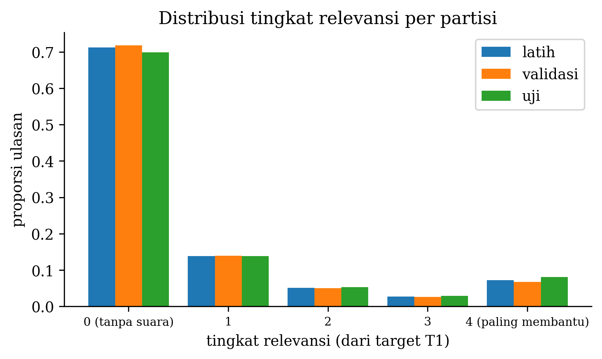
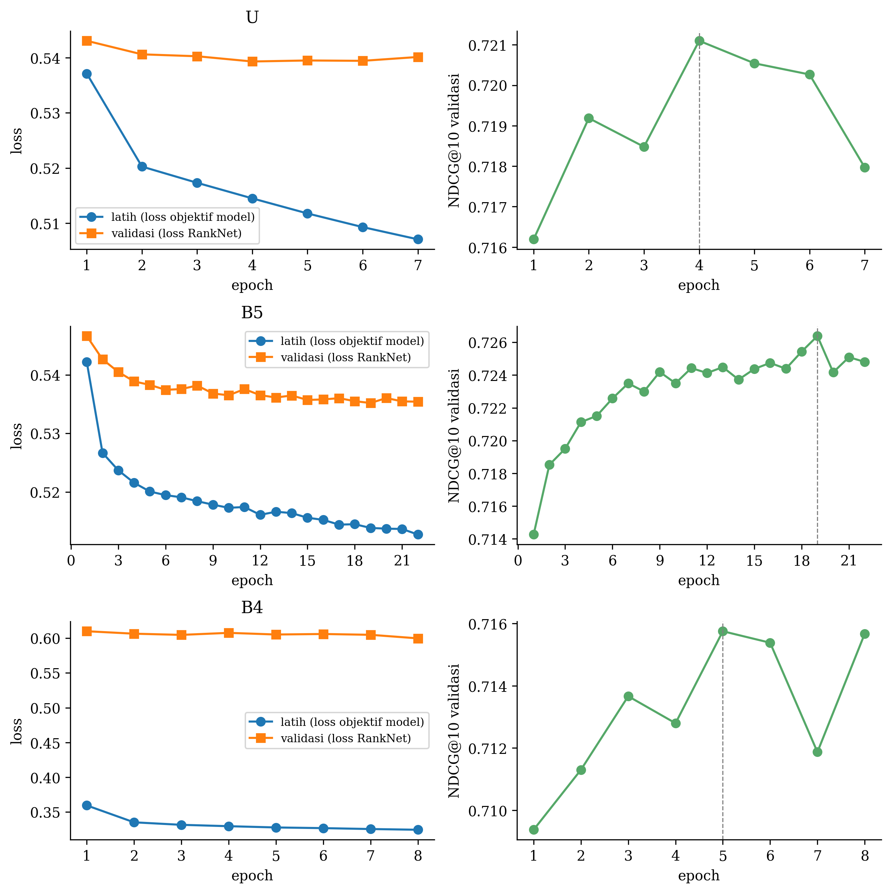

<!--
Draf laporan dalam Markdown. Urutan bagian mengikuti "Format Laporan Tugas Pembelajaran Mendalam.pdf".

Penanda yang masih harus diisi:
  ⟦ISI: ...⟧  diisi kelompok (identitas, pembagian tugas, tautan, detail aplikasi Gradio)
  ⟦NB: ...⟧   disalin dari keluaran laporan/bahan_laporan.ipynb (folder outputs/Video_Games/laporan/ di Drive)

Gambar ada di laporan/gambar/. Gambar yang bertanda (NB) dibuat oleh bahan_laporan.ipynb. Salin dari
outputs/Video_Games/laporan/figures/ di Drive ke laporan/gambar/ dengan nama yang sama.

Semua angka hasil berasal dari run Video_Games yang tersimpan di notebooks/FINISHED RUN/hasil_video_games/.
-->

# Laporan Proyek Ujian Akhir Semester

## Pemeringkatan Kebermanfaatan Ulasan Produk dengan Embedding BLaIR dan Multilayer Perceptron pada Amazon Reviews 2023

| | |
|---|---|
| **Judul** | Pemeringkatan Kebermanfaatan Ulasan Produk dengan Embedding BLaIR dan Multilayer Perceptron pada Amazon Reviews 2023 ⟦ISI: sesuaikan bila judul resmi berbeda⟧ |
| **Mata Kuliah** | Pembelajaran Mendalam ⟦ISI: kode mata kuliah, kelas⟧ |
| **Semester** | Ganjil |
| **Tahun Akademik** | 2026-2027 |
| **Nama Kelompok** | ⟦ISI⟧ |
| **NIM & Nama Anggota** | ⟦ISI: NIM – Nama⟧<br>⟦ISI: NIM – Nama⟧<br>⟦ISI: NIM – Nama⟧ |

<div style="page-break-after: always;"></div>

## Daftar Isi

- [Daftar Gambar](#daftar-gambar)
- [Daftar Tabel](#daftar-tabel)
- [Pembagian Tugas](#pembagian-tugas)
- [Bagian A. Laporan Teknis Proyek](#bagian-a-laporan-teknis-proyek)
  - [1. Kompleksitas Masalah](#1-kompleksitas-masalah)
  - [2. Dataset yang Digunakan](#2-dataset-yang-digunakan)
  - [3. Exploratory Data Analysis (EDA)](#3-exploratory-data-analysis-eda)
  - [4. Preprocessing Data](#4-preprocessing-data)
  - [5. Model yang Digunakan](#5-model-yang-digunakan)
  - [6. Hasil Evaluasi](#6-hasil-evaluasi)
  - [7. Teknologi yang Digunakan](#7-teknologi-yang-digunakan)
  - [8. Lampiran](#8-lampiran)
  - [9. Daftar Pustaka](#9-daftar-pustaka)
- [Bagian B. Tautan](#bagian-b-tautan)

## Daftar Gambar

| No | Judul | Berkas |
|---|---|---|
| Gambar 1 | Sebaran `helpful_vote`, usia ulasan, ulasan per produk, dan jumlah kata | `gambar/eda_distribusi.png` |
| Gambar 2 | Distribusi tingkat relevansi per partisi | `gambar/eda_tingkat_relevansi.png` (NB) |
| Gambar 3 | Jumlah kata per tingkat relevansi | `gambar/eda_kata_per_tingkat.png` (NB) |
| Gambar 4 | Histogram fitur numerik | `gambar/eda_fitur_numerik.png` (NB) |
| Gambar 5 | Korelasi Spearman antarfitur | `gambar/eda_korelasi.png` (NB) |
| Gambar 6 | Kurva efek usia ulasan dari model Negative Binomial | `gambar/age_kurva.png` |
| Gambar 7 | Arsitektur model U | `gambar/arsitektur_model.png` (NB) |
| Gambar 8 | Bentuk fungsi loss RankNet dan MSE | `gambar/loss_function.png` |
| Gambar 9 | Loss latih, loss validasi, dan NDCG@10 validasi per epoch (U, B5, B4) | `gambar/training_loss_ndcg.png` |
| Gambar 10 | Kurva pelatihan untuk semua seed | `gambar/kurva_pelatihan_semua_seed.png` (NB) |
| Gambar 11 | Perbandingan model dan baseline pada data uji | `gambar/uji_baseline.png` |
| Gambar 12 | Ablasi fitur dan pengaruh ukuran data latih | `gambar/uji_ablasi_skala.png` |
| Gambar 13 | NDCG@10 per kuartil ukuran produk dibanding urutan acak | `gambar/uji_ukuran_produk.png` |
| Gambar 14 | NDCG@10 per kelompok usia ulasan | `gambar/usia.png` |
| Gambar 15 | Akurasi pasangan per tingkat relevansi | `gambar/uji_akurasi_pasangan_per_tingkat.png` (NB) |
| Gambar 16 | Confusion matrix B4 | `gambar/uji_confusion_matrix_B4.png` (NB) |

## Daftar Tabel

| No | Judul |
|---|---|
| Tabel 1 | Pembagian tugas anggota kelompok |
| Tabel 2 | Perubahan jumlah data selama preprocessing |
| Tabel 3 | Ringkasan dataset Video_Games |
| Tabel 4 | Pembagian data dan subset skala pelatihan |
| Tabel 5 | Distribusi tingkat relevansi |
| Tabel 6 | Statistik jumlah kata per tingkat relevansi |
| Tabel 7 | Rata-rata `helpful_vote` per kuintil usia ulasan |
| Tabel 8 | Korelasi Spearman antarfitur |
| Tabel 9 | Contoh ulasan per tingkat relevansi |
| Tabel 10 | Daftar model dan baseline |
| Tabel 11 | Lapisan dan jumlah parameter model U |
| Tabel 12 | Konfigurasi pelatihan |
| Tabel 13 | Hasil penalaan hiperparameter model U |
| Tabel 14 | Bukti fitur unik 1 (RankNet vs MSE) |
| Tabel 15 | Bukti fitur unik 2 (ablasi fitur terstruktur) |
| Tabel 16 | Metrik evaluasi dan alasannya |
| Tabel 17 | Hasil pada data uji |
| Tabel 18 | Selisih berpasangan model U terhadap baseline |
| Tabel 19 | Pengaruh ukuran data latih |
| Tabel 20 | Perbandingan strategi target |
| Tabel 21 | NDCG@10 per kuartil ukuran produk |
| Tabel 22 | Teknologi yang digunakan |

## Pembagian Tugas

**Tabel 1.** Pembagian tugas anggota kelompok

| NIM | Nama | Peran | Rincian Pekerjaan |
|---|---|---|---|
| ⟦ISI⟧ | ⟦ISI⟧ | ⟦ISI⟧ | ⟦ISI⟧ |
| ⟦ISI⟧ | ⟦ISI⟧ | ⟦ISI⟧ | ⟦ISI⟧ |
| ⟦ISI⟧ | ⟦ISI⟧ | ⟦ISI⟧ | ⟦ISI⟧ |

<div style="page-break-after: always;"></div>

# Bagian A. Laporan Teknis Proyek

## 1. Kompleksitas Masalah

Sebelum membeli barang secara daring, banyak orang membaca ulasan, tetapi biasanya hanya beberapa ulasan teratas.
Mudambi dan Schuff menemukan bahwa kebermanfaatan ulasan dipengaruhi oleh kedalaman isi, ekstremitas rating, dan
jenis produk [1]. Proyek ini membangun model yang **mengurutkan ulasan di dalam satu produk** berdasarkan perkiraan
kebermanfaatannya, sehingga ulasan yang paling membantu dapat ditampilkan lebih dulu. Model diuji pada produk yang
sama sekali tidak dipakai saat pelatihan.

Label yang tersedia adalah `helpful_vote`, yaitu jumlah pembaca yang menandai ulasan sebagai membantu. Model utama
(kode **U**) memakai embedding teks dari encoder BLaIR-RoBERTa-base yang dibekukan [2], [15], digabung dengan lima
fitur terstruktur, lalu diberi skor oleh Multilayer Perceptron (MLP) yang dilatih dengan loss pairwise RankNet [16].

### 1a. Mengapa masalah ini kompleks

1. **Label lemah dan sangat tidak seimbang.** Sebanyak 74,7% ulasan memiliki `helpful_vote` = 0, mediannya 0, dan
   nilai maksimumnya 10.369 (Gambar 1). Sebanyak 22,2% produk tidak memiliki satu pun ulasan bersuara. Ulasan
   bernilai nol tidak selalu tidak bermanfaat. Bisa jadi ulasan itu belum pernah dibaca.
2. **Label tercampur bias paparan.** Suara bergantung pada posisi tampil dan lamanya ulasan terpasang [4], [5], [6].
   Pada data ini, korelasi Spearman antara usia ulasan dan `helpful_vote` adalah 0,192. Rata-rata suara pada
   kuintil ulasan tertua (2,60) lebih dari empat kali kuintil termuda (0,62) (Tabel 7).
3. **Tugasnya pemeringkatan, bukan klasifikasi.** Yang penting adalah urutan relatif ulasan di dalam satu produk.
   Ulasan dari produk berbeda tidak dapat dibandingkan langsung, karena produk populer mengumpulkan jauh lebih
   banyak suara.
4. **Ukuran produk sangat timpang.** Median ulasan per produk adalah 7, tetapi persentil ke-99 adalah 708. Produk
   kecil mudah diurutkan secara kebetulan, sedangkan produk besar jauh lebih sulit (Tabel 21).
5. **Data teks berdimensi tinggi dan berskala besar.** Ada 4,5 juta ulasan bersih. Setiap ulasan diubah menjadi
   vektor 768 dimensi oleh Transformer 12 lapisan berukuran lebih dari 120 juta parameter, sehingga ekstraksi untuk 1,4 juta ulasan
   butuh sekitar 2,9 jam per encoder pada GPU T4.
6. **Panjang teks sangat bervariasi.** Median panjang pasangan judul dan isi adalah 39 token, persentil ke-95
   adalah 264 token, dan 1,6% ulasan melebihi batas 512 token.

### 1b. Tantangan utama

1. **Mencegah kebocoran data.** Ulasan dari satu produk tidak boleh muncul di data latih dan data uji sekaligus.
   Teks yang sama persis juga tidak boleh muncul di keduanya. `helpful_vote` dan usia ulasan tidak boleh masuk
   ke fitur.
2. **Merancang evaluasi yang jujur.** Produk yang semua ulasannya bernilai nol tidak dapat dievaluasi dengan NDCG
   (IDCG = 0). Hasil juga harus dibandingkan dengan urutan acak, karena NDCG@10 urutan acak pada produk kecil
   sudah tinggi.
3. **Membuktikan manfaat encoder.** Keunggulan atas TF-IDF belum cukup, karena bisa saja berasal dari Transformer
   secara umum. Karena itu BLaIR dibandingkan langsung dengan model awalnya, RoBERTa-base (B5).
4. **Komputasi terbatas.** Seluruh eksperimen dijalankan di Google Colab dengan satu GPU T4. Encoder dibekukan dan
   embedding dihitung sekali lalu disimpan, sehingga puluhan konfigurasi MLP dapat dilatih dalam hitungan menit.
5. **Mengukur pengaruh usia ulasan.** Pengaruh usia diukur dengan model Negative Binomial, dan target yang
   dikoreksi usia (T3) dibandingkan dengan target mentah (T1).

## 2. Dataset yang Digunakan

### 2a. Sumber dataset

- **Nama**: Amazon Reviews 2023, bagian *User Reviews*, kategori **Video_Games** (McAuley Lab, UC San Diego) [2].
- **Tautan berkas**: <https://huggingface.co/datasets/McAuley-Lab/Amazon-Reviews-2023/resolve/main/raw/review_categories/Video_Games.jsonl>
- **Halaman dataset**: <https://huggingface.co/datasets/McAuley-Lab/Amazon-Reviews-2023>
- **Diunduh**: 5 November 2026, 2.682.948.518 byte, SHA-256 `7bde9e0a039bdb321e993bfe78a6c7d438fb1504b1ad152c0cb6a33a8b7cb26a`
  (dicatat otomatis di `manifest_raw.json`).

Untuk tugas ini hanya kategori Video_Games yang dijalankan. Kode sudah mendukung kategori lain melalui satu
pengaturan (`category`), dan kategori lain direncanakan untuk tahap berikutnya.

### 2b. Jumlah data, label, format, dan ukuran

**Tabel 3.** Ringkasan dataset Video_Games

| Aspek | Nilai |
|---|---|
| Format | JSON Lines (satu ulasan per baris), 2,68 GB |
| Baris mentah | 4.624.615 ulasan |
| Setelah preprocessing | 4.529.152 ulasan dari 98.951 produk (`parent_asin`) |
| Atribut yang dipakai | `title`, `text`, `rating`, `verified_purchase`, `timestamp`, `helpful_vote`, `parent_asin`, `asin`, `user_id` |
| Label mentah | `helpful_vote` (bilangan cacah 0 sampai 10.369) |
| Target model (T1) | ln(1 + `helpful_vote`) |
| Kelas relevansi untuk evaluasi | 5 tingkat (0–4). Ambang tingkat 1–4 adalah kuartil target positif pada data latih. Pada run ini hasilnya sama dengan tingkat = min(`helpful_vote`, 4) |
| Fitur masukan per ulasan | Embedding 768 dimensi + 5 fitur terstruktur = 773 fitur |
| Rentang waktu | 17 November 1998 sampai 12 September 2023 |

Lima fitur terstruktur adalah rating, `verified_purchase`, ln(1 + jumlah karakter isi), ln(1 + jumlah kata isi), dan
ln(1 + jumlah karakter judul).

### 2c. Real-world atau sintetis

Dataset ini **real-world**. Isinya ulasan asli pembeli Amazon beserta suara kebermanfaatan dari pembaca. Data
sintetis hanya dipakai pada uji cepat kode (`tests/smoke_test.py`, folder `smoke/`), dan hasilnya tidak dipakai di
laporan ini.

### 2d. Seberapa kompleks dataset ini

Dataset ini kompleks karena (1) ukurannya 4,5 juta ulasan, (2) teksnya bebas dengan panjang yang sangat bervariasi,
(3) labelnya lemah, 74,7% bernilai nol dan bercampur efek usia, (4) unit evaluasinya kelompok ulasan per produk
dengan ukuran yang timpang, dan (5) ada duplikasi teks lintas produk yang harus dibersihkan agar tidak bocor. Rincian
angkanya ada di Subbab 1a dan 3.

## 3. Exploratory Data Analysis (EDA)

EDA dasar dijalankan di notebook `02_preprocessing_eda` pada seluruh data bersih. EDA tambahan (Gambar 2–5,
Tabel 5, 6, 8, 9) dibuat oleh `laporan/bahan_laporan.ipynb` pada **data latih skala terbesar (E5, 1.000.000
ulasan)** agar tidak ada informasi data validasi atau uji yang dipakai.


**Gambar 1.** Sebaran `helpful_vote` (skala log), usia ulasan, jumlah ulasan per produk, dan jumlah kata isi ulasan

### 3a. Distribusi label

`helpful_vote` sangat miring ke kanan, dengan rata-rata 1,23, median 0, persentil ke-99 sebesar 18, dan maksimum
10.369. Untuk evaluasi, target diubah menjadi lima tingkat relevansi.

**Tabel 5.** Distribusi tingkat relevansi (proporsi)

| Tingkat | Arti pada run ini | Latih | Validasi | Uji |
|---|---|---|---|---|
| 0 | 0 suara | 0,713 | 0,718 | 0,699 |
| 1 | 1 suara | 0,138 | 0,139 | 0,139 |
| 2 | 2 suara | 0,051 | 0,050 | 0,052 |
| 3 | 3 suara | 0,026 | 0,025 | 0,029 |
| 4 | 4 suara atau lebih | 0,072 | 0,067 | 0,080 |

Jumlah ulasan per tingkat ada di ⟦NB: tables/eda_tingkat_relevansi.md⟧.



**Gambar 2.** Distribusi tingkat relevansi per partisi (NB)

### 3b. Jumlah kata

Median jumlah kata isi ulasan rendah, dan sebarannya melebar ke ulasan yang sangat panjang (Gambar 1, kanan bawah).
Ulasan yang lebih banyak mendapat suara cenderung lebih panjang (Gambar 3).

**Tabel 6.** Statistik jumlah kata isi ulasan pada data latih E5 per tingkat relevansi

⟦NB: tempel tables/eda_jumlah_kata.md⟧


**Gambar 3.** Jumlah kata isi ulasan per tingkat relevansi (NB)

Untuk tokenizer BLaIR, sampel 50.000 ulasan menghasilkan median 39 token, persentil ke-95 sebesar 264 token, dan
1,6% ulasan melebihi 512 token. Batas 512 token hanya memotong sebagian kecil ulasan.

### 3c. Histogram fitur numerik


**Gambar 4.** Histogram lima fitur terstruktur dan target T1 pada data latih E5 (NB)

Statistik deskriptif setiap fitur ada di ⟦NB: tables/eda_statistik_fitur.md⟧. Rating didominasi bintang 5 dan
sebagian besar ulasan berstatus *verified purchase* (rata-rata 0,863 pada data latih). Fitur panjang miring ke kanan
sehingga ditransformasi dengan ln(1 + x) sebelum distandardisasi.

Efek usia terhadap jumlah suara ditunjukkan pada Tabel 7.

**Tabel 7.** `helpful_vote` per kuintil usia ulasan (seluruh data bersih)

| Kuintil usia | Ulasan | Rata-rata suara | Median | Proporsi nol |
|---|---|---|---|---|
| Q1 (terbaru) | 905.831 | 0,618 | 0 | 0,801 |
| Q2 | 905.830 | 0,933 | 0 | 0,825 |
| Q3 | 905.830 | 1,167 | 0 | 0,766 |
| Q4 | 905.830 | 0,854 | 0 | 0,782 |
| Q5 (terlama) | 905.831 | 2,602 | 0 | 0,562 |

### 3d. Korelasi antarfitur


**Gambar 5.** Korelasi Spearman antarfitur pada data latih E5. Tanda * menandai variabel yang bukan fitur masukan (NB)

**Tabel 8.** Korelasi Spearman antarfitur

⟦NB: tempel tables/eda_korelasi_spearman.md⟧

⟦NB: tulis 2–3 kalimat temuan. Yang perlu dilihat adalah (1) korelasi panjang isi dengan jumlah kata
(`ringkasan.json → korelasi_panjang_isi_vs_jumlah_kata`), (2) korelasi setiap fitur dengan `helpful_vote`
(`korelasi_spearman_dengan_vote`), dan (3) korelasi usia dengan `helpful_vote`.⟧

### 3e. Contoh sampel data per kelas

**Tabel 9.** Contoh ulasan acak (seed 42) untuk setiap tingkat relevansi dari data latih E5

⟦NB: tempel tables/eda_contoh_per_tingkat.md⟧

### 3f. Temuan EDA yang memengaruhi preprocessing dan rancangan model

| Temuan | Dampak pada rancangan |
|---|---|
| 74,7% ulasan bernilai nol dan sebarannya sangat miring | Target memakai ln(1 + v). Model dilatih dengan **pasangan** ulasan berlabel berbeda (RankNet), sehingga ulasan bernilai nol tetap berguna sebagai pasangan pembanding dan tidak mendominasi loss |
| 22,2% produk tidak punya ulasan bersuara | Produk tersebut tidak dapat dievaluasi NDCG. Jumlahnya dilaporkan (Subbab 6b) |
| Ukuran produk timpang (median 7, p99 708) | Data latih dibatasi 200 ulasan per produk agar produk besar tidak mendominasi. Pasangan dibatasi 100 per produk per epoch. Hasil dilaporkan per kuartil ukuran produk |
| Usia berkorelasi dengan jumlah suara | Usia **tidak** dipakai sebagai fitur. Pengaruh usia diukur dengan model Negative Binomial, dan target terkoreksi usia (T3) dibandingkan |
| Fitur panjang miring ke kanan | Transformasi ln(1 + x) lalu standardisasi z-score dari data latih |
| 1,6% ulasan melebihi 512 token | Batas 512 token. Judul dipotong paling banyak 64 kata dan pemotongan hanya dilakukan pada isi |
| Ada teks ulasan yang sama persis di produk berbeda | Ulasan validasi/uji yang teksnya juga ada di data latih dibuang (113.237 ulasan) |

## 4. Preprocessing Data

### 4a. Pembersihan data

Setiap langkah dijalankan oleh `src/hr/data.py` (`preprocess`) dan jumlah baris yang dibuang dicatat di
`preprocess_report.json`.

**Tabel 2.** Perubahan jumlah data selama preprocessing

| Langkah | Alasan | Baris dibuang | Sisa |
|---|---|---|---|
| Data mentah | | | 4.624.615 |
| Validasi tipe (rating 1–5, `helpful_vote` ≥ 0, `verified_purchase` boolean) | Membuang data rusak. Kode berhenti jika lebih dari 5% baris tidak valid | 1 | 4.624.614 |
| Pemeriksaan satuan `timestamp` (milidetik dipilih, 100% dalam rentang 1995–2023) | Usia ulasan harus benar | 0 | 4.624.614 |
| Teks atau `parent_asin` kosong | Tidak ada isi untuk dinilai | 3.618 | 4.620.996 |
| Duplikat (`user_id`, `parent_asin`, `timestamp`, `text` sama) | Ulasan ganda membuat label terhitung dua kali | 53.599 | 4.567.397 |
| Produk dengan kurang dari 2 ulasan | Pemeringkatan butuh minimal dua ulasan | 38.245 | **4.529.152** |

Teks juga dinormalisasi dengan `clean_text`, yaitu menerjemahkan entitas HTML, menghapus tag HTML dan karakter
kendali, serta merapikan spasi. Huruf kapital, tanda baca, angka, dan kata negasi **dipertahankan** karena informasi
itu dibutuhkan encoder.

Pembersihan tambahan dilakukan setelah pembagian data (Subbab 4e), yaitu membuang 113.237 ulasan validasi/uji yang
teksnya sama dengan ulasan latih dan 792 ulasan dari produk evaluasi yang tinggal satu ulasan.

### 4b. Normalisasi, standardisasi, dan representasi teks

- **Tokenisasi**: tokenizer Byte-Pair Encoding (BPE) bawaan checkpoint BLaIR/RoBERTa. Judul (paling banyak 64 kata)
  dan isi ulasan dimasukkan sebagai pasangan kalimat, panjang maksimum 512 token, dan pemotongan hanya pada isi
  (`truncation="only_second"`).
- **Stemming/lemmatization tidak dipakai.** Tokenizer subword sudah menangani variasi bentuk kata. Encoder juga
  dilatih pada teks alami, sehingga stemming justru membuat masukan berbeda dari data pelatihan encoder.
- **Vektorisasi**: vektor token `<s>` ([CLS]) lapisan terakhir, dinormalisasi L2 (norma = 1), lalu disimpan sebagai
  float16 di Google Drive. Prosedur ini sama dengan dokumentasi BLaIR [15] dan dipakai juga untuk RoBERTa-base (B5).
- **Fitur terstruktur**: tiga fitur panjang ditransformasi ln(1 + x). Kelima fitur lalu distandardisasi
  z = (x − μ) / σ dengan μ dan σ **dari data latih saja**.

| Fitur | μ (latih) | σ (latih) |
|---|---|---|
| rating | 4,054 | 1,426 |
| verified_purchase | 0,863 | 0,344 |
| ln(1 + panjang isi) | 4,789 | 1,386 |
| ln(1 + jumlah kata) | 3,197 | 1,289 |
| ln(1 + panjang judul) | 2,939 | 0,678 |

- **Baseline TF-IDF** (B1, B2): unigram dan bigram, `min_df` = 5, `max_df` = 0,9, paling banyak 200.000 fitur,
  *sublinear tf*, dan hanya di-*fit* pada data latih. B2 memperkecil TF-IDF menjadi 768 dimensi dengan Truncated SVD.

### 4c. Augmentasi data

**Tidak ada augmentasi.** Augmentasi teks seperti parafrase atau penggantian sinonim dapat mengubah seberapa
informatif sebuah ulasan, padahal itulah yang ingin dinilai. Labelnya juga milik ulasan asli, sehingga ulasan hasil
augmentasi tidak punya label yang sah. Sebagai gantinya, pasangan pelatihan **diambil ulang secara acak setiap
epoch** (paling banyak 100 pasangan per produk), sehingga model melihat kombinasi pasangan yang berbeda di setiap
epoch.

### 4d. Missing value, outlier, dan ketidakseimbangan kelas

- **Missing value**: baris dengan teks atau `parent_asin` kosong dibuang (3.618). Judul kosong diganti string kosong
  dan panjang judulnya 0.
- **Outlier**: nilai `helpful_vote` ekstrem (sampai 10.369) tidak dibuang karena valid. Pengaruhnya diredam dengan
  transformasi ln(1 + v), dan lima tingkat relevansi menyatukan semua nilai ≥ 4. Fitur panjang ditransformasi
  logaritma. Produk sangat besar dibatasi 200 ulasan per produk pada data latih.
- **Ketidakseimbangan kelas**: 71,3% ulasan latih bernilai nol. Penanganannya adalah **pelatihan pairwise**. Loss hanya
  dihitung pada pasangan ulasan dari produk yang sama dengan label berbeda, sehingga model belajar urutan relatif
  dan tidak bisa mendapat loss rendah hanya dengan menebak nol untuk semua ulasan. Pada E3 terdapat 647.469 pasangan
  per epoch dari 14.748 produk.

### 4e. Pembagian data dan pencegahan kebocoran

Data dibagi **berdasarkan produk (product-disjoint)**. Daftar `parent_asin` diacak dengan seed 42 lalu dialokasikan
80% latih, 10% validasi, dan 10% uji. Seluruh ulasan satu produk selalu berada di partisi yang sama, sehingga data uji
benar-benar berisi produk yang belum pernah dilihat model.

**Tabel 4.** Pembagian data dan subset skala pelatihan

| Partisi | Ulasan | Produk | Proporsi `helpful_vote` = 0 |
|---|---|---|---|
| Latih E1 | 100.000 | 3.777 | 0,706 |
| Latih E2 | 250.000 | 9.773 | 0,708 |
| Latih E3 (skala utama) | 499.999 | 19.200 | 0,712 |
| Latih E4 | 750.000 | 28.357 | 0,712 |
| Latih E5 | 1.000.000 | 38.068 | 0,713 |
| Validasi | 199.189 | 5.094 | 0,718 |
| Uji | 199.926 | 4.816 | 0,699 |

Subset E1–E5 bersifat bertingkat (E1 ⊂ E2 ⊂ … ⊂ E5). Data validasi dan uji dibatasi sekitar 200.000 ulasan dengan
mengambil produk utuh secara acak.

Pencegahan kebocoran yang diperiksa otomatis oleh kode:

1. Tidak ada `parent_asin` yang sama di dua partisi (diperiksa dengan `assert`, hasilnya 0).
2. Tidak ada `asin` yang muncul di dua partisi (hasilnya 0).
3. Ulasan validasi/uji yang teksnya sama persis dengan ulasan latih dibuang (113.237 ulasan).
4. `helpful_vote`, usia ulasan, dan semua kolom target ada di daftar `FORBIDDEN_FEATURES` dan diperiksa dengan
   `assert` setiap kali matriks fitur dibuat.
5. Standardisasi, TF-IDF, SVD, model usia, dan ambang tingkat relevansi hanya di-*fit* pada data latih.
6. Penalaan hiperparameter hanya memakai NDCG@10 validasi. Data uji hanya dievaluasi satu kali di notebook 07.

## 5. Model yang Digunakan

### 5a. Jenis model

Model yang dilatih adalah **Deep Neural Network (DNN)** berupa **Multilayer Perceptron** dengan dua lapisan
tersembunyi. Masukannya adalah fitur hasil **transfer learning** dari encoder BLaIR-RoBERTa-base yang sudah dilatih
sebelumnya [15]. Encoder ini **dibekukan** dan hanya dipakai sebagai pengekstraksi fitur, mirip dengan memakai
ResNet beku sebagai pengekstraksi fitur pada CNN. Bobot encoder tidak diubah, sehingga seluruh pelatihan dalam
proyek ini adalah pelatihan DNN.

**Tabel 10.** Daftar model dan baseline (semua memakai partisi, fitur terstruktur, dan protokol evaluasi yang sama)

| Kode | Representasi teks | Pemberi skor | Loss | Tujuan perbandingan |
|---|---|---|---|---|
| R0 | – | Urutan acak (rata-rata 20 permutasi) | – | Batas bawah |
| B0 | – | Panjang isi ulasan (karakter) | – | Heuristik kedalaman ulasan [1] |
| B1 | TF-IDF | Linear | RankNet (regresi logistik pada selisih pasangan) | Representasi leksikal |
| B2 | TF-IDF + SVD 768 | MLP | RankNet | Leksikal vs embedding dengan MLP yang sama |
| B3 | BLaIR | Linear | RankNet | Sumbangan lapisan tersembunyi MLP |
| B4 | BLaIR | MLP | MSE (pointwise) | Sumbangan loss pairwise (**fitur unik 1**) |
| B5 | RoBERTa-base beku | MLP | RankNet | Sumbangan pelatihan domain BLaIR |
| **U** | **BLaIR** | **MLP** | **RankNet** | **Model utama** |
| A1–A3 | BLaIR | MLP | RankNet | Ablasi fitur terstruktur (**fitur unik 2**) |

### 5b. Arsitektur model


**Gambar 7.** Arsitektur model U (NB)

**Tabel 11.** Lapisan dan jumlah parameter model U (`src/hr/models.py`, kelas `Scorer`)

| No | Lapisan | Ukuran keluaran | Parameter |
|---|---|---|---|
| 0 | Masukan x = [e ; z] (768 + 5) | (batch, 773) | 0 |
| 1 | Linear 773 → 256 | (batch, 256) | 198.144 |
| 2 | ReLU | (batch, 256) | 0 |
| 3 | Dropout (p = 0,3) | (batch, 256) | 0 |
| 4 | Linear 256 → 64 | (batch, 64) | 16.448 |
| 5 | ReLU | (batch, 64) | 0 |
| 6 | Dropout (p = 0,3) | (batch, 64) | 0 |
| 7 | Linear 64 → 1 (tanpa aktivasi) | (batch,) skor s | 65 |
| | **Total parameter yang dilatih** | | **214.657** |

Tabel ini dibuat ulang dari bobot `model.pt` yang tersimpan dengan `strict=True` di
⟦NB: tables/arsitektur_U.md⟧. Pastikan totalnya sama. Jumlah parameter semua model ada di
⟦NB: tables/parameter_per_model.md⟧.

| Komponen | Nilai |
|---|---|
| Encoder (beku) | `hyp1231/blair-roberta-base`, 12 lapisan Transformer, dimensi 768, 12 *attention head*, ⟦NB: tables/parameter_encoder.md, kolom `parameter_dipakai_tanpa_pooler`⟧ parameter. Lapisan *pooler* tidak dipakai |
| Fungsi aktivasi | ReLU pada lapisan tersembunyi [23]. Lapisan keluaran linear karena skor hanya dipakai untuk mengurutkan |
| Regularisasi | Dropout 0,3 setelah setiap lapisan tersembunyi [24], *weight decay* 1 × 10⁻⁵, dan *early stopping* |
| Keluaran | Satu skor real per ulasan. Ulasan dalam satu produk diurutkan menurun berdasarkan skor. Skor kembar diputus dengan hash `rid` yang tidak berkaitan dengan label |

### 5c. Konfigurasi pelatihan

**Tabel 12.** Konfigurasi pelatihan model U (`config.json`)

| Komponen | Nilai |
|---|---|
| Optimizer | Adam [25] |
| Learning rate | 3 × 10⁻⁴ (hasil grid search) |
| Dropout | 0,3 (hasil grid search) |
| Weight decay | 1 × 10⁻⁵ |
| Batch size | 1.024 pasangan per mini-batch (B4 pointwise: 1.024 ulasan) |
| Epoch | Paling banyak 30 |
| Callback | *Early stopping* pada NDCG@10 validasi dengan *patience* 3. Bobot epoch terbaik dipulihkan |
| Fungsi loss | RankNet L = ln(1 + exp(−(sᵢ − sⱼ))) untuk pasangan dengan yᵢ > yⱼ dari produk yang sama [16] |
| Pembentukan pasangan | Paling banyak M = 100 pasangan acak per produk, diambil ulang setiap epoch |
| Data latih utama | E3 (499.999 ulasan, 19.200 produk) |
| Seed | 42, 43, 44. Hasil dirata-ratakan atas seed |

Grid search *learning rate* {1 × 10⁻⁴, 3 × 10⁻⁴, 1 × 10⁻³} × *dropout* {0,1; 0,2; 0,3} dijalankan untuk model U
pada E3 dengan seed 42. Hiperparameter terbaik dipakai untuk **semua** model MLP agar perbandingannya adil. Baseline
linear B1 dituning dengan C ∈ {0,1; 1; 10}.

**Tabel 13.** Hasil penalaan hiperparameter model U (NDCG@10 validasi)

| Learning rate | Dropout | NDCG@10 validasi | Epoch |
|---|---|---|---|
| **3 × 10⁻⁴** | **0,3** | **0,7211** | 7 |
| 3 × 10⁻⁴ | 0,2 | 0,7206 | 7 |
| 1 × 10⁻³ | 0,2 | 0,7206 | 5 |
| 3 × 10⁻⁴ | 0,1 | 0,7204 | 8 |
| 1 × 10⁻³ | 0,3 | 0,7201 | 5 |
| 1 × 10⁻⁴ | 0,1 | 0,7196 | 8 |
| 1 × 10⁻⁴ | 0,2 | 0,7196 | 11 |
| 1 × 10⁻⁴ | 0,3 | 0,7194 | 9 |
| 1 × 10⁻³ | 0,1 | 0,7184 | 5 |

Selisih terbaik dan terburuk hanya 0,0027, jadi model tidak terlalu sensitif terhadap kedua hiperparameter ini.


**Gambar 8.** Bentuk fungsi loss RankNet terhadap selisih skor, dibandingkan dengan MSE

### 5d. Alasan pemilihan model dan arsitektur

1. **Encoder beku + MLP** memungkinkan embedding dihitung sekali (sekitar 2,9 jam per encoder di T4) lalu dipakai
   ulang untuk puluhan run pelatihan (baseline, ablasi, skala, target, penalaan, dan 3 seed). Fine-tuning Transformer untuk setiap konfigurasi tidak realistis di
   satu GPU T4.
2. **BLaIR** dilatih lanjut dari RoBERTa-base [31] pada pasangan teks dan metadata produk dari Amazon Reviews 2023 [2],
   [15], sehingga diduga lebih peka terhadap informasi produk dalam ulasan. Dugaan ini diuji langsung terhadap
   RoBERTa-base (B5).
3. **MLP** dapat memodelkan hubungan nonlinear antara embedding dan fitur terstruktur, misalnya pengaruh panjang
   ulasan yang berbeda menurut isi. Sumbangannya diuji terhadap model linear (B3).
4. **Ukuran kecil (256 → 64)** sesuai dengan jumlah data. Dengan 500 ribu ulasan latih, model berparameter
   sekitar 215 ribu sudah mulai *overfitting* setelah 4–8 epoch (Subbab 6e), sehingga lapisan lebih besar tidak
   diperlukan.
5. **Loss pairwise** sesuai dengan tugas pemeringkatan dalam produk dan dengan label yang tidak seimbang
   (lihat fitur unik 1).

### 5e. Dua fitur unik

#### Fitur unik 1. Pelatihan pairwise RankNet di dalam produk

- **Apa.** Model dilatih untuk mengurutkan **pasangan** ulasan dari produk yang sama dengan benar, bukan untuk
  menebak jumlah suara setiap ulasan.
- **Mengapa dibutuhkan.** (1) Yang dinilai adalah urutan di dalam produk, dan jumlah suara antarproduk tidak dapat
  dibandingkan karena popularitas produk berbeda. (2) Dengan 71,3% label nol, loss pointwise (MSE) dapat ditekan
  hanya dengan menebak nilai mendekati nol. Pada loss pairwise, pasangan berlabel sama tidak menyumbang loss sama
  sekali. Pendekatan ini berfungsi sebagai penanganan ketidakseimbangan label.
- **Implementasi.** `src/hr/pairs.py` (`PairSampler`) mengambil paling banyak 100 pasangan acak (i, j) per produk
  dengan yᵢ > yⱼ, dan mengambil ulang setiap epoch. `src/hr/models.py` menghitung loss dengan bentuk yang stabil
  secara numerik, `softplus(−(sᵢ − sⱼ))`. Kode lengkap ada di Lampiran 8a.
- **Bukti dampak.** Model B4 identik dengan U (encoder, fitur, arsitektur, hiperparameter, seed, data) kecuali
  loss-nya MSE pointwise.

**Tabel 14.** Bukti fitur unik 1 pada data uji (rata-rata 3 seed, IK 95% bootstrap per produk)

| Model | NDCG@10 | NDCG@5 | Spearman | MAP |
|---|---|---|---|---|
| B4 (MSE pointwise) | 0,7102 | 0,6727 | 0,3661 | 0,6321 |
| U (RankNet pairwise) | **0,7147** | **0,6786** | **0,3754** | **0,6366** |
| Selisih U − B4 (NDCG@10) | **+0,0045** [0,0019; 0,0071], p Holm < 0,001 | | | |

U lebih baik dari B4 di keempat metrik. Dari 3.827 produk uji, U menang pada 1.383 produk, seri pada 1.229, dan
kalah pada 1.215. Pada data validasi, U juga lebih tinggi (0,7205 vs 0,7163).

#### Fitur unik 2. Penggabungan embedding dengan fitur terstruktur (feature fusion)

- **Apa.** Embedding BLaIR 768 dimensi digabung dengan lima fitur terstruktur yang distandardisasi,
  x = [e ; z] ∈ ℝ⁷⁷³, sebelum masuk ke MLP.
- **Mengapa dibutuhkan.** Encoder hanya membaca teks dan memotongnya pada 512 token, sehingga tidak menerima
  informasi rating, status pembelian terverifikasi, atau panjang ulasan secara eksplisit. Padahal kedalaman ulasan
  dan ekstremitas rating adalah faktor kebermanfaatan yang konsisten di literatur [1], [8].
- **Implementasi.** `src/hr/features.py` (`fuse`) menyatukan embedding float16 dengan kolom z-score. Fitur yang
  dilarang (`helpful_vote`, usia, target) diperiksa dengan `assert`. Standardisasi memakai μ dan σ data latih
  (`src/hr/split.py`). Kode lengkap ada di Lampiran 8a.
- **Bukti dampak.** Ablasi bertahap dengan arsitektur, hiperparameter, dan seed yang sama.

**Tabel 15.** Bukti fitur unik 2 pada data uji (rata-rata 3 seed)

| Kode | Fitur masukan | NDCG@10 [IK 95%] | Selisih U − Ax ⟦NB: tables/uji_selisih_berpasangan_ablasi.md⟧ |
|---|---|---|---|
| A1 | Embedding saja | 0,6983 [0,6907; 0,7062] | ⟦NB⟧ |
| A2 | + rating | 0,6992 [0,6911; 0,7069] | ⟦NB⟧ |
| A3 | + verified_purchase | 0,7041 [0,6962; 0,7118] | ⟦NB⟧ |
| A4 = U | + tiga fitur panjang (semua fitur) | **0,7147** [0,7068; 0,7226] | – |

Fitur terstruktur menaikkan NDCG@10 sebesar 0,0164 (dari 0,6983 ke 0,7147). Sumbangan terbesar berasal dari tiga
fitur panjang (+0,0106), sesuai dengan temuan bahwa panjang ulasan adalah prediktor kebermanfaatan yang kuat. Pola
yang sama terlihat di validasi (A1 0,7023, A2 0,7048, A3 0,7081, U 0,7205).

**Fitur pendukung lainnya.** Proyek ini juga memuat (1) pembagian data per produk dengan pemeriksaan kebocoran
otomatis (Subbab 4e), (2) model Negative Binomial untuk mengukur efek usia dan target terkoreksi usia T3 (Subbab
6d), dan (3) evaluasi dengan interval kepercayaan bootstrap, uji berpasangan, koreksi Holm, dan pembanding urutan
acak R0 (Subbab 6).

## 6. Hasil Evaluasi

### 6a. Metrik evaluasi dan alasannya

Tugas ini adalah **pemeringkatan**, sehingga *accuracy*, *precision*, *recall*, dan F1 tidak dipakai sebagai metrik
utama. Keempat metrik itu menilai label per ulasan, sedangkan yang dinilai di sini adalah urutan ulasan di dalam
setiap produk. Semua metrik dihitung **per produk** lalu dirata-ratakan secara makro.

**Tabel 16.** Metrik evaluasi dan alasannya

| Metrik | Peran | Alasan |
|---|---|---|
| **NDCG@10** | Metrik utama | Pembaca hanya melihat beberapa ulasan teratas. NDCG memberi bobot lebih besar pada posisi atas dan memakai lima tingkat relevansi [29]. Dihitung pada produk dengan IDCG > 0 |
| NDCG@5 | Pendukung | Sama dengan NDCG@10, untuk tampilan yang lebih pendek |
| Korelasi Spearman | Pendukung | Kesesuaian seluruh urutan, bukan hanya bagian atas [30]. Produk dengan ≥ 3 ulasan dan target tidak konstan |
| MAP | Pendukung | Ketepatan menempatkan ulasan relevan (tingkat ≥ 2, ditetapkan sebelum eksperimen) di posisi atas |
| MAE, RMSE | Khusus B4 | B4 memprediksi ln(1 + v) secara langsung, sehingga galat regresinya dapat dilaporkan |
| Akurasi pasangan | Analisis kesalahan | Proporsi pasangan ulasan berlabel berbeda yang urutannya benar. Ini pengganti *accuracy* untuk pemeringkatan |

Ketidakpastian dilaporkan dengan interval kepercayaan (IK) 95% dari 1.000 bootstrap per produk. Model dinyatakan
lebih baik jika IK selisih berpasangannya tidak memuat nol dan p-value setelah koreksi Holm < 0,05.

### 6b. Nilai metrik pada data uji

Data uji berisi 199.926 ulasan dari 4.816 produk. Sebanyak 3.827 produk (79,5%) dapat dievaluasi NDCG. 989 produk
dikeluarkan karena semua ulasannya bernilai nol.

**Tabel 17.** Hasil pada data uji (E3, target T1, rata-rata 3 seed untuk model neural, IK 95%)

| Kode | NDCG@10 [IK 95%] | NDCG@5 | Spearman | MAP |
|---|---|---|---|---|
| R0 (acak) | 0,4991 [0,4908; 0,5070] | 0,4392 | −0,0005 | 0,3985 |
| B0 (panjang ulasan) | 0,7019 [0,6937; 0,7099] | 0,6634 | 0,3542 | 0,6206 |
| B1 (TF-IDF linear) | 0,7053 [0,6976; 0,7132] | 0,6684 | 0,3686 | 0,6230 |
| B2 (TF-IDF SVD + MLP) | 0,7115 [0,7037; 0,7192] | 0,6766 | 0,3713 | 0,6305 |
| B3 (BLaIR linear) | 0,7066 [0,6985; 0,7146] | 0,6676 | 0,3707 | 0,6271 |
| B4 (BLaIR + MLP, MSE) | 0,7102 [0,7026; 0,7180] | 0,6727 | 0,3661 | 0,6321 |
| **B5 (RoBERTa-base + MLP)** | **0,7198** [0,7121; 0,7271] | **0,6846** | **0,3818** | **0,6421** |
| **U (BLaIR + MLP, RankNet)** | 0,7147 [0,7068; 0,7226] | 0,6786 | 0,3754 | 0,6366 |

Galat B4 pada skala ln(1 + v) adalah MAE 0,400 dan RMSE 0,587.

**Tabel 18.** Selisih berpasangan NDCG@10 model U terhadap setiap baseline (koreksi Holm)

| U vs | Selisih | IK 95% | p Holm | Menang / seri / kalah (produk) | U lebih baik? |
|---|---|---|---|---|---|
| B0 | +0,0128 | [0,0094; 0,0162] | < 0,001 | 1.549 / 1.096 / 1.182 | Ya |
| B1 | +0,0094 | [0,0055; 0,0131] | < 0,001 | 1.507 / 1.030 / 1.290 | Ya |
| B2 | +0,0031 | [0,0001; 0,0063] | 0,046 | 1.420 / 1.060 / 1.347 | Ya (tipis) |
| B3 | +0,0080 | [0,0052; 0,0110] | < 0,001 | 1.428 / 1.269 / 1.130 | Ya |
| B4 | +0,0045 | [0,0019; 0,0071] | < 0,001 | 1.383 / 1.229 / 1.215 | Ya |
| B5 | **−0,0051** | [−0,0079; −0,0022] | < 0,001 | 1.268 / 1.138 / 1.421 | **Tidak, B5 lebih baik** |


**Gambar 11.** Perbandingan model dan baseline pada data uji

### 6c. Grafik loss dan "akurasi" pada data latih dan validasi

Pada tugas pemeringkatan, padanan grafik akurasi adalah **NDCG@10 validasi per epoch**, metrik yang juga dipakai
untuk *early stopping*. Loss validasi dihitung dengan loss RankNet pada himpunan pasangan validasi yang tetap.



**Gambar 9.** Loss latih, loss validasi, dan NDCG@10 validasi per epoch untuk U, B5, dan B4 (seed 42). Garis putus
menandai epoch terbaik


**Gambar 10.** Kurva yang sama untuk ketiga seed (NB)

Ringkasan per model (epoch terbaik, celah loss latih–validasi, waktu per run) ada di
⟦NB: tables/ringkasan_pelatihan_utama.md⟧.

### 6d. Perbandingan antarskenario

**Variasi hiperparameter.** Lihat Tabel 13. Rentang NDCG@10 validasi hanya 0,7184–0,7211.

**Dengan dan tanpa fitur unik.** Lihat Tabel 14 (RankNet vs MSE) dan Tabel 15 (dengan dan tanpa fitur terstruktur).

**Ukuran data latih.**

**Tabel 19.** Pengaruh ukuran data latih pada model U (data uji)

| Skala | Ulasan latih | NDCG@10 [IK 95%] |
|---|---|---|
| E1 | 100.000 | 0,7098 [0,7019; 0,7179] |
| E2 | 250.000 | 0,7122 [0,7043; 0,7200] |
| E3 | 500.000 | 0,7147 [0,7068; 0,7226] |
| E4 | 750.000 | 0,7157 [0,7080; 0,7238] |
| E5 | 1.000.000 | 0,7175 [0,7096; 0,7253] |

Kinerja naik terus, tetapi landai. Sepuluh kali lipat data latih hanya menambah 0,0077.


**Gambar 12.** Ablasi fitur (kiri) dan pengaruh ukuran data latih (kanan)

**Strategi target.** T1 memakai target mentah, T2 memakai pasangan dengan usia berdekatan, dan T3 memakai target
yang dikoreksi usia. Model hitung Negative Binomial dengan efek produk menunjukkan bahwa usia berpengaruh nyata
(uji rasio likelihood = 59.764, df = 5, p ≈ 0, pseudo-R² McFadden = 0,029, basis spline 4 knot).

**Tabel 20.** Perbandingan strategi target (NDCG@10 data uji, model U, E3)

| Target latih | Acuan relevansi T1 (3.827 produk) | Acuan relevansi T3 (2.782 produk) |
|---|---|---|
| T1 (mentah) | **0,7147** | 0,6299 |
| T2 (pasangan usia berdekatan) | 0,7150 | 0,6334 |
| T3 (terkoreksi usia) | 0,6265 | **0,6667** |

Setiap model paling baik pada acuan yang sesuai dengan targetnya, dan kedua acuan tidak dibandingkan langsung. T2
hampir sama dengan T1. Koreksi usia (T3) **mengubah** urutan yang dipelajari, tetapi tanpa label manusia belum dapat
dipastikan apakah urutan itu lebih benar.


**Gambar 6.** Kurva efek usia ulasan terhadap rata-rata jumlah suara (relatif terhadap usia 30 hari) dengan IK 95%


**Gambar 14.** NDCG@10 per kelompok usia ulasan

### 6e. Analisis hasil

**1. Temuan utama.** Model U lebih baik dari semua baseline non-Transformer dan dari B4. Namun, **hipotesis bahwa
BLaIR lebih baik dari RoBERTa-base tidak terbukti**. B5 (RoBERTa-base) lebih baik dari U sebesar 0,0051 NDCG@10 dan
signifikan setelah koreksi Holm. Hal yang sama terlihat di validasi (B5 0,7247 vs U 0,7205). Pelatihan BLaIR untuk
mencocokkan teks dengan produk tampaknya tidak membantu, bahkan sedikit merugikan, untuk menilai seberapa informatif
sebuah ulasan. Selisih U terhadap heuristik panjang ulasan (B0) juga hanya 0,0128, jadi sebagian besar kinerja
berasal dari informasi yang sudah ditangkap oleh panjang ulasan.

**2. Bagian yang sering salah.** Model U tidak menghasilkan kelas, jadi analisisnya memakai akurasi pasangan per
tingkat (Gambar 15) dan kinerja per kelompok data.


**Gambar 15.** Akurasi pasangan per tingkat relevansi pada data uji untuk U, B5, dan B0. Nilai 0,5 sama dengan
urutan acak (NB)

⟦NB: dari tables/uji_akurasi_pasangan_per_tingkat.md, tulis pasangan tingkat dengan akurasi terendah dan
tertinggi. Dugaan awal, pasangan tingkat 1 vs 0 (satu suara vs nol suara) paling sering tertukar karena selisih
satu suara banyak dipengaruhi kebetulan dan paparan, sedangkan pasangan 4 vs 0 paling mudah.⟧

**Tabel 21.** NDCG@10 model U per kuartil ukuran produk, dibanding urutan acak R0

| Kuartil ukuran | Median ulasan | Produk | NDCG@10 U | NDCG@10 R0 | Selisih |
|---|---|---|---|---|---|
| Q1 (kecil) | 2 | 1.204 | 0,8814 | 0,8217 | +0,060 |
| Q2 | 5 | 1.204 | 0,8194 | 0,6915 | +0,128 |
| Q3 | 12 | 1.204 | 0,6993 | 0,5011 | +0,198 |
| Q4 (besar) | 57 | 1.204 | 0,5629 | 0,1831 | +0,380 |


**Gambar 13.** NDCG@10 per kuartil ukuran produk dibanding urutan acak

- **Produk besar** paling sulit (NDCG@10 0,563), tetapi justru di sana model paling jauh mengungguli urutan acak
  (+0,38). NDCG@10 yang tinggi pada produk kecil (0,881) sebagian besar berasal dari kebetulan, karena dengan dua
  ulasan urutan acak pun sudah 0,822.
- **Ulasan pendek** paling sulit. Jika hanya ulasan pendek dalam setiap produk yang diurutkan, NDCG@10 adalah 0,591.
  Untuk ulasan sedang 0,632 dan untuk ulasan panjang 0,757. Ulasan pendek memberi sedikit isi untuk dibedakan.
- **Ulasan baru** lebih sulit (0,684) daripada ulasan lama (0,775), karena label ulasan baru belum sempat terkumpul.
- **Produk terburuk.** Ada 7 produk uji dengan NDCG@10 = 0 (`tables/uji_produk_terburuk.csv`). Pada produk ini,
  ulasan yang mendapat suara ditempatkan di luar 10 besar.
- Untuk B4, confusion matrix tingkat prediksi vs tingkat sebenarnya ada di Gambar 16 (Lampiran 8b).
  ⟦NB: tulis satu kalimat dari tables/uji_confusion_matrix_B4.md, misalnya recall tingkat 0 vs tingkat 4⟧.

**3. Kemungkinan penyebab.** (1) Label lemah. Suara bergantung pada paparan dan usia, bukan hanya mutu isi. (2)
Banyak pasangan berselisih satu suara, sehingga sinyalnya berisik. (3) Encoder dibekukan dan tidak disesuaikan untuk
tugas ini. (4) Pelatihan BLaIR berorientasi pada pencocokan produk, bukan mutu ulasan.

**4. Indikasi overfitting dan underfitting.** Pada model U (Gambar 9 dan 10), loss latih terus turun (0,537 → 0,507
pada seed 42), sedangkan loss validasi datar di sekitar 0,54 sejak epoch 2. NDCG@10 validasi mencapai puncak pada
epoch 4, lalu turun, dan *early stopping* menghentikan pelatihan pada epoch 7. Jadi ada **overfitting ringan setelah
epoch 4**, dan bobot epoch 4 yang dipakai. B5 belajar lebih lambat dan baru mencapai puncak pada epoch 19, yang
menunjukkan embedding RoBERTa-base butuh lebih banyak penyesuaian oleh MLP. Tidak ada tanda underfitting yang kuat.
Kenaikan kinerja dari E1 ke E5 kecil (Tabel 19), dan model linear B3 lebih buruk dari MLP U (−0,0080). Jadi
kapasitas model sudah cukup, dan batas utamanya adalah mutu label. ⟦NB: tambahkan rata-rata epoch terbaik dan celah
loss dari tables/ringkasan_pelatihan_utama.md⟧

## 7. Teknologi yang Digunakan

**Tabel 22.** Teknologi yang digunakan

| Kategori | Teknologi | Versi / keterangan |
|---|---|---|
| **a. Bahasa pemrograman** | Python | ⟦NB: lingkungan.json → python⟧ |
| **b. Library** | PyTorch | ⟦NB: tables/versi_library.md⟧. Model MLP, loss RankNet, pelatihan |
| | Hugging Face Transformers | ⟦NB⟧. Encoder BLaIR dan RoBERTa-base, tokenizer |
| | scikit-learn | ⟦NB⟧. TF-IDF, Truncated SVD, regresi logistik (B1) |
| | NumPy, pandas, PyArrow | ⟦NB⟧. Pengolahan data, berkas Parquet, embedding memmap |
| | SciPy | ⟦NB⟧. Peringkat untuk Spearman |
| | Matplotlib | ⟦NB⟧. Semua grafik (300 dpi) |
| | orjson | ⟦NB⟧. Pembacaan JSONL cepat |
| | nbformat, nbclient | ⟦NB⟧. Pembuatan notebook gabungan dan uji notebook |
| | Gradio | ⟦ISI: versi di requirements Space⟧. Antarmuka aplikasi |
| **c. Lingkungan pengembangan** | Google Colab | Runtime GPU **Tesla T4** (⟦NB: lingkungan.json → gpu_memori_gb⟧ GB), CUDA ⟦NB: cuda_versi_torch⟧, driver ⟦NB: driver_nvidia⟧, RAM ⟦NB: ram_gb⟧ GB, CPU ⟦NB: cpu⟧ |
| | Google Drive | Penyimpanan data mentah, embedding, run, tabel, dan grafik (Drive adalah satu-satunya jalur antar-sesi Colab) |
| | Jupyter Notebook | Notebook 01–10 dan notebook gabungan `00_pipeline_lengkap.ipynb` |
| | Git dan GitHub | Kendali versi kode |
| **d. Framework aplikasi** | Gradio | ⟦ISI⟧ |
| **d. Platform hosting** | Hugging Face Spaces | ⟦ISI: perangkat keras Space, misalnya CPU basic 2 vCPU 16 GB⟧ |

Versi library dicatat dari runtime Colab tempat `bahan_laporan.ipynb` dijalankan pada ⟦NB: lingkungan.json →
tanggal⟧. Run pipeline sendiri dijalankan pada 5–6 November 2026 di runtime Colab T4. `requirements.txt` hanya
memuat batas versi minimum.

**Waktu komputasi utama.** Ekstraksi embedding 1.399.115 ulasan butuh 2,89 jam (BLaIR) dan 2,96 jam (RoBERTa-base)
di T4, sekitar 131–134 ulasan per detik. Satu run MLP U pada E3 butuh ⟦NB: ringkasan_pelatihan_utama.md →
menit_per_run⟧ menit.

### 7d. Aplikasi demo (Gradio di Hugging Face Spaces)

⟦ISI: bagian ini disiapkan sebagai kerangka. Lengkapi setelah Space selesai dibuat.⟧

| Aspek | Keterangan |
|---|---|
| Framework | Gradio ⟦ISI: versi⟧ |
| Hosting | Hugging Face Spaces, ⟦ISI: perangkat keras⟧ |
| Tautan | ⟦ISI: https://huggingface.co/spaces/...⟧ |
| Berkas aplikasi | ⟦ISI: app.py, requirements.txt, model.pt, dst.⟧ |
| Model yang dipakai | Bobot model U (`runs/U_E3_T1_s42/model.pt`) ⟦ISI: konfirmasi seed⟧ dan encoder `hyp1231/blair-roberta-base` |
| Masukan | ⟦ISI: misalnya daftar ulasan satu produk, masing-masing berisi judul, isi, rating, dan status verified purchase⟧ |
| Keluaran | ⟦ISI: misalnya daftar ulasan yang diurutkan berdasarkan skor, beserta skornya⟧ |
| Waktu respons | ⟦ISI: diukur di Space⟧ |

**Langkah inferensi aplikasi harus sama dengan pipeline** (sudah diuji di `bahan_laporan.ipynb` Bagian 6, skor yang
dihitung ulang dari judul dan teks dengan encoder BLaIR sama dengan skor uji tersimpan, dengan selisih maksimum
⟦NB: ringkasan.json → uji_inferensi_ulang.encoder_langsung.selisih_maks_skor⟧ dan korelasi Spearman
⟦NB: ringkasan.json → uji_inferensi_ulang.encoder_langsung.spearman⟧):

1. Rapikan teks dengan aturan `clean_text` (Lampiran 8a).
2. Tokenisasi pasangan (judul dipotong 64 kata, isi) dengan `truncation="only_second"`, `max_length=512`.
3. Ambil `last_hidden_state[:, 0]` dari BLaIR, normalisasi L2, ubah ke float16.
4. Hitung lima fitur (rating, verified 0/1, ln(1 + jumlah karakter isi), ln(1 + jumlah kata isi),
   ln(1 + jumlah karakter judul)) lalu standardisasi dengan μ dan σ di Subbab 4b.
5. Gabungkan [e ; z], beri skor dengan MLP U, lalu urutkan menurun.

⟦ISI: tangkapan layar aplikasi⟧

## 8. Lampiran

### 8a. Cuplikan kode penting

Semua cuplikan disalin dari repositori (Bagian B).

**Preprocessing: normalisasi teks dan fitur panjang** (`src/hr/data.py`)

```python
def clean_text(s) -> str:
    """Rapikan spasi, hapus karakter kendali dan sisa markup HTML. Huruf kapital, tanda baca,
    angka, dan kata negasi dipertahankan karena dibutuhkan encoder."""
    if not isinstance(s, str):
        return ""
    s = html.unescape(s)
    s = _TAG.sub(" ", s)
    s = _CTRL.sub(" ", s)
    return _WS.sub(" ", s).strip()

# di dalam preprocess(): duplikat dan fitur panjang
df = df.drop_duplicates(subset=["user_id", "parent_asin", "timestamp", "text"])
df["review_length"] = df["text"].str.len()
df["word_count"] = df["text"].str.split().str.len()
df["title_length"] = df["title"].str.len()
for c in ("review_length", "word_count", "title_length"):
    df[f"log_{c}"] = np.log1p(df[c].astype(np.float64))
```

**Pembagian data per produk dan pemeriksaan kebocoran** (`src/hr/split.py`)

```python
def split_products(df: pd.DataFrame, cfg: Config) -> pd.DataFrame:
    """Acak daftar parent_asin dengan seed tetap, lalu alokasikan 80/10/10 per produk."""
    rng = np.random.default_rng(cfg.seed)
    prods = np.sort(df["parent_asin"].unique())
    perm = rng.permutation(len(prods))
    n_tr = int(round(cfg.split_frac[0] * len(prods)))
    n_va = int(round(cfg.split_frac[1] * len(prods)))
    split = np.empty(len(prods), dtype=object)
    split[perm[:n_tr]] = "train"
    split[perm[n_tr:n_tr + n_va]] = "val"
    split[perm[n_tr + n_va:]] = "test"
    ...

# di dalam leakage_checks()
assert sum(rep["parent_overlap"].values()) == 0, "parent_asin muncul di dua partisi"
train_hash = set(df.loc[df["split"] == "train", "text_hash"])
leak = (df["split"] != "train") & (df["asin"].isin(shared_asin) | df["text_hash"].isin(train_hash))
```

**Ekstraksi embedding** (`src/hr/embed.py`, inti perulangan)

```python
enc = tok([titles[j] for j in idx], [texts[j] for j in idx], truncation="only_second",
          max_length=max_len, padding=True, return_tensors="pt").to(device)
h = model(**enc).last_hidden_state[:, 0]          # token <s> / [CLS]
h = F.normalize(h.float(), dim=-1)                 # normalisasi L2
mm[idx] = h.cpu().numpy().astype(np.float16)      # disimpan ke memmap di Google Drive
```

**Arsitektur model dan loss** (`src/hr/models.py`)

```python
class Scorer(nn.Module):
    """MLP pada persamaan (2.5)-(2.7). ``hidden=()`` menghasilkan ranker linear (B3)."""

    def __init__(self, d_in: int, hidden=(256, 64), dropout: float = 0.2):
        super().__init__()
        layers, prev = [], d_in
        for h in hidden:
            layers += [nn.Linear(prev, h), nn.ReLU(), nn.Dropout(dropout)]
            prev = h
        layers.append(nn.Linear(prev, 1))      # lapisan keluaran tanpa aktivasi
        self.net = nn.Sequential(*layers)

    def forward(self, x: torch.Tensor) -> torch.Tensor:
        return self.net(x.float()).squeeze(-1)


def ranknet_loss(s_hi: torch.Tensor, s_lo: torch.Tensor) -> torch.Tensor:
    """ln(1 + exp(-(s_i - s_j))) untuk pasangan dengan y_i > y_j."""
    return F.softplus(-(s_hi - s_lo)).mean()
```

**Fitur unik 1: pelatihan pairwise dengan early stopping** (`src/hr/train.py`, diringkas)

```python
opt = torch.optim.Adam(model.parameters(), lr=lr, weight_decay=weight_decay)
sampler = PairSampler(pid_train, y_train, max_pairs, delta, seed=seed)   # pasangan dalam produk yang sama
for ep in range(1, max_epochs + 1):
    model.train()
    hi, lo = sampler.sample()                          # pasangan diambil ulang setiap epoch
    for i in range(0, len(hi), batch_pairs):
        bh, bl = hi_t[i:i + batch_pairs], lo_t[i:i + batch_pairs]
        l = ranknet_loss(model(Xt[bh]), model(Xt[bl]))
        opt.zero_grad(); l.backward(); opt.step()
    m, _ = evaluate_scores(val, predict(model, val.X, device), map_rel)
    if m["ndcg@10"] > best + 1e-6:
        best, best_state, bad = m["ndcg@10"], copy.deepcopy(model.state_dict()), 0
    else:
        bad += 1
        if bad >= patience:                            # early stopping, patience = 3
            break
model.load_state_dict(best_state)
```

**Fitur unik 2: penggabungan fitur** (`src/hr/features.py`)

```python
STRUCT_FEATURES = ["rating", "verified_purchase", "log_review_length", "log_word_count", "log_title_length"]
FORBIDDEN_FEATURES = {"helpful_vote", "age_days", "log_age", "y_t1", "y_t3", "grade_t1", "grade_t3"}

def struct_matrix(df: pd.DataFrame, feats) -> np.ndarray:
    feats = STRUCT_FEATURES if feats == "all" else list(feats)
    bad = set(feats) & FORBIDDEN_FEATURES
    assert not bad, f"Fitur terlarang masuk ke model: {bad}"
    if not feats:
        return np.zeros((len(df), 0), dtype=np.float16)
    return df[[f"z_{c}" for c in feats]].to_numpy(np.float16)

def fuse(emb: np.ndarray, df: pd.DataFrame, feats) -> np.ndarray:
    """x_i = [e_i ; z_i]."""
    assert len(emb) == len(df)
    return np.hstack([np.asarray(emb, dtype=np.float16), struct_matrix(df, feats)])
```

**Inferensi** (`laporan/bahan_laporan.ipynb` Bagian 6, pola yang sama untuk aplikasi Gradio)

```python
std = json.loads((OUT / "split_report.json").read_text())["standardizer"]
raw = pd.DataFrame({"rating": rating, "verified_purchase": verified,
                    "log_review_length": np.log1p(n_karakter_isi),
                    "log_word_count": np.log1p(n_kata_isi),
                    "log_title_length": np.log1p(n_karakter_judul)})
z = np.column_stack([(raw[c] - std[c][0]) / std[c][1] for c in STRUCT]).astype(np.float16)
x = np.hstack([e.astype(np.float16), z])                 # e = embedding BLaIR (CLS + L2)
with torch.no_grad():
    skor = model_u(torch.as_tensor(x)).numpy()
urutan = np.argsort(-skor)                                # ulasan paling membantu di atas
```

### 8b. Grafik evaluasi

Grafik evaluasi utama sudah ditampilkan di Subbab 6 (Gambar 9–15). Grafik pelengkap adalah sebagai berikut.


**Gambar 16.** Confusion matrix tingkat relevansi untuk B4 pada data uji, dinormalisasi per baris (NB). Confusion
matrix hanya dapat dibuat untuk B4, karena hanya B4 yang memprediksi ln(1 + v) secara langsung. Skor model U hanya
bermakna sebagai urutan

## 9. Daftar Pustaka

Penomoran sama dengan naskah paper kelompok, agar sitasi di kedua dokumen konsisten. Referensi [31] adalah
tambahan untuk laporan ini.

[1] S. M. Mudambi and D. Schuff, "What makes a helpful online review? A study of customer reviews on Amazon.com," *MIS Quarterly*, vol. 34, no. 1, pp. 185–200, 2010, doi: 10.2307/20721420.

[2] Y. Hou, J. Li, X. Fu, Z. He, A. Yan, X. Chen, and J. McAuley, "Bridging language and items for retrieval and recommendation: Benchmarking LLMs as semantic encoders," in *Proc. 64th Annu. Meeting Assoc. Comput. Linguistics (Vol. 1: Long Papers)*, 2026, pp. 3251–3265, doi: 10.18653/v1/2026.acl-long.147.

[3] G. Ocampo Diaz and V. Ng, "Modeling and prediction of online product review helpfulness: A survey," in *Proc. 56th Annu. Meeting Assoc. Comput. Linguistics (Vol. 1: Long Papers)*, 2018, pp. 698–708, doi: 10.18653/v1/P18-1065.

[4] J. Liu, Y. Cao, C.-Y. Lin, Y. Huang, and M. Zhou, "Low-quality product review detection in opinion summarization," in *Proc. 2007 Joint Conf. Empirical Methods in Natural Language Processing and Computational Natural Language Learning (EMNLP-CoNLL)*, 2007, pp. 334–342. [Online]. Available: https://aclanthology.org/D07-1035/

[5] M. Alzate, M. Arce-Urriza, and J. Cebollada, "Is review visibility fostering helpful votes? The role of review rank and review characteristics in the adoption of information," *Computers in Human Behavior*, vol. 153, art. no. 108088, 2024, doi: 10.1016/j.chb.2023.108088.

[6] M. T. Nayeem and D. Rafiei, "On the role of reviewer expertise in temporal review helpfulness prediction," in *Findings of the Association for Computational Linguistics: EACL 2023*, 2023, pp. 1684–1692, doi: 10.18653/v1/2023.findings-eacl.125.

[7] I. Duru and A. S. Sunar, "Transformer and pre-transformer model-based sentiment prediction with various embeddings: A case study on Amazon reviews," *Entropy*, vol. 27, no. 12, art. no. 1202, 2025, doi: 10.3390/e27121202.

[8] J. Du, J. Rong, S. Michalska, H. Wang, and Y. Zhang, "Feature selection for helpfulness prediction of online product reviews: An empirical study," *PLOS ONE*, vol. 14, no. 12, art. no. e0226902, 2019, doi: 10.1371/journal.pone.0226902.

[9] S. Mitra and M. Jenamani, "Helpfulness of online consumer reviews: A multi-perspective approach," *Information Processing & Management*, vol. 58, no. 3, art. no. 102538, 2021, doi: 10.1016/j.ipm.2021.102538.

[10] M. Fan, C. Feng, L. Guo, M. Sun, and P. Li, "Product-aware helpfulness prediction of online reviews," in *Proc. World Wide Web Conf. (WWW '19)*, 2019, pp. 2715–2721, doi: 10.1145/3308558.3313523.

[11] M. Bilal and A. A. Almazroi, "Effectiveness of fine-tuned BERT model in classification of helpful and unhelpful online customer reviews," *Electronic Commerce Research*, vol. 23, no. 4, pp. 2737–2757, 2023, doi: 10.1007/s10660-022-09560-w.

[12] J. Liu, Z. Hai, M. Yang, and L. Bing, "Multi-perspective coherent reasoning for helpfulness prediction of multimodal reviews," in *Proc. 59th Annu. Meeting Assoc. Comput. Linguistics and 11th Int. Joint Conf. Natural Language Processing (Vol. 1: Long Papers)*, 2021, pp. 5927–5936, doi: 10.18653/v1/2021.acl-long.461.

[13] T. Nguyen, X. Wu, A. T. Luu, Z. Hai, and L. Bing, "Adaptive contrastive learning on multimodal transformer for review helpfulness prediction," in *Proc. 2022 Conf. Empirical Methods in Natural Language Processing*, 2022, pp. 10085–10096, doi: 10.18653/v1/2022.emnlp-main.686.

[14] T. Nguyen, X. Wu, X. Dong, C.-D. Nguyen, Z. Hai, L. Bing, and A. T. Luu, "Gradient-boosted decision tree for listwise context model in multimodal review helpfulness prediction," in *Findings of the Association for Computational Linguistics: ACL 2023*, 2023, pp. 1670–1696, doi: 10.18653/v1/2023.findings-acl.106.

[15] McAuley Lab, UC San Diego, "BLaIR-roberta-base (hyp1231/blair-roberta-base)," Hugging Face model repository, 2024. [Online]. Available: https://huggingface.co/hyp1231/blair-roberta-base (accessed Oct. 29, 2026).

[16] C. Burges, T. Shaked, E. Renshaw, A. Lazier, M. Deeds, N. Hamilton, and G. Hullender, "Learning to rank using gradient descent," in *Proc. 22nd Int. Conf. Machine Learning (ICML '05)*, 2005, pp. 89–96, doi: 10.1145/1102351.1102363.

[17] C. D. Manning, P. Raghavan, and H. Schütze, *Introduction to Information Retrieval*. Cambridge, U.K.: Cambridge Univ. Press, 2008, doi: 10.1017/CBO9780511809071.

[18] A. Gasparetto, M. Marcuzzo, A. Zangari, and A. Albarelli, "A survey on text classification algorithms: From text to predictions," *Information*, vol. 13, no. 2, art. no. 83, 2022, doi: 10.3390/info13020083.

[19] A. Vaswani, N. Shazeer, N. Parmar, J. Uszkoreit, L. Jones, A. N. Gomez, Ł. Kaiser, and I. Polosukhin, "Attention is all you need," in *Advances in Neural Information Processing Systems 30 (NIPS 2017)*, 2017. [Online]. Available: https://proceedings.neurips.cc/paper/2017/hash/3f5ee243547dee91fbd053c1c4a845aa-Abstract.html

[20] J. Devlin, M.-W. Chang, K. Lee, and K. Toutanova, "BERT: Pre-training of deep bidirectional transformers for language understanding," in *Proc. 2019 Conf. North American Chapter Assoc. Comput. Linguistics: Human Language Technologies (Vol. 1)*, 2019, pp. 4171–4186, doi: 10.18653/v1/N19-1423.

[21] N. Muennighoff, N. Tazi, L. Magne, and N. Reimers, "MTEB: Massive text embedding benchmark," in *Proc. 17th Conf. European Chapter Assoc. Comput. Linguistics*, 2023, pp. 2014–2037, doi: 10.18653/v1/2023.eacl-main.148.

[22] D. E. Rumelhart, G. E. Hinton, and R. J. Williams, "Learning representations by back-propagating errors," *Nature*, vol. 323, no. 6088, pp. 533–536, 1986, doi: 10.1038/323533a0.

[23] X. Glorot, A. Bordes, and Y. Bengio, "Deep sparse rectifier neural networks," in *Proc. 14th Int. Conf. Artificial Intelligence and Statistics (AISTATS)*, PMLR, vol. 15, 2011, pp. 315–323.

[24] N. Srivastava, G. Hinton, A. Krizhevsky, I. Sutskever, and R. Salakhutdinov, "Dropout: A simple way to prevent neural networks from overfitting," *Journal of Machine Learning Research*, vol. 15, no. 56, pp. 1929–1958, 2014.

[25] D. P. Kingma and J. Ba, "Adam: A method for stochastic optimization," in *Proc. 3rd Int. Conf. Learning Representations (ICLR)*, 2015.

[26] T.-Y. Liu, "Learning to rank for information retrieval," *Foundations and Trends in Information Retrieval*, vol. 3, no. 3, pp. 225–331, 2009, doi: 10.1561/1500000016.

[27] Z. Wang, B. Liu, W. Huang, T. Hao, H. Zhou, and Y. Guo, "Leveraging multimodal large language model for multimodal sequential recommendation," *Scientific Reports*, vol. 15, art. no. 28960, 2025, doi: 10.1038/s41598-025-14251-1.

[28] B. Pittman, E. Buta, S. Krishnan-Sarin, S. S. O'Malley, T. Liss, and R. Gueorguieva, "Models for analyzing zero-inflated and overdispersed count data: An application to cigarette and marijuana use," *Nicotine & Tobacco Research*, vol. 22, no. 8, pp. 1390–1398, 2020, doi: 10.1093/ntr/nty072.

[29] K. Järvelin and J. Kekäläinen, "Cumulated gain-based evaluation of IR techniques," *ACM Transactions on Information Systems*, vol. 20, no. 4, pp. 422–446, 2002, doi: 10.1145/582415.582418.

[30] C. Spearman, "The proof and measurement of association between two things," *The American Journal of Psychology*, vol. 15, no. 1, pp. 72–101, 1904, doi: 10.2307/1412159.

[31] Y. Liu, M. Ott, N. Goyal, J. Du, M. Joshi, D. Chen, O. Levy, M. Lewis, L. Zettlemoyer, and V. Stoyanov, "RoBERTa: A robustly optimized BERT pretraining approach," arXiv:1907.11692, 2019. [Online]. Available: https://arxiv.org/abs/1907.11692 ⟦ISI: verifikasi, belum ada di revisi-1-2-3.md⟧

<div style="page-break-after: always;"></div>

# Bagian B. Tautan

Semua tautan di bawah dapat dibuka tanpa meminta akses.

1. **Source code (GitHub):** ⟦ISI: https://github.com/...⟧
2. Aplikasi demo (Hugging Face Spaces): ⟦ISI: https://huggingface.co/spaces/...⟧
3. Dataset: <https://huggingface.co/datasets/McAuley-Lab/Amazon-Reviews-2023>
4. Encoder BLaIR: <https://huggingface.co/hyp1231/blair-roberta-base>
