<!--
Laporan tugas mata kuliah Pembelajaran Mendalam, ditulis ulang dari awal (mulai 7 November 2026).
Urutan bagian mengikuti referensi/pedoman/Format Laporan Tugas Pembelajaran Mendalam.pdf.

Aturan isi:
  - Semua angka diambil dari hasil run, yaitu notebooks/FINISHED RUN/hasil_video_games/ dan keluaran
    bahan_laporan.ipynb (outputs/Video_Games/laporan/ di Drive). Jangan mengambil teks atau dugaan dari arsip/.
  - Laporan, kode, dan angka harus konsisten di semua artefak.
  - Model dibatasi pada DNN dan CNN.
  - Butir 1c (pengembangan dari Tugas Proyek 2) tidak dipakai karena ini Proyek 1.
  - Gambar disimpan di gambar/ dan dirujuk sebagai gambar/<nama>.png.

Penanda:
  ⟦ISI⟧  bagian yang belum ditulis

Sisa ⟦ISI⟧ per 7 November 2026:
  - Cover dan Pembagian Tugas: diisi kelompok.
  - Aplikasi Gradio (7d): tautan Space dan tangkapan layar setelah aplikasi selesai.
  - Bagian B: repo GitHub harus dijadikan publik sebelum dikumpulkan.
-->

# Laporan Proyek Ujian Akhir Semester

| | |
|---|---|
| **Judul** | |
| **Mata Kuliah** | Pembelajaran Mendalam |
| **Semester** | Ganjil |
| **Tahun Akademik** | 2026-2027 |
| **Nama Kelompok** | |
| **NIM & Nama Anggota** | |

<div style="page-break-after: always;"></div>

## Daftar Isi

- Pembagian Tugas
- Bagian A. Laporan Teknis Proyek
  1. Kompleksitas Masalah
  2. Dataset yang Digunakan
  3. Exploratory Data Analysis (EDA)
  4. Preprocessing Data
  5. Model yang Digunakan
  6. Hasil Evaluasi
  7. Teknologi yang Digunakan
  8. Lampiran
  9. Daftar Pustaka
- Bagian B. Tautan

## Daftar Gambar

| No | Judul | Berkas |
|---|---|---|
| Gambar 1 | Sebaran helpful_vote (skala log), usia ulasan, jumlah ulasan per produk, dan jumlah kata per ulasan pada seluruh 4.529.152 ulasan bersih | `gambar/eda_distribusi.png` |
| Gambar 2 | Sebaran jumlah kata per tingkat relevansi pada data latih E5 | `gambar/eda_kata_per_tingkat.png` |
| Gambar 3 | Histogram fitur numerik pada data latih E5 | `gambar/eda_fitur_numerik.png` |
| Gambar 4 | Korelasi Spearman antarfitur pada data latih E5 | `gambar/eda_korelasi.png` |
| Gambar 5 | Diagram arsitektur model U | `gambar/arsitektur_model.png` |
| Gambar 6 | Loss RankNet sebagai fungsi selisih skor pasangan (kiri) dan loss MSE pointwise untuk pembanding B4 (kanan) | `gambar/loss_function.png` |
| Gambar 7 | Rasio rata-rata suara terhadap ulasan berusia 30 hari, setelah efek produk dan kovariat dikendalikan, dengan IK 95% dari 100 ulangan bootstrap per produk (sumbu logaritmik) | `gambar/age_kurva.png` |
| Gambar 8 | NDCG@10 uji dengan IK 95% | `gambar/uji_baseline.png` |
| Gambar 9 | Loss latih (garis penuh) dan validasi (garis putus-putus) serta NDCG@10 validasi per epoch untuk ketiga seed model U, B5, dan B4 | `gambar/kurva_pelatihan_semua_seed.png` |
| Gambar 10 | Ablasi fitur (kiri) dan pengaruh jumlah ulasan latih (kanan, sumbu logaritmik) dengan IK 95% | `gambar/uji_ablasi_skala.png` |
| Gambar 11 | Kurva usia (kiri) dan NDCG@10 uji per kelompok usia untuk ketiga target dengan acuan suara mentah (kanan) | `gambar/usia.png` |
| Gambar 12 | NDCG@10 model U dan urutan acak menurut kuartil ukuran produk | `gambar/uji_ukuran_produk.png` |
| Gambar 13 | Akurasi pasangan per tingkat relevansi pada data uji untuk U, B5, dan B0 (0,5 = acak) | `gambar/uji_akurasi_pasangan_per_tingkat.png` |
| Gambar 14 | Confusion matrix model pointwise B4 pada data uji (proporsi per baris label, gabungan tiga seed) | `gambar/uji_confusion_matrix_B4.png` |

## Daftar Tabel

| No | Judul |
|---|---|
| Tabel 1 | Ringkasan dataset dan hasil preprocessing |
| Tabel 2 | Tingkat relevansi dan sebarannya (proporsi ulasan) |
| Tabel 3 | Jumlah kata per tingkat relevansi (data latih E5) |
| Tabel 4 | Statistik fitur numerik (data latih E5, 1.000.000 ulasan) |
| Tabel 5 | Rata-rata helpful votes per kuintil usia ulasan (seluruh data) |
| Tabel 6 | Contoh ulasan per tingkat relevansi (data latih E5, dipilih acak dengan seed 42) |
| Tabel 7 | Pembagian data dan skala data latih |
| Tabel 8 | Arsitektur model U |
| Tabel 9 | Konfigurasi pelatihan model U |
| Tabel 10 | Selisih NDCG@10 berpasangan U terhadap model ablasi (uji, 3.827 produk) |
| Tabel 11 | Metrik evaluasi |
| Tabel 12 | Daftar model pembanding |
| Tabel 13 | Hasil pada data uji (skala E3, target T1, rata-rata seed, IK 95% bootstrap per produk) |
| Tabel 14 | Selisih NDCG@10 berpasangan U terhadap baseline (uji) |
| Tabel 15 | Ringkasan pelatihan (skala E3, target T1, rata-rata tiga seed) |
| Tabel 16 | Penalaan hiperparameter model U (NDCG@10 validasi, seed 42) |
| Tabel 17 | Ablasi fitur dan skala data latih (NDCG@10 uji) |
| Tabel 18 | Strategi target pada dua acuan relevansi (model U, E3, NDCG@10 uji) |
| Tabel 19 | Kinerja U per kelompok (NDCG@10 uji, acuan suara mentah) |
| Tabel 20 | Waktu komputasi (Video_Games, Google Colab) |

## Pembagian Tugas

| NIM | Nama | Peran | Rincian Pekerjaan |
|---|---|---|---|
| | | | |

<div style="page-break-after: always;"></div>

# Bagian A. Laporan Teknis Proyek

## 1. Kompleksitas Masalah

Produk populer di toko daring dapat memiliki ratusan hingga ribuan ulasan, padahal pembaca umumnya hanya membaca
beberapa ulasan teratas. Proyek ini membangun model yang **mengurutkan ulasan di dalam setiap produk** berdasarkan
kebermanfaatannya (*helpfulness*), sehingga ulasan yang paling bermanfaat ditampilkan lebih dulu. Ukuran
kebermanfaatan yang tersedia adalah jumlah *helpful votes*, yaitu jumlah pembaca yang menandai sebuah ulasan sebagai
bermanfaat. Model terdiri atas encoder teks BLaIR yang dibekukan sebagai pengekstrak fitur dan Multilayer Perceptron
(MLP) yang dilatih dengan loss pemeringkatan berpasangan RankNet.

### 1a. Mengapa masalah ini kompleks

1. **Labelnya lemah dan sangat tidak seimbang.** Sebanyak 74,7% ulasan tidak memiliki satu pun helpful vote, dan
   22,2% produk tidak memiliki ulasan bersuara sama sekali. Ulasan tanpa suara belum tentu tidak bermanfaat,
   mungkin hanya belum dibaca. Di sisi lain, sebarannya berekor panjang, dengan nilai maksimum 10.369 suara.
2. **Label dipengaruhi lamanya ulasan tampil.** Ulasan lama sempat dibaca lebih banyak orang. Rata-rata suara
   ulasan pada kuintil usia tertua adalah 2,60, sedangkan pada kuintil termuda 0,62 (Tabel 5). Penelitian
   sebelumnya juga menunjukkan bahwa visibilitas ulasan memengaruhi jumlah suaranya [1].
3. **Tugasnya pemeringkatan, bukan klasifikasi.** Yang dinilai adalah urutan ulasan di dalam satu produk. Nilai
   suara tidak dapat dibandingkan antarproduk karena produk populer mengumpulkan jauh lebih banyak suara.
4. **Teks berdimensi tinggi dan beragam.** Sifat teks seperti panjang dan kedalaman ulasan sudah lama dipakai untuk
   memprediksi helpfulness [2]. Panjang ulasan berkisar dari satu kata hingga ribuan kata. Setiap ulasan
   diubah menjadi vektor 768 dimensi.
5. **Skala data besar.** Data mentah berisi 4,62 juta ulasan (2,68 GB), dan ekstraksi embedding untuk 1,4 juta
   ulasan membutuhkan sekitar 2,9 jam per encoder pada GPU T4.

### 1b. Tantangan utama

- **Mencegah kebocoran data.** Ulasan dari produk yang sama sangat mirip dan sering berbagi teks. Pembagian data
  dilakukan per produk, lalu ulasan validasi dan uji yang teksnya identik dengan ulasan latih dibuang (Subbab 4e).
- **Memisahkan kualitas ulasan dari efek usia.** Suara yang lebih banyak pada ulasan lama tidak selalu berarti
  ulasan itu lebih bermanfaat. Proyek ini mengukur hubungan usia dan suara dengan model Negative Binomial, lalu
  membandingkan target mentah dengan target yang disesuaikan terhadap usia (fitur unik 1).
- **Membuktikan bahwa model benar-benar belajar.** Pada produk dengan sedikit ulasan, urutan acak pun sudah
  mendapat NDCG tinggi. Karena itu setiap hasil dibandingkan dengan urutan acak (R0) dan baseline panjang ulasan
  (B0), serta diuji secara statistik.
- **Biaya komputasi.** Encoder dibekukan sehingga teks cukup diubah menjadi embedding satu kali, dan pelatihan MLP
  cukup beberapa detik per epoch (Tabel 20).

### 1c. Pengembangan dari Tugas Proyek 2

Tidak berlaku. Proyek ini adalah Proyek 1.

## 2. Dataset yang Digunakan

### 2a. Sumber dataset

Dataset yang dipakai adalah **Amazon Reviews 2023** dari McAuley Lab, UC San Diego [3], kategori **Video_Games**,
bagian *User Reviews*. Berkas diunduh dari repositori Hugging Face
`McAuley-Lab/Amazon-Reviews-2023` (`raw/review_categories/Video_Games.jsonl`) pada 5 November 2026. Ukuran dan
checksum SHA-256 berkas dicatat di `manifest_raw.json` agar unduhan ulang dapat diverifikasi.

### 2b. Jumlah data, label, format, dan ukuran

**Tabel 1. Ringkasan dataset dan hasil preprocessing**

| Keterangan | Nilai |
|---|---|
| Format | JSON Lines, satu ulasan per baris |
| Ukuran berkas | 2,68 GB (2.682.948.518 byte) |
| Jumlah baris mentah | 4.624.615 ulasan |
| Jumlah setelah preprocessing | 4.529.152 ulasan dari 98.951 produk |
| Rentang waktu ulasan | 17 November 1998 sampai 12 September 2023 |
| Ulasan per produk | median 7, persentil ke-99 sebanyak 708 |
| Atribut yang dibaca | `rating`, `title`, `text`, `asin`, `parent_asin`, `user_id`, `timestamp`, `helpful_vote`, `verified_purchase` |
| Masukan model | teks judul dan isi ulasan (menjadi embedding 768 dimensi) dan 5 fitur terstruktur |
| Label | `helpful_vote` (bilangan bulat ≥ 0) |

**Label.** Target pelatihan adalah T1 = ln(1 + helpful_vote). Logaritma memperkecil ekor panjang tanpa mengubah
urutan. Untuk evaluasi, target diubah menjadi lima **tingkat relevansi** (Tabel 2). Batasnya adalah 0 dan kuartil
target positif pada data latih, sehingga tingkat 0 sampai 4 berarti 0, 1, 2, 3, dan sedikitnya 4 suara. Ulasan
dianggap relevan untuk MAP jika tingkatnya ≥ 2. Ambang ini ditetapkan sebelum eksperimen.

**Tabel 2. Tingkat relevansi dan sebarannya (proporsi ulasan)**

| Tingkat | Arti | Latih (E3) | Validasi | Uji |
|---|---|---|---|---|
| 0 | 0 suara | 0,713 | 0,718 | 0,699 |
| 1 | 1 suara | 0,138 | 0,139 | 0,139 |
| 2 | 2 suara | 0,051 | 0,050 | 0,052 |
| 3 | 3 suara | 0,026 | 0,025 | 0,029 |
| 4 | ≥ 4 suara | 0,072 | 0,067 | 0,080 |

### 2c. Real-world atau sintetis

Data bersifat **real-world**. Ulasan ditulis oleh pengguna Amazon, dan helpful votes diberikan oleh pembaca
sungguhan.

### 2d. Kompleksitas dataset

Dataset ini kompleks karena (1) labelnya lemah dan didominasi nol, (2) labelnya bergantung pada usia ulasan,
(3) ukuran produk sangat timpang, dari 2 ulasan hingga belasan ribu ulasan per produk, dan (4) teksnya bebas dengan
panjang yang sangat bervariasi. Selain itu, datanya besar. Untuk menjaga biaya, data latih dibatasi pada skala E1
sampai E5 (100.000 sampai 1.000.000 ulasan), dan data validasi dan uji masing-masing dibatasi sekitar 200.000
ulasan dengan mengambil produk utuh secara acak (Tabel 7).

## 3. Exploratory Data Analysis (EDA)

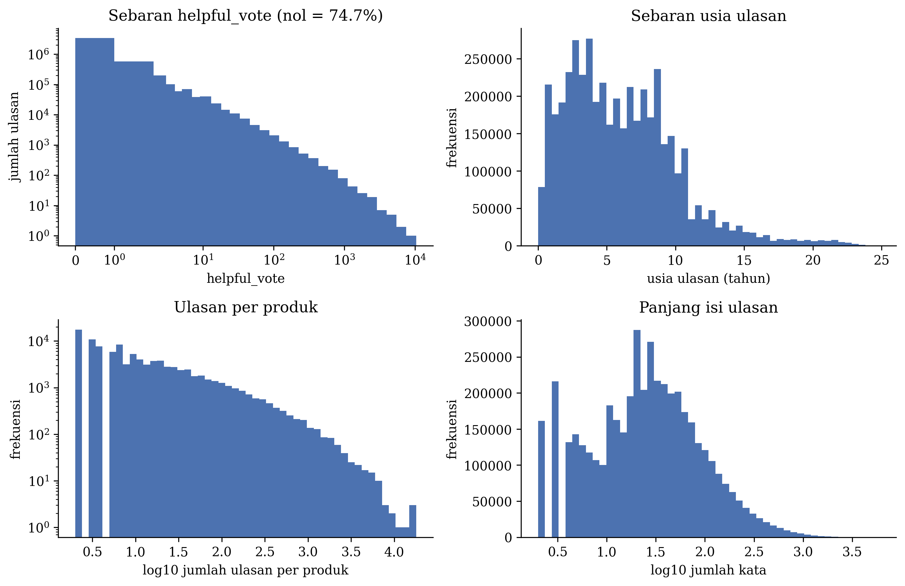

*Gambar 1. Sebaran helpful_vote (skala log), usia ulasan, jumlah ulasan per produk, dan jumlah kata per ulasan
pada seluruh 4.529.152 ulasan bersih.*

### 3a. Distribusi label

Gambar 1 (kiri atas) dan Tabel 2 menunjukkan bahwa label sangat tidak seimbang. Sebanyak 74,7% ulasan bernilai
nol, mediannya 0, rata-ratanya 1,23, persentil ke-99 sebanyak 18 suara, dan maksimumnya 10.369 suara. Sebanyak
22,2% produk tidak memiliki ulasan bersuara sama sekali. Produk seperti ini tidak dapat dinilai dengan NDCG karena
urutan idealnya tidak terdefinisi.

### 3b. Jumlah kata

Jumlah kata per ulasan sangat bervariasi (Gambar 1, kanan bawah). Banyak ulasan hanya berisi beberapa kata,
seperti "Five Stars", sedangkan sebagian lain berisi ratusan kata. Pada sampel 50.000 ulasan, median panjang
setelah tokenisasi RoBERTa adalah 39 token dan persentil ke-95 sebanyak 264 token. Hanya 1,6% ulasan yang
melebihi batas 512 token encoder dan terpotong.

Jumlah kata naik tajam seiring tingkat relevansi (Tabel 3 dan Gambar 2). Median jumlah kata ulasan tanpa
suara adalah 20, sedangkan ulasan dengan sedikitnya 4 suara memiliki median 111 kata. Panjang ulasan adalah
petunjuk kuat bagi kebermanfaatan.

**Tabel 3. Jumlah kata per tingkat relevansi (data latih E5)**

| Kelompok | Jumlah ulasan | Rata-rata | Median | P5 | P25 | P75 | P95 | Maksimum |
|---|---|---|---|---|---|---|---|---|
| Semua | 1.000.000 | 58,7 | 25 | 2 | 10 | 60 | 220 | 5.915 |
| Tingkat 0 | 712.571 | 36,5 | 20 | 2 | 7 | 41 | 125 | 5.002 |
| Tingkat 1 | 138.171 | 72,2 | 38 | 4 | 18 | 83 | 247 | 5.261 |
| Tingkat 2 | 50.939 | 104,5 | 58 | 7 | 26 | 120 | 356 | 5.881 |
| Tingkat 3 | 26.497 | 128,2 | 74 | 10 | 34 | 152 | 426 | 3.783 |
| Tingkat 4 | 71.822 | 194,5 | 111 | 14 | 51 | 236 | 661 | 5.915 |

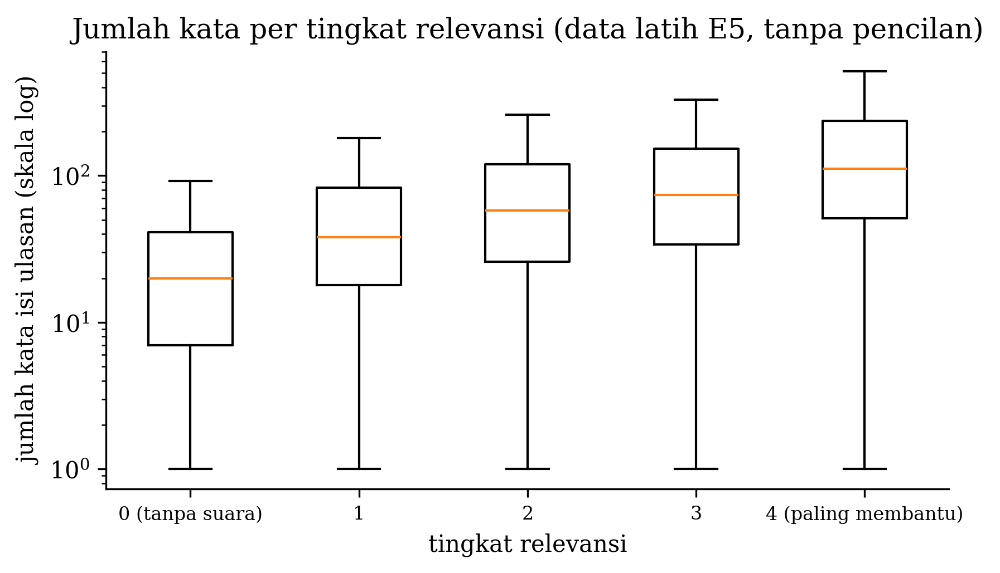

*Gambar 2. Sebaran jumlah kata per tingkat relevansi pada data latih E5.*

### 3c. Histogram fitur numerik

Lima fitur terstruktur masukan model adalah `rating`, `verified_purchase`, dan logaritma panjang isi (karakter),
jumlah kata, dan panjang judul. Tabel 4 memuat statistik fitur mentahnya pada data latih E5. Rating sangat
condong ke bintang 5 (median 5), 85% ulasan berasal dari pembelian terverifikasi, dan ketiga fitur panjang sangat
miring ke kanan. Median panjang isi adalah 134 karakter, tetapi maksimumnya 31.825 karakter. Karena itu, fitur
panjang diubah dengan ln(1 + x) sebelum distandardisasi (Subbab 4b).

**Tabel 4. Statistik fitur numerik (data latih E5, 1.000.000 ulasan)**

| Fitur | Rata-rata | Simpangan baku | Min | Q1 | Median | Q3 | Maks |
|---|---|---|---|---|---|---|---|
| rating | 4,02 | 1,43 | 1 | 3 | 5 | 5 | 5 |
| verified_purchase | 0,85 | 0,36 | 0 | 1 | 1 | 1 | 1 |
| panjang isi (karakter) | 315,4 | 634,4 | 1 | 51 | 134 | 318 | 31.825 |
| jumlah kata | 58,7 | 115,4 | 1 | 10 | 25 | 60 | 5.915 |
| panjang judul (karakter) | 22,9 | 17,4 | 0 | 10 | 17 | 30 | 605 |
| helpful_vote (label) | 1,25 | 8,08 | 0 | 0 | 0 | 1 | 1.662 |

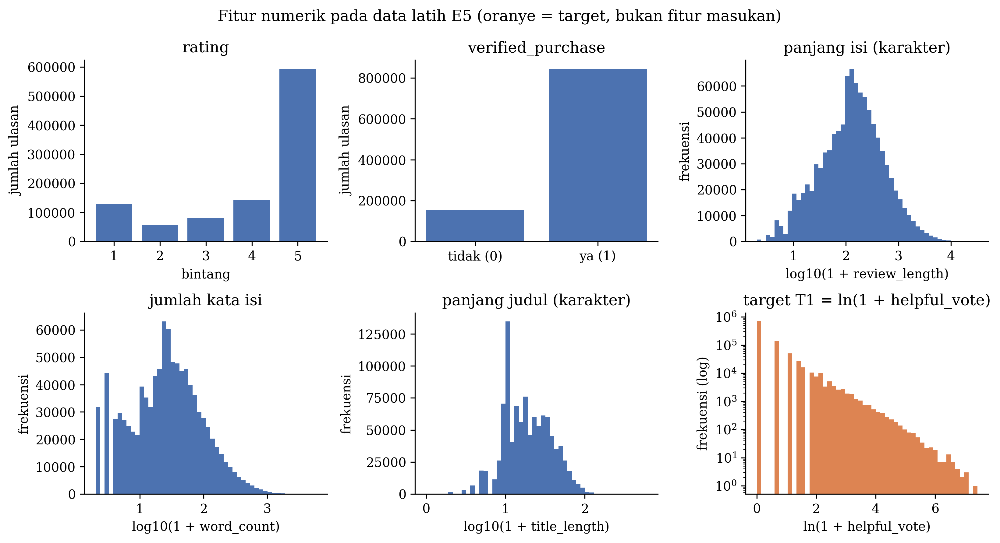

*Gambar 3. Histogram fitur numerik pada data latih E5.*

### 3d. Korelasi antarfitur

Korelasi Spearman antara usia ulasan dan helpful_vote pada seluruh data adalah 0,19. Usia tidak dipakai sebagai
fitur masukan model, karena model harus dapat menilai ulasan baru. Usia hanya dipakai untuk analisis dan untuk
menyesuaikan target (fitur unik 1). Pada model Negative Binomial dengan efek produk, koefisien terstandardisasi
ln(1 + panjang isi) adalah +1,14, jauh lebih besar daripada rating (−0,18) dan verified_purchase (+0,01). Ulasan
yang lebih panjang cenderung mendapat lebih banyak suara.

Korelasi Spearman antarfitur pada data latih E5 (Gambar 4) menunjukkan empat hal.
1. Panjang isi dan jumlah kata hampir identik (ρ = 0,997). Panjang judul berkorelasi sedang dengan keduanya
   (ρ ≈ 0,50).
2. Fitur yang paling berkorelasi dengan helpful_vote adalah panjang isi (ρ = 0,397), jumlah kata (0,396), dan
   panjang judul (0,203).
3. verified_purchase (ρ = −0,215) dan rating (−0,142) berkorelasi negatif lemah dengan helpful_vote. Ulasan
   bernilai rendah dan ulasan dari pembelian tidak terverifikasi cenderung sedikit lebih sering dinilai
   bermanfaat.
4. Usia berkorelasi dengan helpful_vote (ρ = 0,202) dan dengan panjang isi (0,181). Karena ulasan lama cenderung
   lebih panjang, efek usia perlu diukur bersama panjang ulasan, seperti pada model Negative Binomial.

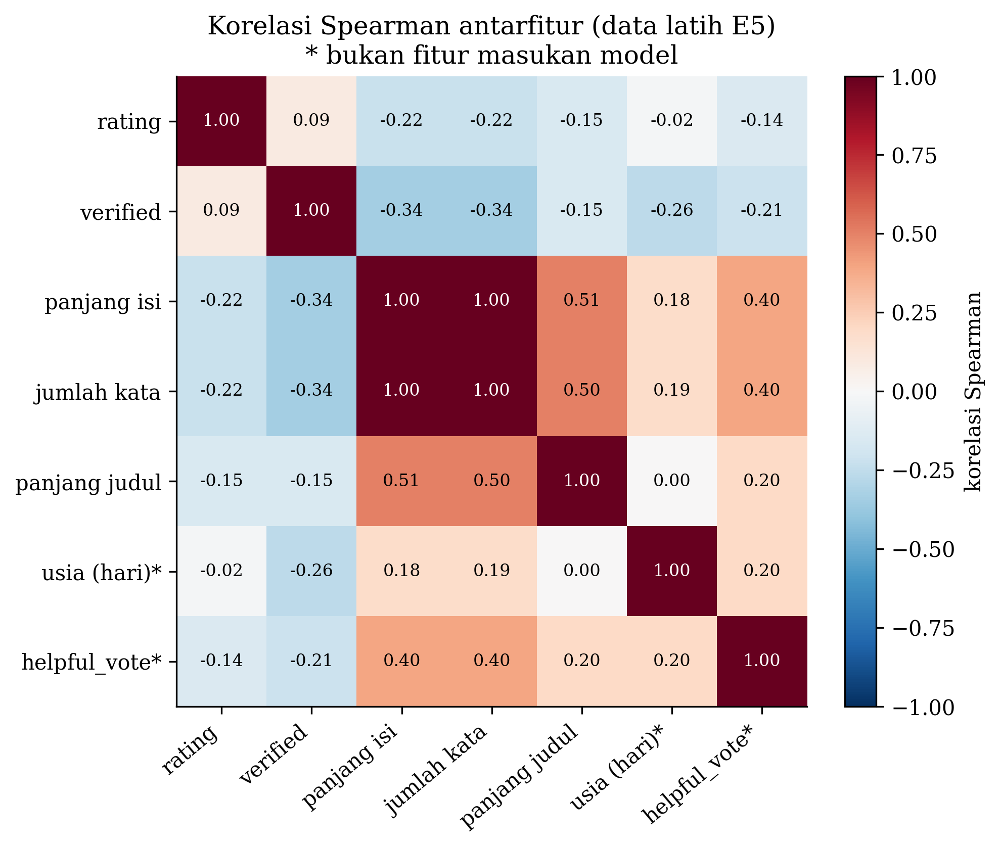

*Gambar 4. Korelasi Spearman antarfitur pada data latih E5. Tanda bintang menandai kolom yang tidak menjadi fitur
model (usia dan label).*

**Tabel 5. Rata-rata helpful votes per kuintil usia ulasan (seluruh data)**

| Kuintil usia | Jumlah ulasan | Rata-rata suara | Proporsi nol |
|---|---|---|---|
| Q1 (terbaru) | 905.831 | 0,62 | 80,1% |
| Q2 | 905.830 | 0,93 | 82,5% |
| Q3 | 905.830 | 1,17 | 76,6% |
| Q4 | 905.830 | 0,85 | 78,2% |
| Q5 (terlama) | 905.831 | 2,60 | 56,2% |

### 3e. Contoh sampel data per kelas

Tabel 6 memuat dua ulasan acak dari setiap tingkat relevansi pada data latih E5.

**Tabel 6. Contoh ulasan per tingkat relevansi (data latih E5, dipilih acak dengan seed 42)**

| Tingkat | Suara | Rating | Terverifikasi | Kata | Judul | Cuplikan isi |
|---|---|---|---|---|---|---|
| 0 | 0 | 5 | ya | 2 | Five Stars | Muy bueno |
| 0 | 0 | 5 | ya | 18 | Great! | Sturdy case, and it holds 29 games and 2 tiny extra slots. ... |
| 1 | 1 | 5 | ya | 6 | Five Stars | This Disney infinity character is awesome. |
| 1 | 1 | 5 | ya | 4 | Five Stars | Love using this trap! |
| 2 | 2 | 4 | tidak | 275 | Extremely Playable | Maybe it is not fair reviewing this before I saw EA's hockey game for this season. ... |
| 2 | 2 | 2 | ya | 93 | Hyped | I'm not deducting points for it being buggy, but the mechanics of the game are trash. ... |
| 3 | 3 | 5 | tidak | 407 | Addictive game for a non-gamer | I'm coming clean. For years my wife and I attempted to take the stance that Video Games were not ... |
| 3 | 3 | 5 | ya | 97 | Perfect Replacement. Shame on Nintendo for ever inventing this. | Perfect replacement. Its a real shame Nintendo is using such a crappy and poorly tested power connector. ... |
| 4 | 5 | 1 | tidak | 9 | Wait | Wait for patch, to many glitches in both games. |
| 4 | 14 | 5 | ya | 5 | Shipped fast. Works great. | No issues. Works as expected. |

Contoh ini memperlihatkan pola umum sekaligus kebisingan label. Ulasan tingkat 2 dan 3 umumnya panjang dan
menjelaskan alasannya, sedangkan tingkat 0 dan 1 didominasi ulasan sangat pendek seperti "Five Stars". Namun,
kedua contoh tingkat 4 justru pendek, termasuk "Shipped fast. Works great." dengan 14 suara, sehingga helpful votes
tidak selalu mencerminkan isi ulasan.

### 3f. Temuan EDA yang memengaruhi preprocessing

| Temuan | Keputusan preprocessing atau pemodelan |
|---|---|
| Label berekor panjang (maksimum 10.369) | Target memakai ln(1 + v), dan evaluasi memakai lima tingkat relevansi |
| 74,7% ulasan bernilai nol | Pasangan latih hanya dibentuk dari ulasan dengan suara berbeda. Produk tanpa ulasan bersuara tidak ikut dalam NDCG. |
| Suara naik tajam dengan usia ulasan | Usia tidak menjadi fitur. Target alternatif yang disesuaikan terhadap usia dibandingkan (fitur unik 1). |
| Panjang ulasan berkaitan kuat dengan suara | Panjang ulasan menjadi fitur terstruktur dan baseline B0 (fitur unik 2) |
| Ukuran produk sangat timpang | Paling banyak 200 ulasan per produk di data latih, dan metrik dihitung per produk lalu dirata-ratakan |
| Hanya 1,6% ulasan melebihi 512 token | Batas panjang encoder 512 token sudah cukup |
| Teks memuat sisa HTML dan karakter kendali | Teks dibersihkan tanpa mengubah huruf dan tanda baca (Subbab 4a) |

## 4. Preprocessing Data

### 4a. Pembersihan data

Urutan langkahnya adalah sebagai berikut.

1. **Tipe dan rentang nilai.** Baris dengan rating di luar 1–5, helpful_vote kosong atau negatif, atau
   verified_purchase tidak valid dibuang. Hanya 1 baris yang terbuang. Kode berhenti dengan error jika lebih dari
   5% baris tidak valid, karena hal itu menandakan format berkas berbeda dari yang diharapkan.
2. **Satuan timestamp.** Satuan milidetik dan detik dicoba, lalu dipilih yang seluruh tanggalnya berada pada
   rentang dataset (1995–2023). Milidetik terpilih dengan 100% data berada di rentang yang valid.
3. **Teks kosong.** Sebanyak 3.618 baris tanpa isi ulasan atau tanpa parent_asin dibuang.
4. **Normalisasi teks.** Entitas HTML diubah menjadi karakter biasa, tag HTML dan karakter kendali dihapus, dan
   spasi berlebih dirapikan. Huruf kapital, tanda baca, angka, dan kata negasi tidak diubah, karena encoder
   Transformer memanfaatkannya.
5. **Duplikat.** Sebanyak 53.599 baris dengan user_id, parent_asin, timestamp, dan teks yang sama dibuang.
6. **Produk kecil.** Sebanyak 38.245 ulasan dari produk dengan kurang dari 2 ulasan dibuang, karena pemeringkatan
   membutuhkan sedikitnya dua ulasan.

Hasilnya 4.529.152 ulasan dari 98.951 produk. Label tidak dikoreksi, karena helpful_vote adalah hasil pengamatan
apa adanya. Kebisingan label ditangani melalui target dan evaluasi (Subbab 4d).

### 4b. Normalisasi, standardisasi, dan representasi teks

- **Representasi teks.** Judul dan isi ditokenisasi sebagai pasangan teks dengan tokenizer BPE (*byte-pair
  encoding*) RoBERTa, dengan panjang maksimum 512 token. Judul dipotong paling banyak 64 kata, dan jika pasangan
  melebihi 512 token, yang dipotong hanya bagian isi. Untuk baseline TF-IDF (B1 dan B2), judul dan isi digabung
  menjadi satu teks "judul . isi". Stemming, lemmatisasi, dan penghapusan
  stopword **tidak** dilakukan, karena encoder pralatih dilatih pada teks alami dan memerlukan struktur kalimat
  yang utuh. Vektorisasi dilakukan oleh encoder BLaIR, yaitu keadaan tersembunyi lapisan terakhir pada token
  pertama (`<s>`), yang kemudian dinormalisasi dengan norma L2 menjadi vektor 768 dimensi.
- **Fitur turunan.** Panjang isi (karakter), jumlah kata, dan panjang judul diubah dengan ln(1 + x) karena
  sebarannya sangat miring.
- **Standardisasi.** Kelima fitur terstruktur diubah menjadi skor-z, (x − rata-rata) / simpangan baku. Rata-rata
  dan simpangan baku dihitung **hanya dari data latih** (Subbab 3c).
- **Usia ulasan** dihitung sebagai selisih hari dari timestamp terbaru di dataset (12 September 2023). Usia hanya
  dipakai untuk analisis dan penyesuaian target, bukan sebagai fitur model.

### 4c. Augmentasi data

Tidak ada augmentasi. Mengubah teks ulasan, misalnya dengan sinonim atau terjemahan balik, juga mengubah
kualitasnya, sehingga labelnya tidak lagi sesuai dengan teks yang baru.

### 4d. Missing value, outlier, dan ketidakseimbangan kelas

- **Missing value.** Baris tanpa teks atau tanpa parent_asin dibuang (3.618 baris). Judul yang kosong diganti
  dengan string kosong.
- **Outlier.** Nilai suara ekstrem tidak dibuang karena merupakan pengamatan sah. Pengaruhnya diperkecil dengan
  transformasi ln(1 + v) dan pembagian ke lima tingkat relevansi. Ukuran produk yang ekstrem dibatasi paling banyak
  200 ulasan per produk di data latih.
- **Ketidakseimbangan.** Model dilatih secara berpasangan. Setiap pasangan terdiri atas dua ulasan dari produk
  yang sama dengan target **berbeda**, sehingga mayoritas ulasan bernilai nol tidak menghasilkan pasangan dengan
  target sama. Paling banyak 100 pasangan diambil per produk per epoch, agar produk besar tidak mendominasi. Pada
  skala E3, cara ini menghasilkan sekitar 647.000 pasangan per epoch dari 14.748 produk, sedangkan 4.452 produk
  lainnya tidak menghasilkan pasangan karena semua ulasannya bersuara sama. Pada evaluasi, metrik dihitung per
  produk lalu dirata-ratakan, sehingga produk besar tidak mendominasi.

### 4e. Pembagian data dan pencegahan kebocoran

Data dibagi **per produk** (`parent_asin`) dengan proporsi 80/10/10 untuk latih, validasi, dan uji. Semua ulasan
dari satu produk berada di partisi yang sama, sehingga model diuji pada produk yang belum pernah dilihat.

Pencegahan kebocoran dilakukan sebagai berikut.

1. Tidak ada parent_asin yang muncul di dua partisi. Hal ini diperiksa otomatis dan hasilnya 0.
2. Tidak ada asin (varian produk) yang muncul di dua partisi.
3. Ulasan validasi dan uji yang teksnya sama persis dengan ulasan latih dibuang (113.237 ulasan), karena teks
   pendek yang umum seperti "Great game" muncul di banyak produk. Sebanyak 792 ulasan lagi dibuang karena produknya
   tersisa kurang dari 2 ulasan.
4. Standardisasi, TF-IDF, SVD, model usia, dan ambang tingkat relevansi hanya diestimasi dari data latih.
5. Data uji hanya dievaluasi satu kali, setelah semua hiperparameter dipilih berdasarkan data validasi.

**Tabel 7. Pembagian data dan skala data latih**

| Partisi | Ulasan | Produk | Proporsi bernilai nol |
|---|---|---|---|
| Latih E1 | 100.000 | 3.777 | 0,706 |
| Latih E2 | 250.000 | 9.773 | 0,708 |
| **Latih E3 (skala utama)** | **499.999** | **19.200** | **0,712** |
| Latih E4 | 750.000 | 28.357 | 0,712 |
| Latih E5 | 1.000.000 | 38.068 | 0,713 |
| Validasi | 199.189 | 5.094 | 0,718 |
| Uji | 199.926 | 4.816 | 0,699 |

Skala E1 sampai E5 bersarang, artinya E1 adalah bagian dari E2 dan seterusnya. Dengan begitu, perbedaan kinerja
antarskala hanya berasal dari jumlah data.

## 5. Model yang Digunakan

### 5a. Jenis model

Model yang dilatih adalah **Deep Neural Network (DNN)** berupa Multilayer Perceptron (MLP) sebagai pemberi skor.
Teks ulasan diubah menjadi vektor oleh **BLaIR-RoBERTa-base** (`hyp1231/blair-roberta-base`) [3], [4], yaitu
encoder Transformer pralatih berarsitektur RoBERTa-base [5] (12 lapisan Transformer, 12 attention head,
dimensi 768, dan 124,1 juta parameter yang dipakai) yang dibekukan dan hanya dipakai sebagai pengekstrak fitur.
Pola ini sama dengan
*transfer learning* pada CNN, yaitu backbone pralatih yang dibekukan dengan kepala jaringan yang dilatih. Semua
parameter yang dilatih berada di MLP.

### 5b. Arsitektur model

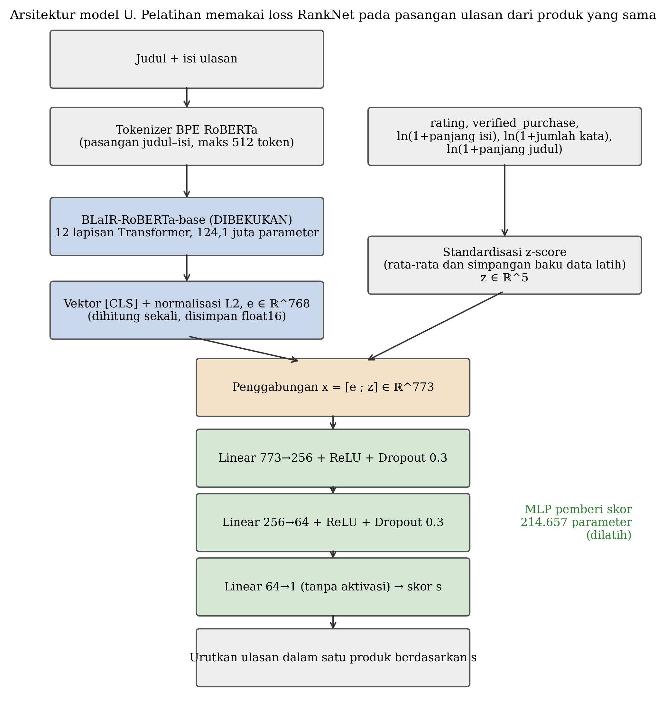

*Gambar 5. Diagram arsitektur model U. Bagian biru dibekukan, bagian hijau dilatih.*

**Tabel 8. Arsitektur model U**

| Lapisan | Keluaran | Aktivasi | Regularisasi | Parameter |
|---|---|---|---|---|
| Encoder BLaIR-RoBERTa-base (dibekukan), token `<s>` + norma L2 | 768 | – | – | tidak dilatih |
| Fusi, [embedding ; 5 fitur terstandardisasi] | 773 | – | – | 0 |
| Linear 773 → 256 | 256 | ReLU | Dropout 0,3 | 198.144 |
| Linear 256 → 64 | 64 | ReLU | Dropout 0,3 | 16.448 |
| Linear 64 → 1 (skor) | 1 | tanpa aktivasi | – | 65 |
| **Total parameter yang dilatih** | | | | **214.657** |

ReLU dipilih sebagai fungsi aktivasi [6], dan dropout dipakai untuk mengurangi overfitting [7]. Selain dropout,
regularisasi dilakukan dengan weight decay 1e-5 dan early stopping. Keluaran berupa satu skor tanpa aktivasi.
Ulasan dalam satu produk diurutkan dari skor tertinggi. Jumlah parameter di atas diperiksa dengan memuat bobot U
yang tersimpan ke kelas yang sama secara ketat (strict). Model pembanding MLP (B2, B4, dan B5) memiliki arsitektur
dan jumlah parameter yang sama (214.657). Model ablasi memiliki masukan lebih kecil, yaitu A1 dengan 213.377, A2
dengan 213.633, dan A3 dengan 213.889 parameter. Ranker linear B3 hanya memiliki 774 parameter.

### 5c. Konfigurasi pelatihan

**Tabel 9. Konfigurasi pelatihan model U**

| Komponen | Nilai |
|---|---|
| Fungsi loss | RankNet, L = ln(1 + exp(−(s_i − s_j))) untuk pasangan dengan y_i > y_j [8] |
| Pasangan latih | Paling banyak 100 pasangan per produk, diambil ulang setiap epoch, tanpa pasangan bertarget sama |
| Optimizer | Adam [9] dengan weight decay 1e-5 |
| Learning rate | 3e-4 (dipilih dari 1e-4, 3e-4, dan 1e-3) |
| Dropout | 0,3 (dipilih dari 0,1, 0,2, dan 0,3) |
| Batch size | 1.024 pasangan |
| Epoch | Maksimum 30, dengan early stopping |
| Callback | Early stopping dengan patience 3 berdasarkan NDCG@10 validasi. Bobot terbaik dipulihkan. |
| Seed | 42, 43, dan 44. Hasil dirata-ratakan atas ketiga seed. |
| Data latih | Skala E3 (499.999 ulasan) |
| Encoder | Presisi fp16, batch 64, panjang maksimum 512 token, embedding dihitung satu kali dan disimpan |

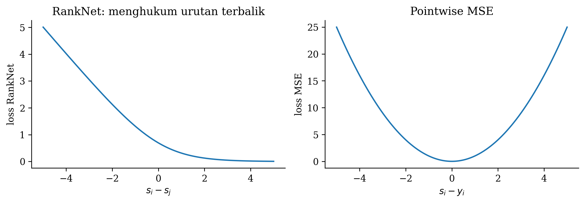

*Gambar 6. Loss RankNet sebagai fungsi selisih skor pasangan (kiri) dan loss MSE pointwise untuk pembanding B4
(kanan). Loss RankNet kecil jika skor ulasan yang lebih bermanfaat jauh di atas pasangannya.*

Hiperparameter dipilih dengan grid search kecil pada data validasi (Tabel 16). Hiperparameter terbaik model U
dipakai untuk semua model MLP pembanding agar perbandingannya adil. Untuk target T2, lebar jendela usia dipilih
1,0 dalam satuan ln(1 + hari) dari kandidat 0,25, 0,5, dan 1,0.

### 5d. Alasan pemilihan model dan arsitektur

- **Encoder BLaIR.** BLaIR adalah RoBERTa-base yang dilatih lanjut pada data Amazon Reviews 2023 untuk
  menghubungkan teks dengan produk [3]. Karena domainnya sama, BLaIR diduga lebih peka terhadap informasi produk
  di dalam ulasan. Dugaan ini diuji langsung dengan membandingkannya terhadap RoBERTa-base asli (B5).
- **Encoder dibekukan.** Embedding cukup dihitung satu kali, sekitar 2,9 jam untuk 1,4 juta ulasan. Setelah itu,
  satu run pelatihan hanya membutuhkan 0,3 sampai 1,0 menit (Tabel 20). Dengan begitu, puluhan konfigurasi dan
  tiga seed dapat dijalankan dalam satu sesi Colab, termasuk 9 kombinasi penalaan, ablasi, 5 skala data, dan
  3 strategi target.
- **MLP.** MLP dapat memodelkan hubungan nonlinear antara embedding dan fitur terstruktur. Model linear pada
  masukan yang sama (B3) lebih rendah 0,008 NDCG@10 (Tabel 14). Ukuran MLP yang kecil, 214.657 parameter, cukup
  untuk 500.000 ulasan latih, sehingga kesenjangan loss latih dan validasi tetap kecil (Subbab 6e).
- **RankNet berpasangan.** Tugasnya adalah mengurutkan ulasan di dalam produk. Pendekatan *learning to rank*
  berpasangan [8], [10] langsung mempelajari urutan relatif dan tidak terpengaruh perbedaan jumlah suara antarproduk. Model yang sama dengan loss
  MSE pointwise (B4) lebih rendah 0,0045 NDCG@10, dan selisih ini konsisten di ketiga seed (Tabel 14).

### 5e. Dua fitur unik

#### Fitur unik 1. Penyesuaian target terhadap usia ulasan

**Apa.** Selain target mentah T1 = ln(1 + v), model juga dilatih dengan target T3 yang komponen usianya
dikurangi, yaitu T3 = ln(1 + v) − [f(ln(1 + usia)) − f̄]. Komponen f diestimasi oleh model Negative Binomial.
Pembanding ketiga adalah T2, yaitu target mentah dengan pasangan latih yang hanya dibentuk dari ulasan berusia
berdekatan.

**Mengapa.** Ulasan lama sempat dibaca lebih banyak orang, sehingga jumlah suara bercampur dengan lamanya ulasan
tampil (Tabel 5). Model yang dilatih dengan suara mentah dapat belajar mengenali ulasan lama, bukan ulasan
bermanfaat. Hal ini merugikan ulasan baru yang belum sempat dinilai.

**Bagaimana.**
1. Model Negative Binomial (NB2) dengan efek tetap per produk dan fungsi spline pada ln(1 + usia), ditambah
   kovariat rating, verified_purchase, dan ln(1 + panjang isi), diestimasi pada data latih E5 (1 juta ulasan) [11].
   Bentuk fungsi usia dipilih dari linear dan spline 4, 6, atau 8 knot berdasarkan log-likelihood validasi
   terbesar. Spline 4 knot terpilih.
2. Untuk data latih, komponen usia dihitung **out-of-fold** dengan 5 fold yang dikelompokkan per produk, sehingga
   label sebuah ulasan tidak ikut membentuk targetnya sendiri. f̄ adalah rata-rata komponen usia out-of-fold pada
   data latih.
3. Ambang tingkat relevansi T3 dipilih sehingga proporsi setiap tingkat sama dengan T1.
4. Setiap model dievaluasi pada **dua acuan relevansi**, yaitu tingkat dari target mentah dan tingkat dari target
   yang disesuaikan. Hasil kedua acuan dilaporkan terpisah.

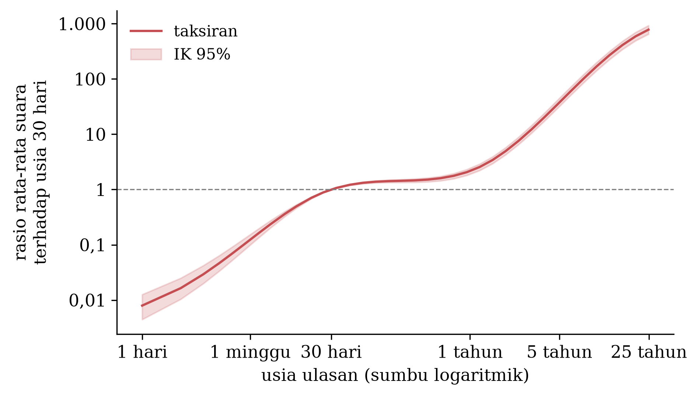

*Gambar 7. Rasio rata-rata suara terhadap ulasan berusia 30 hari, setelah efek produk dan kovariat dikendalikan,
dengan IK 95% dari 100 ulangan bootstrap per produk (sumbu logaritmik).*

**Bukti dampak.**
- **Efek usia nyata dan besar.** Uji rasio likelihood terhadap model tanpa usia menghasilkan LR = 59.764 (df = 5,
  p < 0,001). Pseudo-R² McFadden terhadap model tanpa usia adalah 0,029. Gambar 7 menunjukkan tiga fase. Rasio
  naik tajam dari 0,008 pada usia 1 hari menjadi 1 pada 30 hari, hampir datar hingga sekitar 1 tahun (2,06 pada
  344 hari), lalu naik lagi menjadi 34,9 pada sekitar 5 tahun dan 781 pada sekitar 25 tahun (IK 95% 649–928).
  Hubungan ini bersifat asosiasi, bukan sebab-akibat.
- **Target yang disesuaikan mengubah apa yang diurutkan sebagai bermanfaat** (Tabel 18). Pada acuan
  relevansinya sendiri, T3 menjadi yang terbaik, dengan NDCG@10 0,667 dibanding 0,630 untuk T1. Pada acuan suara
  mentah, T3 lebih rendah (0,627 dibanding 0,715). Per kelompok usia dengan acuan mentah, T3 meratakan kinerja
  antara ulasan baru dan lama (0,642, 0,670, dan 0,675), sedangkan T1 jauh lebih baik pada ulasan lama (0,684,
  0,721, dan 0,775).
- **T2 tidak mengubah hasil.** NDCG@10 T2 adalah 0,715, sama dengan T1.

Kesimpulannya, fitur ini tidak meningkatkan pemeringkatan menurut suara mentah, tetapi menyediakan pilihan target
yang tidak terlalu mengunggulkan ulasan lama. Pilihan antara T1 dan T3 bergantung pada definisi "bermanfaat" yang
diinginkan.

#### Fitur unik 2. Fusi embedding teks dengan fitur terstruktur

**Apa.** Embedding BLaIR 768 dimensi digabung dengan 5 fitur terstruktur yang sudah distandardisasi, yaitu rating,
verified_purchase, dan tiga fitur panjang, sehingga masukan MLP berukuran 773.

**Mengapa.** Embedding [CLS] yang dinormalisasi L2 merangkum makna teks, tetapi tidak secara langsung menyimpan
informasi seperti panjang ulasan, padahal kedalaman ulasan diketahui berhubungan dengan kebermanfaatannya [12].
Pada data ini, baseline yang hanya mengurutkan berdasarkan panjang isi (B0) mendapat NDCG@10 0,702, lebih tinggi
daripada model yang hanya memakai embedding (A1, 0,698).

**Bagaimana.** Fitur panjang diubah dengan ln(1 + x), semua fitur diubah menjadi skor-z dengan statistik data
latih, lalu digabung dengan embedding sebelum masuk ke MLP. Usia ulasan dan helpful_vote secara eksplisit dilarang
masuk sebagai fitur, dan larangan ini diperiksa dengan `assert` di kode.

**Bukti dampak** (ablasi pada skala E3, rata-rata tiga seed, Tabel 17 dan Gambar 10).

| Konfigurasi | NDCG@10 uji | IK 95% |
|---|---|---|
| A1, embedding saja | 0,698 | 0,691–0,706 |
| A2, + rating | 0,699 | 0,691–0,707 |
| A3, + verified_purchase | 0,704 | 0,696–0,712 |
| A4 = U, + fitur panjang (semua fitur) | **0,715** | 0,707–0,723 |

Penambahan seluruh fitur menaikkan NDCG@10 sebesar 0,016, dan kenaikan terbesar berasal dari fitur panjang.
Uji berpasangan per produk dengan prosedur yang sama seperti Tabel 14 (bootstrap per produk dan koreksi Holm)
memastikan bahwa semua kenaikan ini nyata.

**Tabel 10. Selisih NDCG@10 berpasangan U terhadap model ablasi (uji, 3.827 produk)**

| U vs | Selisih | IK 95% | p Holm | Produk U lebih baik / sama / lebih buruk |
|---|---|---|---|---|
| A1, embedding saja | +0,0163 | +0,0129 – +0,0199 | < 0,001 | 1.645 / 1.005 / 1.177 |
| A2, + rating | +0,0155 | +0,0121 – +0,0191 | < 0,001 | 1.611 / 1.049 / 1.167 |
| A3, + verified_purchase | +0,0106 | +0,0076 – +0,0137 | < 0,001 | 1.582 / 1.080 / 1.165 |

## 6. Hasil Evaluasi

### 6a. Metrik evaluasi dan alasannya

Tugas ini adalah pemeringkatan di dalam produk, sehingga metrik klasifikasi seperti accuracy atau F1 tidak
mengukur hal yang dibutuhkan. Semua metrik dihitung **per produk**, lalu dirata-ratakan agar produk besar tidak
mendominasi.

**Tabel 11. Metrik evaluasi**

| Metrik | Peran | Alasan dan aturan |
|---|---|---|
| NDCG@10 [13] | Metrik utama | Kualitas sepuluh ulasan teratas, posisi atas berbobot lebih besar. Dihitung pada produk dengan IDCG > 0. |
| NDCG@5 | Pendukung | Kualitas lima posisi teratas |
| Spearman [14] | Pendukung | Kesesuaian urutan seluruh ulasan. Dihitung pada produk dengan ≥ 3 ulasan dan target tidak konstan. |
| MAP [15] | Pendukung | Posisi ulasan relevan (tingkat ≥ 2). Dihitung pada produk yang punya ulasan relevan dan tidak relevan. |
| MAE dan RMSE | Khusus B4 | Ketepatan taksiran ln(1 + v) model pointwise |

Ketidakpastian diukur dengan **bootstrap per produk** sebanyak 1.000 ulangan [16]. Sebuah model dinyatakan lebih
baik jika IK 95% selisih berpasangannya tidak memuat nol dan p-value setelah koreksi Holm [17] kurang dari 0,05.
Arah selisih juga dilaporkan untuk setiap seed sebagai pelengkap. Sebanyak 989 dari 4.816 produk uji (20,5%) tidak
memiliki ulasan bersuara, sehingga NDCG dihitung pada 3.827 produk yang mencakup 196.051 ulasan.

### 6b. Nilai metrik pada data uji

**Tabel 12. Daftar model pembanding**

| Kode | Konfigurasi |
|---|---|
| R0 | Urutan acak, rata-rata 20 permutasi (batas bawah) |
| B0 | Urutan berdasarkan panjang isi ulasan (heuristik tanpa pembelajaran) |
| B1 | TF-IDF unigram dan bigram + fitur, ranker linear berpasangan (regresi logistik) |
| B2 | TF-IDF yang direduksi ke 768 dimensi dengan SVD + fitur, MLP RankNet |
| B3 | BLaIR + fitur, ranker linear RankNet |
| B4 | BLaIR + fitur, MLP dengan loss MSE pointwise |
| B5 | RoBERTa-base asli (dibekukan) + fitur, MLP RankNet |
| **U** | **BLaIR + fitur, MLP RankNet (model utama)** |

**Tabel 13. Hasil pada data uji (skala E3, target T1, rata-rata seed, IK 95% bootstrap per produk)**

| Kode | NDCG@10 | IK 95% | NDCG@5 | Spearman | MAP |
|---|---|---|---|---|---|
| R0 | 0,499 | 0,491–0,507 | 0,439 | −0,001 | 0,398 |
| B0 | 0,702 | 0,694–0,710 | 0,663 | 0,354 | 0,621 |
| B1 | 0,705 | 0,698–0,713 | 0,668 | 0,369 | 0,623 |
| B2 | 0,712 | 0,704–0,719 | 0,677 | 0,371 | 0,630 |
| B3 | 0,707 | 0,699–0,715 | 0,668 | 0,371 | 0,627 |
| B4 | 0,710 | 0,703–0,718 | 0,673 | 0,366 | 0,632 |
| **B5** | **0,720** | 0,712–0,727 | **0,685** | **0,382** | **0,642** |
| U | 0,715 | 0,707–0,723 | 0,679 | 0,375 | 0,637 |

Jumlah produk yang dievaluasi adalah 3.827 untuk NDCG, 3.389 untuk Spearman, dan 2.942 untuk MAP. Model pointwise
B4 memiliki MAE 0,400 dan RMSE 0,587 terhadap ln(1 + v).

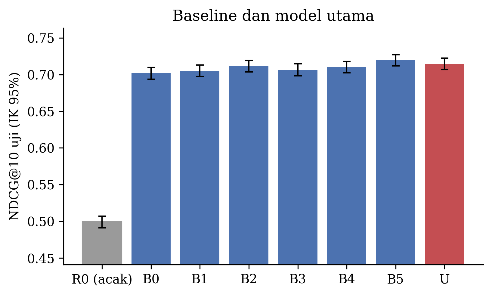

*Gambar 8. NDCG@10 uji dengan IK 95%. Batang abu-abu adalah urutan acak R0, dan batang merah adalah model U.*

**Tabel 14. Selisih NDCG@10 berpasangan U terhadap baseline (uji)**

| U vs | Selisih | IK 95% | p Holm | U lebih baik | Selisih per seed (42, 43, 44) | Searah di semua seed |
|---|---|---|---|---|---|---|
| B0 | +0,0128 | +0,0094 – +0,0162 | < 0,001 | ya | +0,0132, +0,0123, +0,0128 | 3 dari 3 |
| B1 | +0,0094 | +0,0055 – +0,0131 | < 0,001 | ya | +0,0098, +0,0089, +0,0094 | 3 dari 3 |
| B2 | +0,0031 | +0,0001 – +0,0063 | 0,046 | ya (tipis) | +0,0038, +0,0019, +0,0037 | 3 dari 3 |
| B3 | +0,0080 | +0,0052 – +0,0110 | < 0,001 | ya | +0,0086, +0,0074, +0,0080 | 3 dari 3 |
| B4 | +0,0045 | +0,0019 – +0,0071 | < 0,001 | ya | +0,0051, +0,0038, +0,0046 | 3 dari 3 |
| B5 | −0,0051 | −0,0079 – −0,0022 | < 0,001 | **tidak, B5 lebih baik** | −0,0058, −0,0059, −0,0037 | 3 dari 3 |

B0 dan B1 hanya dijalankan satu kali karena deterministik, sehingga dipasangkan dengan setiap seed U.

### 6c. Grafik loss dan akurasi pada data latih dan validasi

Model pemeringkatan tidak menghasilkan akurasi kelas. Sebagai pengganti grafik akurasi, digunakan NDCG@10 validasi
per epoch, yang juga menjadi dasar early stopping. Loss validasi adalah loss RankNet pada pasangan validasi yang
tetap.

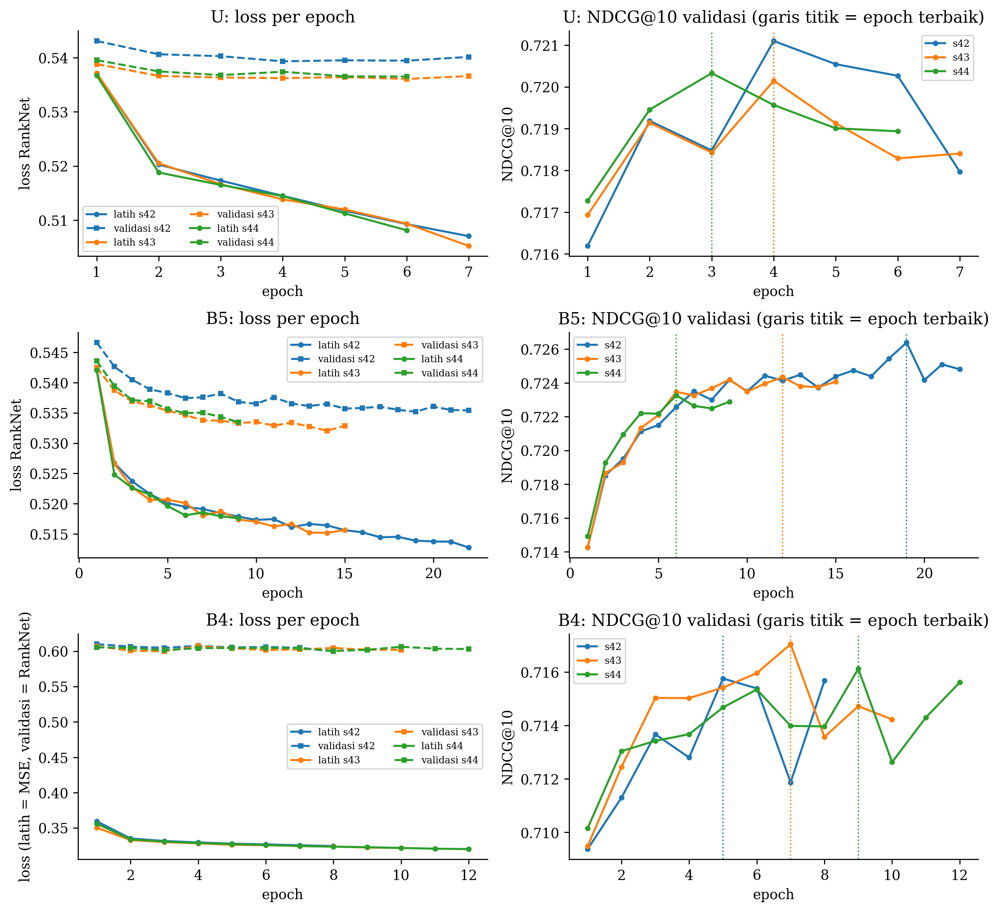

*Gambar 9. Loss latih (garis penuh) dan validasi (garis putus-putus) serta NDCG@10 validasi per epoch untuk ketiga
seed model U, B5, dan B4. Garis titik menandai epoch terbaik yang bobotnya dipakai. Loss latih B4 adalah MSE
sehingga skalanya berbeda.*

Pada model U, loss latih turun terus dari 0,537 ke 0,507, sedangkan loss validasi berhenti turun setelah epoch 4
(0,539) dan mulai naik sedikit. NDCG@10 validasi mencapai puncak 0,721 pada epoch 4, lalu turun, sehingga
pelatihan berhenti di epoch 7 dan bobot epoch 4 dipulihkan. Pola yang sama terlihat pada ketiga seed, dengan
epoch terbaik 3 sampai 4. Tabel 15 merangkum pelatihan semua model.

**Tabel 15. Ringkasan pelatihan (skala E3, target T1, rata-rata tiga seed)**

| Kode | Epoch dijalankan | Epoch terbaik | NDCG@10 validasi | Loss latih | Loss validasi | Celah loss | Menit per run |
|---|---|---|---|---|---|---|---|
| B2 | 5,3 | 2,3 | 0,7222 ± 0,0006 | 0,511 | 0,539 | 0,029 | 0,37 |
| B3 | 19,3 | 16,3 | 0,7108 ± 0,0003 | 0,526 | 0,547 | 0,021 | 1,03 |
| B4 | 10,0 | 7,0 | 0,7163 ± 0,0007 | 0,325 (MSE) | 0,603 | – | 0,47 |
| B5 | 15,3 | 12,3 | 0,7247 ± 0,0016 | 0,516 | 0,535 | 0,018 | 1,03 |
| **U** | **6,7** | **3,7** | **0,7205 ± 0,0005** | **0,515** | **0,537** | **0,022** | **0,48** |
| A1 | 9,0 | 6,0 | 0,7023 ± 0,0002 | 0,519 | 0,550 | 0,031 | 0,62 |
| A2 | 8,0 | 5,0 | 0,7048 ± 0,0007 | 0,521 | 0,548 | 0,027 | 0,55 |
| A3 | 9,3 | 6,3 | 0,7081 ± 0,0006 | 0,511 | 0,546 | 0,035 | 0,63 |

Loss dan celah loss diambil pada epoch terbaik. Celah loss adalah loss validasi dikurangi loss latih. B0 dan B1
tidak dilatih dengan PyTorch, sehingga tidak memiliki kurva. NDCG@10 validasi B0 adalah 0,7100 dan B1 adalah
0,7160.

### 6d. Perbandingan antarskenario

**Tabel 16. Penalaan hiperparameter model U (NDCG@10 validasi, seed 42)**

| Learning rate | Dropout 0,1 | Dropout 0,2 | Dropout 0,3 |
|---|---|---|---|
| 1e-4 | 0,7196 | 0,7196 | 0,7194 |
| **3e-4** | 0,7204 | 0,7206 | **0,7211** |
| 1e-3 | 0,7184 | 0,7206 | 0,7201 |

Semua kombinasi berada pada rentang 0,718–0,721, sehingga model tidak sensitif terhadap hiperparameter ini.

**Tabel 17. Ablasi fitur dan skala data latih (NDCG@10 uji)**

| Skenario | NDCG@10 | IK 95% |
|---|---|---|
| A1, embedding saja | 0,698 | 0,691–0,706 |
| A2, + rating | 0,699 | 0,691–0,707 |
| A3, + verified_purchase | 0,704 | 0,696–0,712 |
| A4 = U, semua fitur | 0,715 | 0,707–0,723 |
| E1, 100.000 ulasan | 0,710 | 0,702–0,718 |
| E2, 250.000 ulasan | 0,712 | 0,704–0,720 |
| E3, 499.999 ulasan | 0,715 | 0,707–0,723 |
| E4, 750.000 ulasan | 0,716 | 0,708–0,724 |
| E5, 1.000.000 ulasan | 0,718 | 0,710–0,725 |

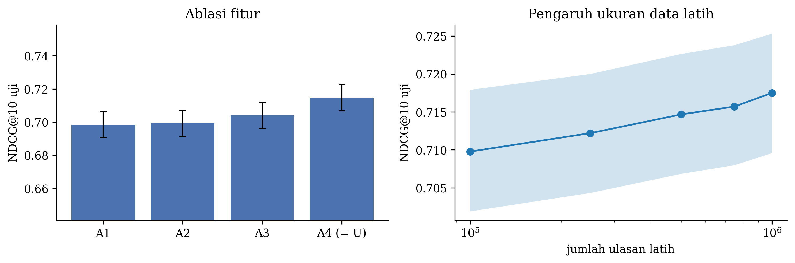

*Gambar 10. Ablasi fitur (kiri) dan pengaruh jumlah ulasan latih (kanan, sumbu logaritmik) dengan IK 95%.*

Menambah data latih sepuluh kali lipat, dari 100.000 menjadi 1.000.000 ulasan, menaikkan NDCG@10 secara konsisten
tetapi hanya sebesar 0,008, dan IK semua skala saling tumpang tindih.

**Tabel 18. Strategi target pada dua acuan relevansi (model U, E3, NDCG@10 uji)**

| Target pelatihan | Acuan suara mentah | Acuan disesuaikan usia |
|---|---|---|
| T1, suara mentah | **0,715** | 0,630 |
| T2, pasangan berusia berdekatan | **0,715** | 0,633 |
| T3, disesuaikan usia | 0,627 | **0,667** |

Angka pada dua acuan yang berbeda tidak dibandingkan langsung, karena keduanya mengukur definisi relevansi yang
berbeda.

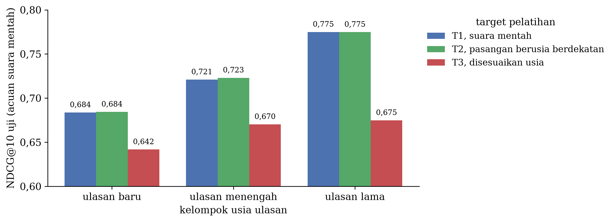

*Gambar 11. Kurva usia (kiri) dan NDCG@10 uji per kelompok usia untuk ketiga target dengan acuan suara mentah
(kanan).*

### 6e. Analisis hasil

**Temuan utama.**
1. **Semua model jauh di atas urutan acak.** U lebih tinggi 0,216 NDCG@10 daripada R0. Selisih antarmodel hanya
   0,018, kecil dibanding jarak ke urutan acak.
2. **U lebih baik daripada B0–B4**, dan hasilnya konsisten di ketiga seed. Keunggulan atas B2 (TF-IDF dengan SVD
   dan MLP) tipis, yaitu +0,003 dengan p Holm 0,046. Pada data validasi, B2 justru lebih baik daripada U di
   ketiga seed (rata-rata 0,7222 dibanding 0,7205), sehingga keunggulan ini tidak dianggap kuat.
3. **RoBERTa-base asli (B5) lebih baik daripada BLaIR (U)** di semua metrik, pada data validasi dan uji, dan di
   ketiga seed. Pelatihan lanjut BLaIR untuk mencocokkan teks dengan produk tidak membantu tugas penilaian
   kebermanfaatan ulasan pada data ini.
4. **Fitur panjang ulasan memberi sumbangan terbesar** (Tabel 17), sejalan dengan kuatnya baseline B0.

**Tabel 19. Kinerja U per kelompok (NDCG@10 uji, acuan suara mentah)**

| Kelompok | NDCG@10 U | NDCG@10 acak | Jumlah produk |
|---|---|---|---|
| Ulasan baru (usia ≤ 1.283 hari) | 0,684 | – | 1.528 |
| Ulasan menengah | 0,721 | – | 1.501 |
| Ulasan lama (usia > 2.776 hari) | 0,775 | – | 1.674 |
| Produk kecil Q1 (median 2 ulasan) | 0,881 | 0,822 | 1.204 |
| Produk Q2 (median 5 ulasan) | 0,819 | 0,692 | 1.204 |
| Produk Q3 (median 12 ulasan) | 0,699 | 0,501 | 1.204 |
| Produk besar Q4 (median 57 ulasan) | 0,563 | 0,183 | 1.204 |
| Ulasan pendek (tertil jumlah kata) | 0,591 | – | 1.723 |
| Ulasan sedang | 0,632 | – | 2.306 |
| Ulasan panjang | 0,757 | – | 2.532 |

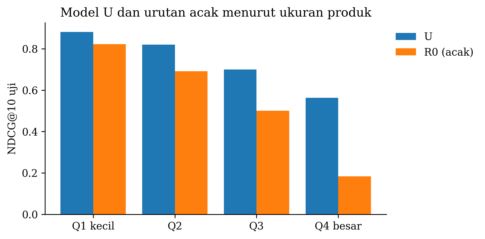

*Gambar 12. NDCG@10 model U dan urutan acak menurut kuartil ukuran produk.*

**Bagian yang paling sering salah diurutkan.**
- **Ulasan pendek** (NDCG@10 0,591) dan **ulasan baru** (0,684). Ulasan pendek memberi sedikit informasi teks,
  dan ulasan baru belum sempat mengumpulkan suara, sehingga labelnya paling bising.
- **Produk besar.** NDCG@10 absolut paling rendah (0,563), tetapi justru di sinilah model paling bermanfaat,
  yaitu +0,38 di atas urutan acak. Pada produk kecil, NDCG tinggi sebagian besar karena kebetulan. Dengan dua
  ulasan, urutan acak sudah benar pada separuh kasus.
- **Contoh kegagalan.** Pada 7 produk uji, NDCG@10 bernilai 0. Polanya sama. Model menaruh ulasan panjang tanpa
  suara di posisi teratas, misalnya ulasan 59 kata berjudul "Must have game if you love fighting games but wanna go
  old school", sedangkan ulasan yang bersuara adalah ulasan pendek dengan satu suara, misalnya "Five Stars"
  (10 kata). Kesalahan seperti ini mencerminkan dua hal, yaitu kecenderungan model mengunggulkan ulasan panjang dan
  label satu suara yang sangat bising.
- **Tingkat yang bertetangga.** Model pemeringkatan tidak menghasilkan kelas, sehingga confusion matrix biasa
  diganti dengan **akurasi pasangan per tingkat** (Gambar 13). Akurasi ini adalah proporsi pasangan ulasan dari
  produk yang sama (tingkat a > tingkat b) yang diurutkan benar, dengan 0,5 setara urutan acak. Dari 33,2 juta
  pasangan uji, U mengurutkan benar 72,6%, hampir sama dengan B5 (72,7%) dan di atas B0 (70,0%). Pasangan yang
  tingkatnya jauh, misalnya 4 dibanding 0, hampir selalu benar (86,9%). Pasangan tingkat yang bertetangga paling
  sering terbalik, yaitu 3 dibanding 2 (53,8%), 2 dibanding 1 (57,9%), dan 4 dibanding 3 (58,2%). Selisih satu atau
  dua suara memang sulit dibedakan dari teks, dan sebagian besar hanyalah kebisingan.

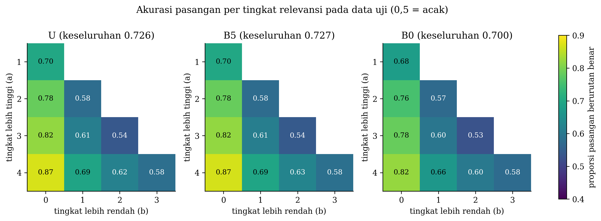

*Gambar 13. Akurasi pasangan per tingkat relevansi pada data uji untuk U, B5, dan B0 (0,5 = acak).*

- **Model pointwise B4 tidak pernah memprediksi tingkat 0** (Gambar 14). Taksiran ln(1 + v)-nya selalu di atas nol, termasuk
  untuk ulasan tanpa suara, sehingga 92,6% ulasan tingkat 0 diprediksi sebagai tingkat 1, dan hanya
  13,9% ulasan uji yang tingkatnya tepat. Regresi pointwise
  menaksir nilai rata-rata, dan pada label yang didominasi nol, nilai itu tidak bisa membedakan ulasan. Hal ini
  menjelaskan mengapa loss berpasangan lebih cocok untuk tugas ini.

**Overfitting dan underfitting.** Kesenjangan antara loss validasi dan loss latih pada epoch terbaik model U kecil,
yaitu 0,020–0,025 di ketiga seed. Setelah epoch terbaik, loss latih terus turun sedangkan loss validasi naik
sedikit, yang menandakan awal overfitting. Early stopping menghentikannya pada epoch 3–4. B2 menunjukkan overfitting
lebih kuat, karena loss latihnya turun ke 0,463 sementara loss validasinya naik ke 0,562 dalam 6 epoch. Tidak ada
tanda underfitting yang jelas, tetapi kenaikan yang kecil dari penambahan data (Tabel 17) menunjukkan bahwa
kinerja lebih dibatasi oleh kebisingan label daripada oleh kapasitas model atau jumlah data.

## 7. Teknologi yang Digunakan

### 7a. Bahasa pemrograman

Python 3.13 (3.13.18 di runtime Google Colab).

### 7b. Library dan versinya

| Library | Kegunaan | Versi minimum (`requirements.txt`) | Versi di Colab |
|---|---|---|---|
| PyTorch | MLP, pelatihan, dan model usia Negative Binomial | 2.2 | 2.14.1 |
| Transformers | Tokenizer dan encoder BLaIR/RoBERTa | 4.40 | 5.22.1 |
| Tokenizers dan huggingface-hub | Tokenisasi BPE dan unduhan model | – | 0.23.3 dan 1.33.0 |
| scikit-learn | TF-IDF, SVD, regresi logistik (B1), spline | 1.4 | 1.6.1 |
| NumPy dan pandas | Pengolahan data | 1.26 dan 2.1 | 2.4.6 dan 2.2.3 |
| PyArrow | Penyimpanan Parquet | 14 | 23.0.1 |
| SciPy | Statistik (uji rasio likelihood, peringkat) | 1.11 | 1.16.3 |
| Matplotlib | Grafik | 3.8 | 3.10.0 |
| orjson | Membaca JSONL dengan cepat | 3.9 | 3.13.0 |
| Gradio | Aplikasi demo | – | 6.31.0 |

Versi di Colab dicatat oleh `laporan/bahan_laporan.ipynb` pada 7 November 2026. Run pipeline dijalankan pada
5–6 November 2026 di runtime GPU Colab yang sama, tetapi versinya tidak dicatat saat itu. Colab dapat memperbarui
library di antara kedua tanggal tersebut.

### 7c. Lingkungan pengembangan dan spesifikasi GPU

Semua eksperimen dijalankan di **Google Colab** dengan runtime GPU **NVIDIA Tesla T4** dan High-RAM. Semua data dan
hasil disimpan di Google Drive. Seluruh pipeline dijalankan dari satu notebook (`notebooks/00_pipeline_lengkap.ipynb`)
yang membawa kode `src/hr` di dalamnya. GPU T4 memiliki memori 16 GB. Bahan laporan (statistik tambahan, grafik,
dan pemeriksaan inferensi) dibuat di runtime CPU Colab dengan prosesor Intel Xeon 2,20 GHz 2 core dan RAM 13,6 GB.
Pengujian cepat dengan data sintetis dilakukan secara lokal tanpa GPU.

**Tabel 20. Waktu komputasi (Video_Games, Google Colab)**

| Tahap | Waktu |
|---|---|
| Seluruh pipeline, dari unduhan hingga grafik | sekitar 8,5 jam |
| Ekstraksi embedding BLaIR, 1.399.115 ulasan | 2,9 jam (134 ulasan per detik) |
| Ekstraksi embedding RoBERTa-base, 1.399.115 ulasan | 3,0 jam (131 ulasan per detik) |
| Satu epoch pelatihan U (E3, sekitar 647.000 pasangan) | 4–5 detik |
| Satu run pelatihan U lengkap dengan early stopping | sekitar 0,5 menit |
| Satu run pelatihan, dari skala E1 hingga E5 | 0,3–1,0 menit |
| Inferensi encoder BLaIR di CPU 2 core | sekitar 2 ulasan per detik |
| Inferensi MLP U di CPU 2 core | sekitar 83.000 ulasan per detik |

Sekitar 6 dari 8,5 jam habis untuk mengubah teks menjadi embedding satu kali. Pelatihan MLP sendiri hanya
membutuhkan waktu kurang dari satu menit per run.

### 7d. Framework aplikasi dan platform hosting

Aplikasi demo menggunakan **Gradio 6.31.0** dan di-hosting di **Hugging Face Spaces** dengan perangkat keras
**ZeroGPU**, di https://huggingface.co/spaces/Nathjsn/pemeringkatan-ulasan-helpful. Kode aplikasi ada di folder
`app/` pada repo GitHub. Alur inferensinya adalah sebagai
berikut.

1. Pengguna memasukkan beberapa ulasan untuk satu produk, masing-masing berisi judul, isi, rating, dan status
   pembelian terverifikasi.
2. Teks dibersihkan dengan fungsi yang sama dengan preprocessing, lalu diubah menjadi embedding oleh BLaIR.
3. Kelima fitur terstruktur dihitung dan distandardisasi dengan rata-rata dan simpangan baku data latih yang
   tersimpan di `split_report.json`.
4. MLP U menghasilkan skor untuk setiap ulasan, dan ulasan ditampilkan dari skor tertinggi.

Alur inferensi ini sudah diperiksa terhadap skor uji yang tersimpan. Fitur terstruktur yang dihitung dari teks
mentah identik dengan nilai tersimpan (selisih maksimum 0). Untuk 300 ulasan uji, skor dari encoder BLaIR yang
dijalankan langsung di CPU hampir sama dengan skor tersimpan, dengan selisih maksimum 0,0018 dan korelasi
Spearman 0,999997. Selisih kecil ini kemungkinan berasal dari perbedaan presisi, karena embedding saat run disimpan dalam fp16. Encoder
adalah bagian paling lambat. Di CPU 2 core, kecepatannya sekitar 2 ulasan per detik, sedangkan MLP memproses
sekitar 83.000 ulasan per detik. Jadi, mengurutkan 20 ulasan satu produk di CPU sejenis membutuhkan sekitar
10 detik.

Karena itu, di Spaces encoder dijalankan di GPU. Akun gratis Hugging Face hanya dapat menjalankan Space Gradio di
ZeroGPU, yang meminjamkan GPU untuk setiap permintaan. Fungsi pengurutan diberi dekorator `@spaces.GPU` dengan
batas 15 detik, dan encoder berjalan dengan presisi fp16 seperti saat ekstraksi embedding di run. Skor di Space
hampir sama dengan skor aplikasi yang dijalankan di CPU lokal (selisih sekitar 0,001). Waktu yang diukur adalah
sebagai berikut.

| Permintaan ke Space | Waktu total | Waktu model |
|---|---|---|
| 5 ulasan, permintaan pertama (GPU dinyalakan) | 5,9–6,2 detik | 0,6 detik |
| 5 ulasan, permintaan berikutnya | 2,5 detik | < 0,1 detik |
| 20 ulasan | 2,9 detik | < 0,1 detik |

Sebagian besar waktu total adalah antrean dan alokasi GPU, bukan perhitungan model. Saat pertama kali dijalankan,
Space mengunduh encoder BLaIR (sekitar 500 MB), dan pembangunan hingga aplikasi berjalan memakan waktu sekitar
70 detik.

⟦ISI: tangkapan layar aplikasi (simpan di gambar/aplikasi_gradio.png)⟧

## 8. Lampiran

### 8a. Cuplikan kode penting

**Preprocessing teks** (`src/hr/data.py`)

```python
def clean_text(s) -> str:
    """Rapikan spasi, hapus karakter kendali dan sisa markup HTML. Huruf kapital, tanda baca,
    angka, dan kata negasi dipertahankan karena dibutuhkan encoder."""
    if not isinstance(s, str):
        return ""
    s = html.unescape(s)
    s = _TAG.sub(" ", s)
    s = _CTRL.sub(" ", s)
    return _WS.sub(" ", s).strip()
```

**Fusi fitur, fitur unik 2** (`src/hr/features.py`)

```python
def fuse(emb: np.ndarray, df: pd.DataFrame, feats) -> np.ndarray:
    """x_i = [e_i ; z_i]. ``emb`` harus sejajar baris dengan ``df``."""
    assert len(emb) == len(df)
    return np.hstack([np.asarray(emb, dtype=np.float16), struct_matrix(df, feats)])
```

**Arsitektur MLP dan loss RankNet** (`src/hr/models.py`)

```python
class Scorer(nn.Module):
    def __init__(self, d_in: int, hidden=(256, 64), dropout: float = 0.2):
        super().__init__()
        layers, prev = [], d_in
        for h in hidden:
            layers += [nn.Linear(prev, h), nn.ReLU(), nn.Dropout(dropout)]
            prev = h
        layers.append(nn.Linear(prev, 1))      # lapisan keluaran tanpa aktivasi
        self.net = nn.Sequential(*layers)

    def forward(self, x: torch.Tensor) -> torch.Tensor:
        return self.net(x.float()).squeeze(-1)


def ranknet_loss(s_hi: torch.Tensor, s_lo: torch.Tensor) -> torch.Tensor:
    return F.softplus(-(s_hi - s_lo)).mean()
```

**Target yang disesuaikan terhadap usia, fitur unik 1** (`notebooks/03_split_dan_target.ipynb`)

```python
f_oof = targets.oof_age_component(tr, best_kind, cfg.n_folds_age, cfg.seed)   # out-of-fold per produk
f_bar = float(f_oof.mean())
f_all = {"train": f_oof, "val": full.f(va["log_age"].to_numpy()), "test": full.f(te["log_age"].to_numpy())}
# y_t3 = ln(1 + v) - (f - f_bar)
```

**Inferensi** (`src/hr/train.py`)

```python
@torch.no_grad()
def predict(model: torch.nn.Module, X, device: str, batch: int = 65536) -> np.ndarray:
    model.eval()
    out = []
    for i in range(0, len(X), batch):
        xb = torch.as_tensor(np.asarray(X[i:i + batch]), device=device)
        out.append(model(xb).float().cpu().numpy())
    s = np.concatenate(out) if out else np.zeros(0)
    if not np.isfinite(s).all():
        raise FloatingPointError(f"{(~np.isfinite(s)).sum()} skor prediksi NaN/inf. Model divergen.")
    return s
```

### 8b. Grafik evaluasi

Grafik evaluasi utama adalah Gambar 8 (perbandingan model), Gambar 9 (kurva loss), Gambar 10 (ablasi dan skala),
Gambar 11 (usia), Gambar 12 (ukuran produk), dan Gambar 13 (akurasi pasangan per tingkat, pengganti confusion
matrix untuk model pemeringkatan). Confusion matrix biasa hanya dapat dibuat untuk model pointwise B4, karena
taksiran ln(1 + v)-nya dapat diubah menjadi tingkat dengan ambang yang sama dengan label.

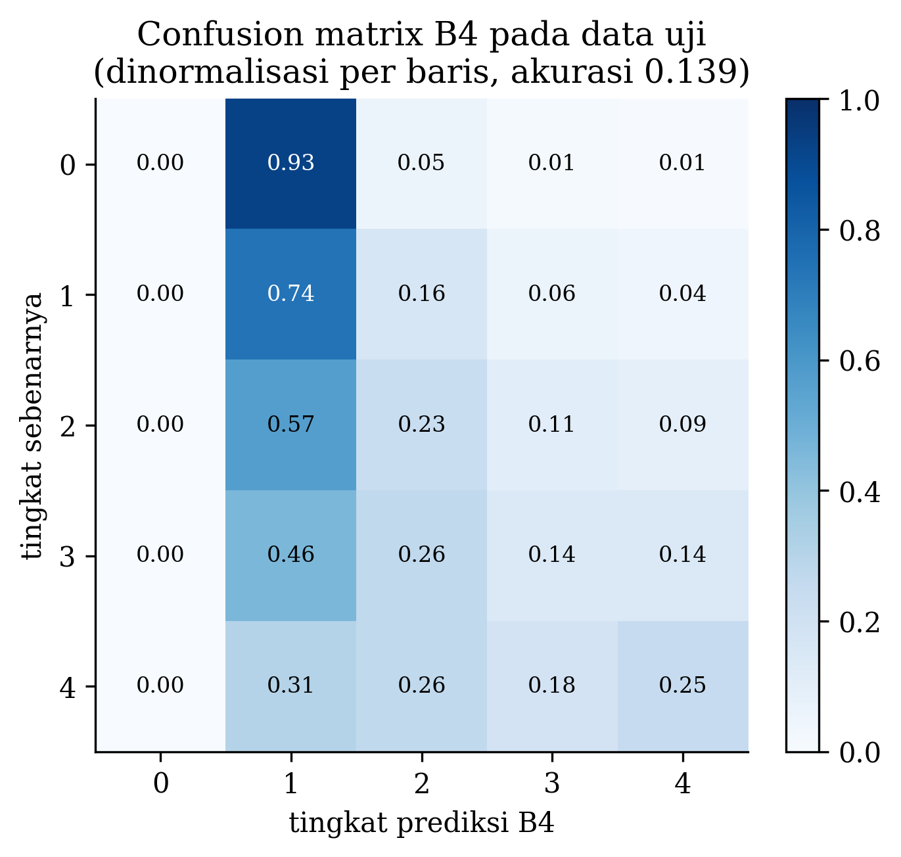

*Gambar 14. Confusion matrix model pointwise B4 pada data uji (proporsi per baris label, gabungan tiga seed).*

## 9. Daftar Pustaka

[1] M. Alzate, M. Arce-Urriza, and J. Cebollada, "Is review visibility fostering helpful votes? The role of review
rank and review characteristics in the adoption of information," *Computers in Human Behavior*, vol. 153,
p. 108088, 2024.

[2] G. Ocampo Diaz and V. Ng, "Modeling and prediction of online product review helpfulness: A survey," in *Proc.
56th Annual Meeting of the Association for Computational Linguistics (Volume 1: Long Papers)*, 2018.

[3] Y. Hou, J. Li, X. Fu, Z. He, A. Yan, X. Chen, and J. McAuley, "Bridging language and items for retrieval and
recommendation: Benchmarking LLMs as semantic encoders," in *Proc. 64th Annual Meeting of the Association for
Computational Linguistics (Volume 1: Long Papers)*, 2026, pp. 3251–3265.

[4] McAuley Lab, UC San Diego, "BLaIR-roberta-base (hyp1231/blair-roberta-base)," Hugging Face model card, 2024.

[5] Y. Liu, M. Ott, N. Goyal, J. Du, M. Joshi, D. Chen, *et al.*, "RoBERTa: A robustly optimized BERT pretraining
approach," arXiv:1907.11692, 2019. ⟦belum ada di Zotero⟧

[6] X. Glorot, A. Bordes, and Y. Bengio, "Deep sparse rectifier neural networks," in *Proc. Fourteenth
International Conference on Artificial Intelligence and Statistics*, PMLR vol. 15, 2011, pp. 315–323.

[7] N. Srivastava, G. Hinton, A. Krizhevsky, I. Sutskever, and R. Salakhutdinov, "Dropout: A simple way to prevent
neural networks from overfitting," *Journal of Machine Learning Research*, vol. 15, pp. 1929–1958, 2014.

[8] C. Burges, T. Shaked, E. Renshaw, A. Lazier, M. Deeds, N. Hamilton, and G. Hullender, "Learning to rank using
gradient descent," in *Proc. 22nd International Conference on Machine Learning (ICML '05)*, 2005.

[9] D. P. Kingma and J. Ba, "Adam: A method for stochastic optimization," in *3rd International Conference on
Learning Representations (ICLR 2015)*, 2015.

[10] T.-Y. Liu, "Learning to rank for information retrieval," *Foundations and Trends in Information Retrieval*,
vol. 3, no. 3, pp. 225–331, 2009.

[11] B. Pittman, E. Buta, S. Krishnan-Sarin, S. S. O'Malley, T. Liss, and R. Gueorguieva, "Models for analyzing
zero-inflated and overdispersed count data: An application to cigarette and marijuana use," *Nicotine & Tobacco
Research*, vol. 22, no. 8, pp. 1390–1398, 2020.

[12] S. M. Mudambi and D. Schuff, "What makes a helpful online review? A study of customer reviews on Amazon.com,"
*MIS Quarterly*, vol. 34, no. 1, pp. 185–200, 2010.

[13] K. Järvelin and J. Kekäläinen, "Cumulated gain-based evaluation of IR techniques," *ACM Transactions on
Information Systems*, vol. 20, no. 4, pp. 422–446, 2002.

[14] C. Spearman, "The proof and measurement of association between two things," *The American Journal of
Psychology*, vol. 15, no. 1, pp. 72–101, 1904.

[15] C. D. Manning, P. Raghavan, and H. Schütze, *Introduction to Information Retrieval*. Cambridge University Press,
2008.

[16] B. Efron and R. J. Tibshirani, *An Introduction to the Bootstrap*. Chapman & Hall, 1993. ⟦belum ada di Zotero⟧

[17] S. Holm, "A simple sequentially rejective multiple test procedure," *Scandinavian Journal of Statistics*,
vol. 6, no. 2, pp. 65–70, 1979. ⟦belum ada di Zotero⟧

<div style="page-break-after: always;"></div>

# Bagian B. Tautan

<!-- Halaman terakhir. Semua tautan harus dapat dibuka tanpa meminta akses. -->

1. **Source code (GitHub):** https://github.com/Vito28/dl-paper ⟦pastikan repo sudah publik sebelum dikumpulkan⟧
