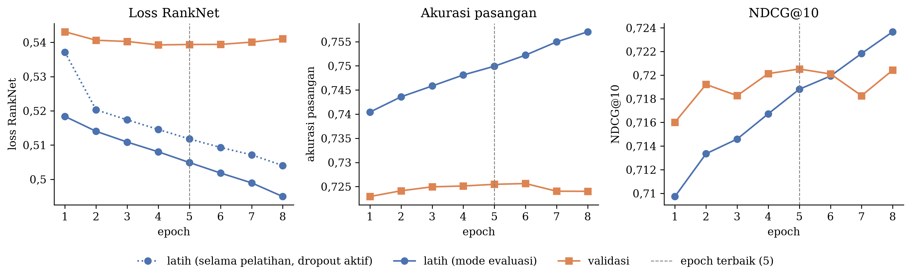
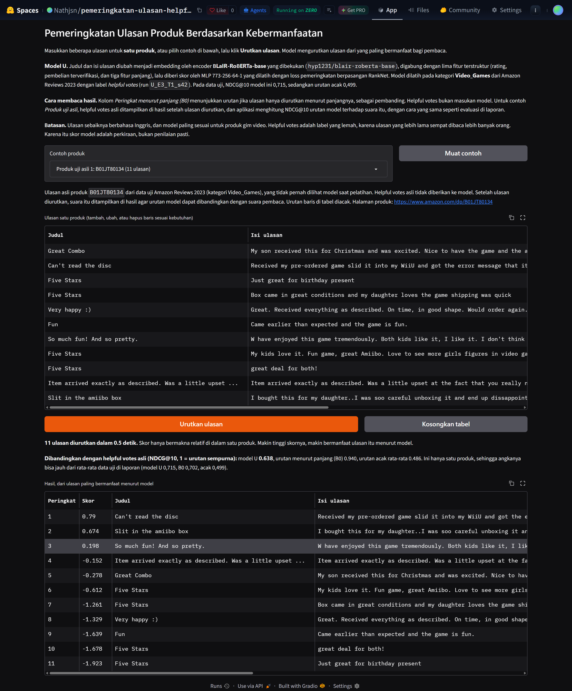
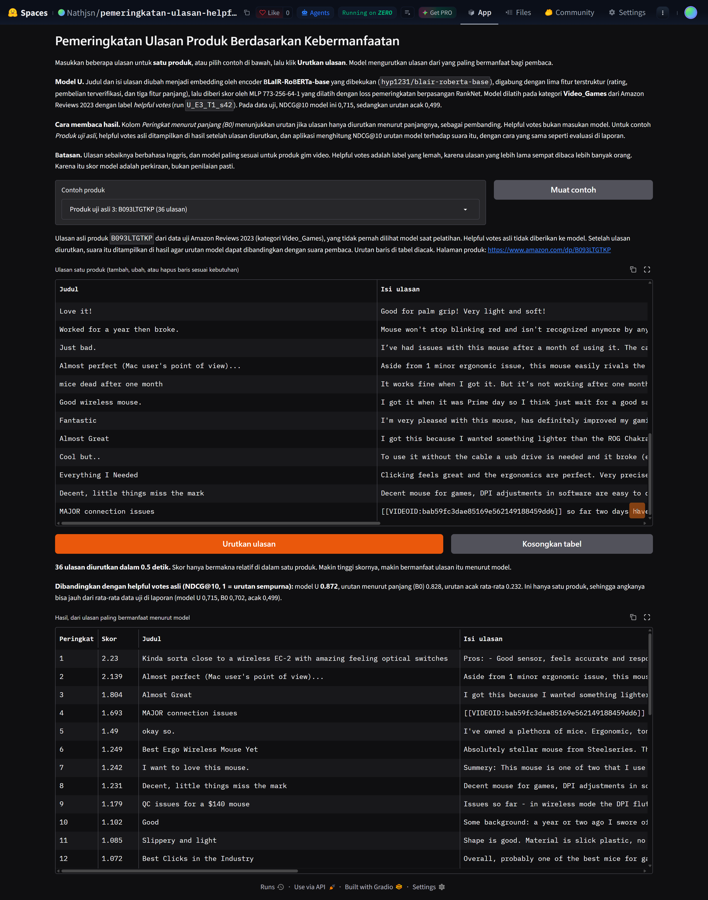

<!--
Laporan tugas mata kuliah Pembelajaran Mendalam, ditulis ulang dari awal (mulai 7 November 2026).
Urutan bagian mengikuti referensi/pedoman/Format Laporan Tugas Pembelajaran Mendalam.pdf.

Aturan isi:
  - Semua angka diambil dari hasil run, yaitu notebooks/FINISHED RUN/hasil_video_games/, keluaran
    bahan_laporan.ipynb (outputs/Video_Games/laporan/ di Drive), dan untuk Subbab 6c notebooks/FINISHED RUN/kurva_latih/
    (pelatihan ulang U seed 42 oleh notebooks/00c_kurva_latih.ipynb). Jangan mengambil teks atau dugaan dari arsip/.
  - Laporan, kode, dan angka harus konsisten di semua artefak.
  - Model dibatasi pada DNN dan CNN.
  - Butir 1c (pengembangan dari Tugas Proyek 2) tidak dipakai karena ini Proyek 1.
  - Gambar disimpan di gambar/ dan dirujuk sebagai gambar/<nama>.png.

Penanda:
  ⟦ISI⟧  bagian yang belum ditulis

Naskah utama yang disunting kelompok adalah LAPORAN.docx (format template Tugas Akhir-Tesis 2026). Berkas Markdown ini
adalah cerminan teksnya dan diperbarui mengikuti LAPORAN.docx setiap kali .docx berubah. Isinya sama,
tetapi strukturnya mengikuti format tugas (bagian 1-9, nomor Gambar dan Tabel berurutan, Subbab 4a), sedangkan .docx
memakai BAB I-VII, Gambar 3.1, Tabel 6.1, dan Lampiran 1-2. Sampul, Abstrak, dan Pembagian Tugas disalin dari .docx.
Terakhir diselaraskan: 7 November 2026, dengan LAPORAN.docx yang di-commit bersama berkas ini.
Istilah: label ditulis *helpful votes* di seluruh laporan (bukan "suara").
Daftar Pustaka: [3] merujuk BLaIR versi 1 (arXiv v1, 2024) karena model BLaIR diperkenalkan di versi itu.

PDF: python tools/build_pdf.py laporan/LAPORAN.md <keluaran.pdf> [--final]. Daftar Isi, Daftar Gambar, dan Daftar
Tabel di PDF dibangun ulang dengan nomor halaman. Opsi --final gagal jika masih ada penanda ⟦…⟧.
-->

# Laporan Proyek Ujian Tengah Semester

- **Judul** : Pemeringkatan *Helpfulness* Ulasan Menggunakan *Embedding* BLaIR dan MLP pada *Dataset* Amazon Reviews 2023
- **Judul (bahasa Inggris)** : Review Helpfulness Ranking Using BLaIR Embeddings and MLP on the Amazon Reviews 2023 Dataset
- **Mata Kuliah** : Pembelajaran Mendalam
- **Semester** : Ganjil
- **TA.** 2026-2027
- **Program Studi** : S-1 Teknik Informatika, Fakultas Informatika, Universitas Mikroskil
- **Nama Kelompok** : SquadFam
- **NIM & Nama Anggota Kelompok** :
  - 231111369 Andrew Senna Wijaya
  - 231111185 Delvin De Vito
  - 231110389 Dickson Yangga
  - 231112380 Elvina Estelita
  - 231110013 Jason Nathanael

<div style="page-break-after: always;"></div>

## Abstrak

Pembaca umumnya hanya membaca beberapa ulasan teratas dari ribuan ulasan sebuah produk populer. Proyek ini mengurutkan ulasan di dalam setiap produk berdasarkan kebermanfaatannya dengan jumlah *helpful votes* sebagai label lemah. Sebanyak 74,7% label bernilai nol, dan nilainya dipengaruhi usia ulasan. Judul dan isi ulasan diubah menjadi vektor oleh *encoder* BLaIR-RoBERTa-base yang dibekukan, digabung dengan lima fitur terstruktur, lalu diberi skor oleh *Multilayer Perceptron* (MLP) yang dilatih dengan *loss* pemeringkatan berpasangan RankNet. Data yang digunakan adalah 4,53 juta ulasan kategori Video_Games dari Amazon Reviews 2023 yang dibagi per produk, dan model utama dilatih pada sekitar 500.000 ulasan. Pada data uji, model mencapai NDCG@10 0,715, jauh di atas urutan acak (0,499). Model ini juga secara signifikan lebih baik daripada lima *baseline* menurut uji *bootstrap* per produk dengan koreksi Holm, meskipun keunggulannya atas TF-IDF dengan MLP tipis. *Encoder* RoBERTa-base asli justru lebih unggul (0,720) daripada BLaIR. Fitur panjang ulasan memberi sumbangan terbesar. Kesalahan terbanyak terjadi pada ulasan pendek, ulasan baru, dan pasangan ulasan dengan selisih *helpful votes* yang kecil. Hasil ini menunjukkan bahwa MLP yang dilatih secara berpasangan di atas *embedding* yang dibekukan efektif dan murah untuk pemeringkatan ulasan, tetapi kinerjanya lebih dibatasi oleh *noise* pada label daripada oleh kapasitas model.

**Kata kunci:** pemeringkatan ulasan, *helpfulness*, RankNet, BLaIR, Amazon Reviews 2023

### Abstract

*Readers usually read only the first few of the thousands of reviews on a popular product. This project ranks reviews within each product by helpfulness, using helpful votes as a weak label. Most reviews (74.7%) have no votes, and vote counts depend on review age. Review titles and texts are encoded by a frozen BLaIR-RoBERTa-base encoder, combined with five structured features, and scored by a Multilayer Perceptron (MLP) trained with the pairwise RankNet loss. The data consist of 4.53 million reviews from the Video_Games category of Amazon Reviews 2023, split by product, and the main model is trained on about 500,000 reviews. On the test set, the model reaches an NDCG@10 of 0.715, far above random ordering (0.499). It also significantly outperforms five baselines according to a per-product bootstrap test with Holm correction, although its margin over TF-IDF with an MLP is small. The original RoBERTa-base encoder scores higher (0.720). Review length features contribute the most, and most errors occur on short reviews, new reviews, and pairs with small vote differences. These results show that a pairwise MLP on frozen embeddings ranks reviews effectively and cheaply, but its performance is limited more by label noise than by model capacity.*

**Keywords:** *review ranking, helpfulness, RankNet, BLaIR, Amazon Reviews 2023*

## Daftar Isi

- Abstrak
- Daftar Gambar
- Daftar Tabel
- Pembagian Tugas
- Bagian A. Laporan Teknis Proyek
  1. Kompleksitas Masalah
  2. *Dataset* yang Digunakan
  3. *Exploratory Data Analysis* (EDA)
  4. *Preprocessing* Data
  5. Model yang Digunakan
  6. Hasil Evaluasi (Akurasi/*Error*)
  7. Teknologi yang Digunakan
  8. Lampiran
  9. Daftar Pustaka
- Bagian B. Tautan

## Daftar Gambar

| No | Judul |
|---|---|
| Gambar 1 | Distribusi helpful_vote (skala log), usia ulasan, jumlah ulasan per produk, dan jumlah kata per ulasan pada seluruh 4.529.152 ulasan bersih |
| Gambar 2 | Distribusi jumlah kata per tingkat relevansi pada data latih E5 |
| Gambar 3 | Histogram fitur numerik pada data latih E5 |
| Gambar 4 | Korelasi Spearman antarfitur pada data latih E5 |
| Gambar 5 | Diagram arsitektur model U |
| Gambar 6 | *Loss* RankNet sebagai fungsi selisih skor pasangan (kiri) dan *loss* MSE *pointwise* untuk *baseline* B4 (kanan) |
| Gambar 7 | NDCG@10 uji dengan IK 95% |
| Gambar 8 | *Loss* RankNet, akurasi pasangan, dan NDCG@10 pada data latih dan validasi per *epoch* (pelatihan ulang model U *seed* 42) |
| Gambar 9 | *Loss* latih dan validasi serta NDCG@10 validasi per *epoch* untuk ketiga *seed* model U, B5, dan B4 (*run* asli) |
| Gambar 10 | Ablasi fitur (kiri) dan pengaruh jumlah ulasan latih (kanan, sumbu logaritmik) dengan IK 95% |
| Gambar 11 | Rasio rata-rata *helpful votes* terhadap ulasan berusia 30 hari, setelah efek produk dan kovariat dikendalikan, dengan IK 95% dari 100 ulangan *bootstrap* per produk (sumbu logaritmik) |
| Gambar 12 | NDCG@10 uji per kelompok usia ulasan untuk ketiga target pelatihan (acuan *helpful votes* mentah) |
| Gambar 13 | NDCG@10 model U dan urutan acak menurut kuartil ukuran produk |
| Gambar 14 | Akurasi pasangan per tingkat relevansi pada data uji untuk U, B5, dan B0 (0,5 = acak) |
| Gambar 15 | Tampilan aplikasi demo di Hugging Face Spaces untuk produk uji asli B01JT80134 (11 ulasan) |
| Gambar 16 | Tampilan aplikasi demo di Hugging Face Spaces untuk produk uji asli B093LTGTKP (36 ulasan) |
| Gambar 17 | *Confusion matrix* model *pointwise* B4 pada data uji (proporsi per baris label, gabungan tiga *seed*) |

## Daftar Tabel

| No | Judul |
|---|---|
| Tabel 1 | Ringkasan *dataset* dan hasil *preprocessing* |
| Tabel 2 | Tingkat relevansi dan distribusinya (proporsi ulasan) |
| Tabel 3 | Jumlah kata per tingkat relevansi (data latih E5) |
| Tabel 4 | Statistik fitur numerik (data latih E5, 1.000.000 ulasan) |
| Tabel 5 | Rata-rata *helpful votes* per kuintil usia ulasan (seluruh data, K1 sampai K5) |
| Tabel 6 | Contoh ulasan per tingkat relevansi (data latih E5, dipilih acak dengan *seed* 42) |
| Tabel 7 | Temuan EDA dan keputusan *preprocessing* atau pemodelan |
| Tabel 8 | Pembagian data dan skala data latih |
| Tabel 9 | Daftar model utama, *baseline*, dan model ablasi |
| Tabel 10 | Arsitektur model U |
| Tabel 11 | Konfigurasi pelatihan model U |
| Tabel 12 | NDCG@10 uji per konfigurasi ablasi (skala E3, rata-rata tiga *seed*) |
| Tabel 13 | Selisih NDCG@10 berpasangan U terhadap model ablasi (uji, 3.827 produk) |
| Tabel 14 | Padanan metrik pada format laporan dengan metrik yang digunakan |
| Tabel 15 | Metrik evaluasi |
| Tabel 16 | Hasil pada data uji (skala E3, target T1, rata-rata *seed*, IK 95% *bootstrap* per produk) |
| Tabel 17 | Selisih NDCG@10 berpasangan U terhadap *baseline* (uji) |
| Tabel 18 | Ringkasan pelatihan (skala E3, target T1, rata-rata tiga *seed*) |
| Tabel 19 | Penalaan hiperparameter model U (NDCG@10 validasi, *seed* 42) |
| Tabel 20 | Pengaruh jumlah data latih (model U, target T1, NDCG@10 uji) |
| Tabel 21 | Strategi target pada dua acuan relevansi (model U, E3, NDCG@10 uji) |
| Tabel 22 | Kinerja U per kelompok (NDCG@10 uji, acuan *helpful votes* mentah) |
| Tabel 23 | *Library* dan versinya |
| Tabel 24 | Waktu komputasi (Video_Games, Google Colab) |
| Tabel 25 | Waktu permintaan ke aplikasi di Hugging Face Spaces |

## Pembagian Tugas

| NIM | Nama | Peran | Rincian Pekerjaan |
|---|---|---|---|
| 231111369 | Andrew Senna Wijaya | Pemodelan dan dokumentasi | Pembagian data, pembentukan target, dan model hitung usia (bersama Elvina). RoBERTa-base dan MLP (bersama Jason). Dokumentasi (bersama Delvin dan Dickson). |
| 231111185 | Delvin De Vito | *Baseline* dan dokumentasi | *Baseline* (TF-IDF) dan BLaIR-RoBERTa-base (bersama Jason). Dokumentasi (bersama Dickson dan Andrew). |
| 231110389 | Dickson Yangga | Data dan dokumentasi | Pengumpulan data dan *preprocessing* (bersama Elvina). Dokumentasi (bersama Delvin dan Andrew). |
| 231112380 | Elvina Estelita | Data dan target | Pengumpulan data dan *preprocessing* (bersama Dickson). Pembagian data, pembentukan target, dan model hitung usia (bersama Andrew). |
| 231110013 | Jason Nathanael | Pemodelan | *Baseline* (TF-IDF) dan BLaIR-RoBERTa-base (bersama Delvin). RoBERTa-base dan MLP (bersama Andrew). |

<div style="page-break-after: always;"></div>

# Bagian A. Laporan Teknis Proyek

## 1. Kompleksitas Masalah

Produk populer di toko daring dapat memiliki ratusan hingga ribuan ulasan, padahal pembaca umumnya hanya membaca
beberapa ulasan teratas. Proyek ini membangun model yang **mengurutkan ulasan secara terpisah untuk setiap produk** berdasarkan
tingkat kebermanfaatannya (*helpfulness*) sehingga ulasan yang paling bermanfaat ditampilkan lebih awal. Ukuran
kebermanfaatan yang tersedia adalah jumlah *helpful votes*, yaitu jumlah pengguna yang menandai
suatu ulasan sebagai bermanfaat. Model yang dilatih adalah *Deep Neural Network* (DNN) berupa *Multilayer Perceptron*
(MLP) dengan *loss* pemeringkatan berpasangan RankNet. Sebelum pelatihan, teks setiap ulasan diubah menjadi vektor
oleh *encoder* BLaIR (*Bridging Language and Items for Retrieval and Recommendation*) yang tidak dilatih (*frozen*,
bobotnya tidak diperbarui), sebagai tahap vektorisasi teks.

### 1a. Mengapa masalah ini kompleks

1. **Label berupa *weak label* dan sangat tidak seimbang.** Sebanyak 74,7% ulasan tidak memiliki satu pun *helpful vote*, dan
   22,2% produk tidak memiliki ulasan dengan *helpful votes* sama sekali. Ulasan tanpa *helpful votes* belum tentu tidak bermanfaat. Ada
   kemungkinan ulasan tersebut belum cukup banyak dilihat oleh pengguna sehingga belum sempat dinilai. Selain itu,
   distribusi jumlah *helpful votes* bersifat *long-tailed* dengan nilai maksimum 10.369 *helpful votes*.
2. **Label dipengaruhi lamanya ulasan tampil.** Ulasan lama berkesempatan dilihat oleh lebih banyak pengguna. Rata-rata *helpful votes*
   ulasan pada kuintil usia terlama adalah 2,60, sedangkan pada kuintil terbaru 0,62 (Tabel 5). Penelitian
   sebelumnya juga menunjukkan bahwa visibilitas ulasan memengaruhi jumlah *helpful votes*-nya [1].
3. **Tugasnya pemeringkatan, bukan klasifikasi.** Penilaian dilakukan terhadap urutan ulasan dalam satu produk. Nilai *helpful votes* tidak dapat dibandingkan antarproduk karena produk populer mengumpulkan jauh lebih banyak *helpful votes*.
4. **Teks berdimensi tinggi dan beragam.** Sifat teks seperti panjang dan kedalaman ulasan telah lama digunakan untuk
   memprediksi kebermanfaatan ulasan [2]. Panjang ulasan berkisar dari satu kata hingga ribuan kata. Setiap ulasan
   diubah menjadi vektor 768 dimensi.
5. **Skala data besar.** Data mentah berisi 4,62 juta ulasan (2,68 GB), dan ekstraksi *embedding* untuk 1,4 juta
   ulasan membutuhkan sekitar 2,9–3,0 jam per *encoder* pada *Graphics Processing Unit* (GPU) T4.

### 1b. Tantangan utama

- **Mencegah *data leakage*.** Ulasan dari produk yang sama cenderung sangat mirip dan sering kali memuat teks yang sama. Pembagian data
  dilakukan per produk, lalu ulasan validasi dan uji yang teksnya identik dengan ulasan latih dibuang (Subbab 4e).
- **Memisahkan kualitas ulasan dari efek usia.** Ulasan lama yang memperoleh lebih banyak *helpful votes* belum tentu lebih
  bermanfaat. Oleh karena itu, proyek ini mengukur hubungan antara usia ulasan (selisih hari antara tanggal ulasan
  dan tanggal ulasan terbaru dalam *dataset*) dan jumlah *helpful votes* yang diterimanya menggunakan model regresi
  *Negative Binomial*. Model ini juga memperhitungkan efek produk serta kovariat rating, status pembelian
  terverifikasi, dan panjang isi ulasan. Hasilnya digunakan untuk membentuk target yang disesuaikan
  terhadap usia, yang kemudian dibandingkan dengan target mentah (Subbab 6d).
- **Memastikan bahwa model benar-benar mempelajari pola.** Pada produk dengan sedikit ulasan, urutan acak pun telah
  memperoleh nilai *Normalized Discounted Cumulative Gain* (NDCG) yang tinggi. Oleh karena itu, setiap hasil
  dibandingkan dengan urutan acak (R0) dan *baseline* panjang ulasan (B0), serta diuji secara statistik.
- **Biaya komputasi.** *Encoder* dibuat *frozen* sehingga teks hanya perlu diubah menjadi *embedding* satu kali, dan pelatihan
  MLP hanya memerlukan beberapa detik per *epoch* (Tabel 24).

### 1c. Pengembangan dari Tugas Proyek 2

Tidak berlaku. Laporan ini adalah Proyek 1 dan tidak melanjutkan Tugas Proyek 2 sehingga tidak ada bagian yang ditambah, diperbaiki, atau diganti dari tugas tersebut.

## 2. *Dataset* yang Digunakan

### 2a. Sumber *dataset*

*Dataset* yang digunakan adalah **Amazon Reviews 2023** dari McAuley Lab, UC San Diego [3], kategori **Video_Games**,
bagian *User Reviews* (https://amazon-reviews-2023.github.io). Berkas diunduh dari repositori Hugging Face
https://huggingface.co/datasets/McAuley-Lab/Amazon-Reviews-2023 (berkas `raw/review_categories/Video_Games.jsonl`) pada
5 November 2026. Ukuran dan
*checksum* SHA-256 (*Secure Hash Algorithm* 256-bit) berkas dicatat di `manifest_raw.json` agar unduhan ulang dapat diverifikasi.

### 2b. Jumlah data, label, format, dan ukuran

**Tabel 1. Ringkasan *dataset* dan hasil *preprocessing***

| Keterangan | Nilai |
|---|---|
| Format | JSON Lines (JSONL), yaitu format *JavaScript Object Notation* (JSON) dengan satu ulasan per baris |
| Ukuran berkas | 2,68 GB (2.682.948.518 *byte*) |
| Jumlah baris mentah | 4.624.615 ulasan |
| Jumlah setelah *preprocessing* | 4.529.152 ulasan dari 98.951 produk |
| Rentang waktu ulasan | 17 November 1998 sampai 12 September 2023 |
| Ulasan per produk | median 7, persentil ke-99 sebanyak 708 |
| Atribut yang dibaca | `rating`, `title`, `text`, `asin`, `parent_asin`, `user_id`, `timestamp`, `helpful_vote`, `verified_purchase` |
| Masukan model | teks judul dan isi ulasan (menjadi *embedding* 768 dimensi) dan 5 fitur terstruktur |
| Label | `helpful_vote` (bilangan bulat ≥ 0) |

Atribut `asin` adalah ASIN (*Amazon Standard Identification Number*), yaitu kode identifikasi untuk setiap varian
produk, sedangkan `parent_asin` adalah kode produk induk yang menghimpun seluruh variannya.

**Label.** Target pelatihan adalah T1 = ln(1 + helpful_vote). Logaritma memperkecil pengaruh *long tail* tanpa mengubah
urutan. Untuk evaluasi, target diubah menjadi lima **tingkat relevansi** (Tabel 2). Batasnya adalah 0 dan kuartil
target positif pada data latih sehingga tingkat 0 sampai 4 berarti 0, 1, 2, 3, dan sedikitnya 4 *helpful votes*. Ulasan
dianggap relevan untuk *Mean Average Precision* (MAP) jika tingkatnya ≥ 2. Ambang ini ditetapkan sebelum eksperimen.

**Tabel 2. Tingkat relevansi dan distribusinya (proporsi ulasan)**

| Tingkat | Arti | Latih (E5) | Validasi | Uji |
|---|---|---|---|---|
| 0 | 0 *helpful votes* | 0,713 | 0,718 | 0,699 |
| 1 | 1 *helpful vote* | 0,138 | 0,139 | 0,139 |
| 2 | 2 *helpful votes* | 0,051 | 0,050 | 0,052 |
| 3 | 3 *helpful votes* | 0,026 | 0,025 | 0,029 |
| 4 | ≥ 4 *helpful votes* | 0,072 | 0,067 | 0,080 |

E5 adalah data latih skala terbesar (1.000.000 ulasan). Skala data latih E1 sampai E5 dijelaskan pada Subbab 2d
dan Tabel 8.

### 2c. *Real-world* atau sintetis

Data ini merupakan data *real-world*. Ulasan ditulis oleh pengguna Amazon, dan *helpful votes* diberikan oleh
pengguna platform tersebut yang menandai suatu ulasan sebagai bermanfaat.

### 2d. Kompleksitas *dataset*

*Dataset* ini kompleks karena (1) labelnya berupa *weak label* dan didominasi nol, (2) labelnya bergantung pada usia ulasan,
(3) ukuran produk sangat timpang, dari dua ulasan hingga belasan ribu ulasan per produk, dan (4) teksnya bebas dengan
panjang yang sangat bervariasi. Selain itu, datanya besar. Untuk menekan biaya komputasi, data latih dibatasi pada skala E1
sampai E5 (100.000 sampai 1.000.000 ulasan), dan data validasi dan uji masing-masing dibatasi sekitar 200.000
ulasan dengan mengambil produk utuh secara acak (Tabel 8).

## 3. *Exploratory Data Analysis* (EDA)


*Gambar 1. Distribusi helpful_vote (skala log), usia ulasan, jumlah ulasan per produk, dan jumlah kata per ulasan
pada seluruh 4.529.152 ulasan bersih.*

### 3a. Distribusi label

Gambar 1 (kiri atas) dan Tabel 2 menunjukkan bahwa label sangat tidak seimbang. Sebanyak 74,7% ulasan bernilai
nol, mediannya 0, rata-ratanya 1,23, persentil ke-99 sebanyak 18 *helpful votes*, dan maksimumnya 10.369 *helpful votes*. Sebanyak
22,2% produk tidak memiliki ulasan dengan *helpful votes* sama sekali. Produk seperti ini tidak dapat dinilai dengan NDCG karena
nilai *Ideal Discounted Cumulative Gain* (IDCG), yaitu nilai DCG pada urutan ideal, bernilai nol sehingga NDCG tidak terdefinisi (Subbab 6a).

### 3b. Jumlah kata

Jumlah kata per ulasan sangat bervariasi (Gambar 1, kanan bawah). Banyak ulasan hanya berisi beberapa kata,
seperti "Five Stars", sedangkan sebagian lain berisi ratusan kata. Pada sampel 50.000 ulasan, median panjang
setelah tokenisasi RoBERTa (*Robustly Optimized BERT Pretraining Approach*), yaitu pengembangan dari BERT
(*Bidirectional Encoder Representations from Transformers*), adalah 39 token dan persentil ke-95 sebanyak 264 token. Hanya 1,6% ulasan yang
melebihi batas 512 token *encoder* dan terpotong.

Jumlah kata meningkat tajam seiring tingkat relevansi (Tabel 3 dan Gambar 2). Median jumlah kata ulasan tanpa
*helpful votes* adalah 20, sedangkan ulasan dengan sedikitnya 4 *helpful votes* memiliki median 111 kata. Panjang ulasan merupakan
indikator kuat kebermanfaatan.

**Tabel 3. Jumlah kata per tingkat relevansi (data latih E5)**

| Kelompok | Jumlah ulasan | Rata-rata | Median | P5 | P25 | P75 | P95 | Maksimum |
|---|---|---|---|---|---|---|---|---|
| Semua | 1.000.000 | 58,7 | 25 | 2 | 10 | 60 | 220 | 5.915 |
| Tingkat 0 | 712.571 | 36,5 | 20 | 2 | 7 | 41 | 125 | 5.002 |
| Tingkat 1 | 138.171 | 72,2 | 38 | 4 | 18 | 83 | 247 | 5.261 |
| Tingkat 2 | 50.939 | 104,5 | 58 | 7 | 26 | 120 | 356 | 5.881 |
| Tingkat 3 | 26.497 | 128,2 | 74 | 10 | 34 | 152 | 426 | 3.783 |
| Tingkat 4 | 71.822 | 194,5 | 111 | 14 | 51 | 236 | 661 | 5.915 |

P5, P25, P75, dan P95 menyatakan persentil ke-5, ke-25, ke-75, dan ke-95.


*Gambar 2. Distribusi jumlah kata per tingkat relevansi pada data latih E5.*

### 3c. Histogram fitur numerik

Lima fitur terstruktur masukan model adalah `rating`, `verified_purchase`, serta logaritma panjang isi (karakter),
jumlah kata, dan panjang judul. Tabel 4 memuat statistik fitur mentahnya pada data latih E5. Rating sangat
condong ke bintang 5 (median 5), 85% ulasan berasal dari pembelian terverifikasi, dan ketiga fitur panjang sangat
miring ke kanan. Median panjang isi adalah 134 karakter, tetapi maksimumnya 31.825 karakter. Oleh karena itu, fitur
panjang diubah dengan ln(1 + x) sebelum distandardisasi (Subbab 4b).

**Tabel 4. Statistik fitur numerik (data latih E5, 1.000.000 ulasan)**

| Fitur | Rata-rata | Simpangan baku | Min | Kuartil 1 | Median | Kuartil 3 | Maks |
|---|---|---|---|---|---|---|---|
| rating | 4,02 | 1,43 | 1 | 3 | 5 | 5 | 5 |
| verified_purchase | 0,85 | 0,36 | 0 | 1 | 1 | 1 | 1 |
| panjang isi (karakter) | 315,4 | 634,4 | 1 | 51 | 134 | 318 | 31.825 |
| jumlah kata | 58,7 | 115,4 | 1 | 10 | 25 | 60 | 5.915 |
| panjang judul (karakter) | 22,9 | 17,4 | 0 | 10 | 17 | 30 | 605 |
| helpful_vote (label) | 1,25 | 8,08 | 0 | 0 | 0 | 1 | 1.662 |


*Gambar 3. Histogram fitur numerik pada data latih E5.*

### 3d. Korelasi antarfitur

Korelasi Spearman antara usia ulasan dan helpful_vote pada seluruh data adalah 0,19. Usia tidak digunakan sebagai
fitur masukan model karena model harus dapat menilai ulasan baru. Usia hanya digunakan untuk analisis dan untuk
skenario target yang disesuaikan terhadap usia (Subbab 6d). Pada model *Negative Binomial* dengan efek produk, koefisien terstandardisasi
ln(1 + panjang isi) adalah +1,14, jauh lebih besar daripada rating (−0,18) dan verified_purchase (+0,01). Ulasan
yang lebih panjang cenderung memperoleh lebih banyak *helpful votes*.

Korelasi Spearman (ρ) antarfitur pada data latih E5 (Gambar 4) menunjukkan empat hal.
1. Panjang isi dan jumlah kata hampir identik (ρ = 0,997). Panjang judul berkorelasi sedang dengan keduanya
   (ρ ≈ 0,50).
2. Fitur yang paling berkorelasi dengan helpful_vote adalah panjang isi (ρ = 0,397), jumlah kata (0,396), dan
   panjang judul (0,203).
3. Fitur verified_purchase (ρ = −0,215) dan rating (−0,142) berkorelasi negatif lemah dengan helpful_vote. Ulasan
   dengan rating rendah dan ulasan dari pembelian tidak terverifikasi cenderung sedikit lebih sering dinilai
   bermanfaat.
4. Usia berkorelasi dengan helpful_vote (ρ = 0,202) dan dengan panjang isi (0,181). Karena ulasan lama cenderung
   lebih panjang, efek usia perlu diukur bersama panjang ulasan, seperti pada model *Negative Binomial*.


*Gambar 4. Korelasi Spearman antarfitur pada data latih E5. Tanda bintang menandai kolom yang tidak menjadi fitur
model (usia dan label).*

**Tabel 5. Rata-rata *helpful votes* per kuintil usia ulasan (seluruh data, K1 sampai K5)**

| Kuintil usia | Jumlah ulasan | Rata-rata *helpful votes* | Proporsi nol |
|---|---|---|---|
| K1 (terbaru) | 905.831 | 0,62 | 80,1% |
| K2 | 905.830 | 0,93 | 82,5% |
| K3 | 905.830 | 1,17 | 76,6% |
| K4 | 905.830 | 0,85 | 78,2% |
| K5 (terlama) | 905.831 | 2,60 | 56,2% |

### 3e. Contoh sampel data per kelas

Tabel 6 memuat dua ulasan acak dari setiap tingkat relevansi pada data latih E5.

**Tabel 6. Contoh ulasan per tingkat relevansi (data latih E5, dipilih acak dengan *seed* 42)**

| Tingkat | *Helpful votes* | Rating | Terverifikasi | Kata | Judul | Cuplikan isi |
|---|---|---|---|---|---|---|
| 0 | 0 | 5 | ya | 2 | Five Stars | Muy bueno |
| 0 | 0 | 5 | ya | 18 | Great! | Sturdy case, and it holds 29 games and 2 tiny extra slots. ... |
| 1 | 1 | 5 | ya | 6 | Five Stars | This Disney infinity character is awesome. |
| 1 | 1 | 5 | ya | 4 | Five Stars | Love using this trap! |
| 2 | 2 | 4 | tidak | 275 | Extremely Playable | Maybe it is not fair reviewing this before I saw EA's hockey game for this season. ... |
| 2 | 2 | 2 | ya | 93 | Hyped | I'm not deducting points for it being buggy, but the mechanics of the game are trash. ... |
| 3 | 3 | 5 | tidak | 407 | Addictive game for a non-gamer | I'm coming clean. For years my wife and I attempted to take the stance that Video Games were not ... |
| 3 | 3 | 5 | ya | 97 | Perfect Replacement. Shame on Nintendo for ever inventing this. | Perfect replacement. Its a real shame Nintendo is using such a crappy and poorly tested power connector. ... |
| 4 | 5 | 1 | tidak | 9 | Wait | Wait for patch, to many glitches in both games. |
| 4 | 14 | 5 | ya | 5 | Shipped fast. Works great. | No issues. Works as expected. |

Contoh ini memperlihatkan pola umum sekaligus adanya *label noise*. Ulasan tingkat 2 dan 3 umumnya panjang dan
menjelaskan alasannya, sedangkan tingkat 0 dan 1 didominasi ulasan sangat pendek seperti "Five Stars". Namun,
kedua contoh tingkat 4 justru pendek, termasuk "Shipped fast. Works great." dengan 14 *helpful votes*. Hal ini menunjukkan bahwa
jumlah *helpful votes* tidak selalu mencerminkan isi ulasan.

### 3f. Temuan EDA yang memengaruhi *preprocessing*

**Tabel 7. Temuan EDA dan keputusan *preprocessing* atau pemodelan**

| Temuan | Keputusan *preprocessing* atau pemodelan |
|---|---|
| Distribusi label *long-tailed* (maksimum 10.369) | Target menggunakan ln(1 + v), dan evaluasi menggunakan lima tingkat relevansi |
| 74,7% ulasan bernilai nol | Pasangan latih hanya dibentuk dari ulasan dengan jumlah *helpful votes* berbeda (fitur unik 1). Produk tanpa ulasan dengan *helpful votes* tidak ikut dalam NDCG. |
| Ulasan terlama (kuintil K5) memperoleh *helpful votes* jauh lebih banyak | Usia tidak menjadi fitur. Target alternatif yang disesuaikan terhadap usia dibandingkan (Subbab 6d). |
| Panjang ulasan berkaitan kuat dengan *helpful votes* | Panjang ulasan menjadi fitur terstruktur dan *baseline* B0 (fitur unik 2) |
| Ukuran produk sangat timpang | Paling banyak 200 ulasan per produk di data latih, dan metrik dihitung per produk lalu dirata-ratakan |
| Hanya 1,6% ulasan melebihi 512 token | Batas panjang *encoder* 512 token telah memadai |
| Teks memuat sisa *HyperText Markup Language* (HTML) dan karakter kendali | Teks dibersihkan tanpa mengubah huruf dan tanda baca (Subbab 4a) |

## 4. *Preprocessing* Data

### 4a. Pembersihan data

Urutan langkahnya adalah sebagai berikut.

1. **Tipe dan rentang nilai.** Baris dengan rating di luar 1–5, helpful_vote kosong atau negatif, atau
   verified_purchase tidak valid dibuang. Hanya satu baris yang dibuang. Kode berhenti dengan *error* jika lebih dari
   5% baris tidak valid karena hal itu menandakan format berkas berbeda dari yang diharapkan.
2. **Satuan *timestamp*.** Satuan milidetik dan detik dicoba, lalu dipilih yang seluruh tanggalnya berada pada
   rentang *dataset* (1995–2023). Satuan milidetik terpilih karena seluruh data (100%) berada pada rentang yang valid.
3. **Normalisasi teks.** Entitas HTML diubah menjadi karakter biasa, *tag* HTML dan karakter kendali dihapus, dan
   spasi berlebih dirapikan. Huruf kapital, tanda baca, angka, dan kata negasi tidak diubah karena *encoder*
   Transformer memanfaatkannya.
4. **Teks kosong.** Sebanyak 3.618 baris tanpa isi ulasan (setelah normalisasi) atau tanpa parent_asin dibuang.
5. **Duplikat.** Sebanyak 53.599 baris dengan user_id, parent_asin, timestamp, dan teks yang sama dibuang.
6. **Produk kecil.** Sebanyak 38.245 ulasan dari produk dengan kurang dari dua ulasan dibuang karena pemeringkatan
   membutuhkan sedikitnya dua ulasan.

Hasil akhirnya adalah 4.529.152 ulasan dari 98.951 produk. Label tidak dikoreksi karena helpful_vote merupakan data
pengamatan sebagaimana adanya. *Label noise* ditangani melalui target dan evaluasi (Subbab 4d dan 6a).

### 4b. Normalisasi, standardisasi, dan representasi teks

- **Representasi teks.** Judul dan isi ditokenisasi sebagai pasangan teks dengan *tokenizer* BPE (*byte-pair
  encoding*) RoBERTa, dengan panjang maksimum 512 token. Judul dibatasi paling banyak 64 kata, dan jika pasangan
  melebihi 512 token, yang dipotong hanya bagian isi. Untuk *baseline* berbasis *Term Frequency–Inverse Document Frequency* (TF-IDF), yaitu B1 dan B2, judul dan isi digabung
  menjadi satu teks "judul . isi". *Stemming*, lemmatisasi, dan penghapusan
  *stopword* **tidak** dilakukan karena *pretrained encoder*, yaitu *encoder* yang telah dilatih sebelumnya pada teks alami berskala besar,
  memerlukan struktur kalimat yang utuh. Vektor representasi diambil dari *hidden state* lapisan terakhir *encoder* BLaIR pada token pertama
  (`<s>`), yang kemudian dinormalisasi dengan norma L2 menjadi vektor 768 dimensi.
- **Fitur turunan.** Panjang isi (karakter), jumlah kata, dan panjang judul diubah dengan ln(1 + x) karena
  distribusinya sangat miring.
- **Standardisasi.** Kelima fitur terstruktur diubah menjadi skor-z, (x − rata-rata) / simpangan baku. Rata-rata
  dan simpangan baku dihitung **hanya dari data latih**, yaitu seluruh partisi latih setelah transformasi
  ln(1 + x) (Subbab 4e), sehingga nilainya berbeda dari statistik fitur mentah pada Tabel 4.
- **Usia ulasan** dihitung sebagai selisih hari dari *timestamp* terbaru di *dataset* (12 September 2023). Usia hanya
  digunakan untuk analisis dan penyesuaian target, bukan sebagai fitur model.

### 4c. Augmentasi data

Tidak ada augmentasi. Mengubah teks ulasan, misalnya dengan sinonim atau *back-translation*, juga mengubah
kualitasnya sehingga labelnya tidak lagi sesuai dengan teks yang baru.

### 4d. *Missing value*, *outlier*, dan ketidakseimbangan kelas

- ***Missing value*.** Baris tanpa teks atau tanpa parent_asin dibuang (3.618 baris). Judul yang tidak tersedia diisi
  dengan *string* kosong.
- ***Outlier*.** Nilai *helpful votes* ekstrem tidak dibuang karena merupakan pengamatan sah. Pengaruhnya diperkecil dengan
  transformasi ln(1 + v) dan pembagian ke lima tingkat relevansi. Ukuran produk yang ekstrem dibatasi paling banyak
  200 ulasan per produk di data latih.
- **Ketidakseimbangan.** Ketidakseimbangan label ditangani oleh pelatihan berpasangan (fitur unik 1, Subbab 5e).
  Setiap pasangan terdiri atas dua ulasan dari produk
  yang sama dengan target **berbeda** sehingga mayoritas ulasan bernilai nol tidak menghasilkan pasangan dengan
  target sama. Paling banyak 100 pasangan diambil per produk per *epoch* agar produk besar tidak mendominasi. Pada
  skala E3, cara ini menghasilkan sekitar 647.000 pasangan per *epoch* dari 14.748 produk, sedangkan 4.452 produk
  lainnya tidak menghasilkan pasangan karena semua ulasannya memiliki jumlah *helpful votes* yang sama. Pada evaluasi, metrik dihitung per
  produk lalu dirata-ratakan sehingga produk besar tidak mendominasi.

### 4e. Pembagian data dan pencegahan *data leakage*

Data dibagi **per produk** (`parent_asin`) dengan proporsi 80/10/10 untuk latih, validasi, dan uji. Semua ulasan
dari satu produk berada di partisi yang sama sehingga model diuji pada produk yang belum pernah dilihat. Proporsi
80/10/10 berlaku untuk produk. Karena data latih dibatasi pada skala E1 sampai E5 dan data validasi serta uji dibatasi
sekitar 200.000 ulasan, jumlah ulasan yang dipakai pada skala utama E3 adalah 499.999 (latih), 199.189 (validasi), dan
199.926 (uji).

Pencegahan *data leakage* dilakukan sebagai berikut.

1. Tidak ada parent_asin yang muncul di dua partisi. Hal ini diperiksa secara otomatis, dan tidak ditemukan satu pun tumpang tindih.
2. Tidak ada asin (varian produk) yang muncul di dua partisi.
3. Ulasan validasi dan uji yang teksnya identik dengan ulasan latih (tanpa membedakan huruf kapital) dibuang (113.237 ulasan) karena teks
   pendek yang umum seperti "Great game" muncul di banyak produk. Sebanyak 792 ulasan lagi dibuang karena produknya
   tersisa kurang dari dua ulasan.
4. Standardisasi, TF-IDF, *Singular Value Decomposition* (SVD), model usia, dan ambang tingkat relevansi hanya diestimasi dari data latih.
5. Data uji hanya dievaluasi satu kali, setelah semua hiperparameter dipilih berdasarkan data validasi.

**Tabel 8. Pembagian data dan skala data latih**

| Partisi | Ulasan | Produk | Proporsi bernilai nol |
|---|---|---|---|
| Latih E1 | 100.000 | 3.777 | 0,706 |
| Latih E2 | 250.000 | 9.773 | 0,708 |
| **Latih E3 (skala utama)** | **499.999** | **19.200** | **0,712** |
| Latih E4 | 750.000 | 28.357 | 0,712 |
| Latih E5 | 1.000.000 | 38.068 | 0,713 |
| Validasi | 199.189 | 5.094 | 0,718 |
| Uji | 199.926 | 4.816 | 0,699 |

Skala E1 sampai E5 bersarang, yaitu E1 merupakan bagian dari E2, dan seterusnya. Dengan demikian, perbedaan kinerja
antarskala hanya berasal dari jumlah data. E3 berisi 499.999, bukan 500.000 ulasan, karena satu produk hanya terambil
satu ulasan di batas skala. Produk itu dibuang karena pemeringkatan membutuhkan sedikitnya dua ulasan per produk.

## 5. Model yang Digunakan

### 5a. Jenis model

Model yang dilatih adalah ***Deep Neural Network*** **(DNN)** berupa *Multilayer Perceptron* (MLP) yang memberi skor pada
setiap ulasan. Model utama ini selanjutnya disebut model U. Semua parameter yang dilatih berada di MLP.

Sebelum masuk ke MLP, teks ulasan diubah menjadi vektor oleh **BLaIR-RoBERTa-base** (`hyp1231/blair-roberta-base`)
[3], [4], yaitu *pretrained encoder* Transformer berarsitektur RoBERTa-base [5] (12 lapisan Transformer, 12
*attention head*, dimensi 768, dan 124,1 juta parameter). *Encoder* ini tidak dilatih (*frozen*) dan dijalankan satu
kali sebelum pelatihan sehingga perannya sama dengan tahap vektorisasi teks seperti TF-IDF pada *baseline* B1 dan
B2 (Subbab 4b). Pola ini setara dengan *transfer learning* yang diizinkan untuk *Convolutional Neural Network* (CNN),
yaitu *pretrained backbone* yang dibekukan dengan *head* yang dilatih. Kemampuan pemeringkatan terutama berasal dari
MLP, bukan hanya dari *encoder*. Hal ini terlihat dari B2, yaitu MLP yang sama dengan masukan TF-IDF tanpa *encoder*
Transformer, yang sudah mencapai NDCG@10 0,712, hanya 0,003 di bawah U (Tabel 17).

Model pembanding diberi kode pada Tabel 9, dan kode ini dipakai di seluruh laporan.

**Tabel 9. Daftar model utama, *baseline*, dan model ablasi**

| Kode | Konfigurasi |
|---|---|
| R0 | Urutan acak, rata-rata 20 permutasi (batas bawah) |
| B0 | Urutan berdasarkan panjang isi ulasan (heuristik tanpa pembelajaran) |
| B1 | TF-IDF *unigram* dan *bigram* + fitur, *ranker* linear berpasangan (regresi logistik) |
| B2 | TF-IDF yang direduksi ke 768 dimensi dengan SVD + fitur, MLP RankNet |
| B3 | BLaIR + fitur, *ranker* linear RankNet |
| B4 | BLaIR + fitur, MLP dengan *loss Mean Squared Error* (MSE) *pointwise* |
| B5 | RoBERTa-base asli (*frozen*) + fitur, MLP RankNet |
| **U** | **BLaIR + fitur, MLP RankNet (model utama)** |
| A1 | U tanpa fitur terstruktur (*embedding* BLaIR saja) |
| A2 | A1 + rating |
| A3 | A2 + verified_purchase |
| A4 | A3 + tiga fitur panjang, sama dengan U (tidak dilatih ulang) |

Semua model dilatih dan dievaluasi pada pembagian data yang sama (skala E3, target T1, Tabel 8) kecuali disebutkan lain.

### 5b. Arsitektur model


*Gambar 5. Diagram arsitektur model U. Bagian biru tidak dilatih (frozen, pada gambar tertulis "dibekukan"),
dan bagian hijau dilatih. "Vektor [CLS]" pada gambar adalah keluaran token pertama, yaitu token &lt;s&gt; pada
tokenizer RoBERTa.*

**Tabel 10. Arsitektur model U**

| Lapisan | Keluaran | Aktivasi | Regularisasi | Parameter |
|---|---|---|---|---|
| *Encoder* BLaIR-RoBERTa-base (*frozen*), token `<s>` ([CLS]) + norma L2 | 768 | – | – | tidak dilatih |
| Fusi, [*embedding* ; 5 fitur terstandardisasi] | 773 | – | – | 0 |
| Linear 773 → 256 | 256 | *Rectified Linear Unit* (ReLU) | *Dropout* 0,3 | 198.144 |
| Linear 256 → 64 | 64 | ReLU | *Dropout* 0,3 | 16.448 |
| Linear 64 → 1 (skor) | 1 | tanpa aktivasi | – | 65 |
| **Total parameter yang dilatih** | | | | **214.657** |

ReLU dipilih sebagai fungsi aktivasi [6], dan *dropout* digunakan untuk mengurangi *overfitting* [7]. Selain *dropout*,
regularisasi dilakukan dengan *weight decay* 1e-5 dan *early stopping*. Keluaran berupa satu skor tanpa aktivasi.
Ulasan dalam satu produk diurutkan dari skor tertinggi. Jumlah parameter tersebut diverifikasi dengan memuat bobot U
yang tersimpan ke dalam kelas model yang sama dalam mode ketat (*strict*). Model *baseline* berbasis MLP (B2, B4, dan B5) memiliki arsitektur
dan jumlah parameter yang sama (214.657). Model ablasi memiliki masukan lebih kecil, yaitu A1 dengan 213.377, A2
dengan 213.633, dan A3 dengan 213.889 parameter. *Ranker* linear B3 hanya memiliki 774 parameter.

### 5c. Konfigurasi pelatihan

**Tabel 11. Konfigurasi pelatihan model U**

| Komponen | Nilai |
|---|---|
| Fungsi *loss* | RankNet, L = ln(1 + exp(−(s_i − s_j))) untuk pasangan dengan y_i > y_j [8] |
| Pasangan latih | Paling banyak 100 pasangan per produk, diambil ulang setiap *epoch*, tanpa pasangan bertarget sama |
| *Optimizer* | Adam [9] dengan *weight decay* 1e-5 |
| *Learning rate* | 3e-4 (dipilih dari 1e-4, 3e-4, dan 1e-3) |
| *Dropout* | 0,3 (dipilih dari 0,1; 0,2; dan 0,3) |
| *Batch size* | 1.024 pasangan |
| *Epoch* | Maksimum 30, dengan *early stopping* |
| *Callback* | *Early stopping* dengan *patience* 3 berdasarkan NDCG@10 validasi. Bobot terbaik dipulihkan. |
| *Seed* | 42, 43, dan 44. Hasil dirata-ratakan atas ketiga *seed*. |
| Data latih | Skala E3 (499.999 ulasan) |
| *Encoder* | Presisi *16-bit floating point* (fp16), *batch* 64, panjang maksimum 512 token, *embedding* dihitung satu kali dan disimpan |


*Gambar 6. Loss RankNet sebagai fungsi selisih skor pasangan (kiri) dan loss MSE pointwise untuk baseline B4
(kanan). Loss RankNet kecil jika skor ulasan yang lebih bermanfaat jauh di atas pasangannya.*

Hiperparameter dipilih dengan *grid search* berskala kecil pada data validasi (Tabel 19). Hiperparameter terbaik model U
digunakan untuk semua model *baseline* berbasis MLP agar perbandingannya adil. Untuk skenario target T2 (Subbab 6d),
lebar *age window* dipilih 1,0 dalam satuan ln(1 + hari) dari kandidat 0,25; 0,5; dan 1,0.

### 5d. Alasan pemilihan model dan arsitektur

- ***Encoder* BLaIR.** BLaIR adalah RoBERTa-base yang dilatih lanjut pada data Amazon Reviews 2023 untuk
  menghubungkan teks dengan produk [3]. Karena domainnya sama, BLaIR diduga lebih peka terhadap informasi produk
  di dalam ulasan. Dugaan ini diuji langsung dengan membandingkannya terhadap RoBERTa-base asli (B5), dan ternyata
  tidak terbukti (butir terakhir di bawah).
- ***Encoder* bersifat *frozen*.** *Embedding* BLaIR hanya perlu dihitung satu kali, yaitu sekitar 2,9 jam untuk 1,4 juta ulasan. Setelah itu,
  satu *run* pelatihan hanya membutuhkan sekitar satu menit atau kurang (Tabel 24). Dengan demikian, puluhan konfigurasi dan
  tiga *seed* dapat dijalankan dalam satu sesi Colab, termasuk 9 kombinasi penalaan, ablasi, 5 skala data, dan
  3 strategi target.
- **MLP.** MLP dapat memodelkan hubungan nonlinear antara *embedding* dan fitur terstruktur. Model linear pada
  masukan yang sama (B3) memperoleh NDCG@10 0,008 lebih rendah (Tabel 17). Ukuran MLP yang kecil (214.657 parameter)
  memadai untuk sekitar 500.000 ulasan latih sehingga *loss gap*, yaitu selisih *loss* validasi dan *loss* latih, tetap kecil (Subbab 6e).
- **RankNet berpasangan.** Tugasnya adalah mengurutkan ulasan di dalam produk. Pendekatan *learning to rank*
  berpasangan [8], [10] langsung mempelajari urutan relatif dan tidak terpengaruh oleh perbedaan jumlah *helpful votes* antarproduk. Model yang
  sama dengan *loss* MSE *pointwise* (B4) memperoleh NDCG@10 0,0045 lebih rendah, dan selisih ini konsisten di ketiga *seed* (Tabel 17).
  Cara ini sekaligus menangani label yang tidak seimbang (fitur unik 1).
- **Mengapa U tetap menjadi model utama walaupun B5 lebih baik.** Model utama dan pembandingnya ditetapkan sebelum
  eksperimen untuk menguji dugaan bahwa *encoder* yang dilatih pada domain Amazon lebih cocok. Hasilnya menolak
  dugaan tersebut. B5 lebih baik, baik pada data validasi (NDCG@10 0,7247 dibanding 0,7205, Tabel 18) maupun pada data uji
  (0,720 dibanding 0,715, Tabel 16). Model utama tidak diganti setelah hasil uji terlihat karena data uji hanya
  dipakai satu kali untuk menilai desain yang sudah dikunci (Subbab 4e). Oleh karena itu, U tetap dilaporkan sebagai
  model utama dan dipakai di aplikasi demo, sedangkan B5 dilaporkan apa adanya sebagai model terbaik. Untuk
  penggunaan berikutnya, B5 adalah pilihan yang lebih baik, dengan waktu ekstraksi *embedding* yang hampir sama
  (3,0 dibanding 2,9 jam, Tabel 24).

### 5e. Dua fitur unik

#### Fitur unik 1. Pelatihan berpasangan RankNet untuk menangani label yang tidak seimbang

**Apa.** Model tidak dilatih untuk menaksir jumlah *helpful votes* setiap ulasan, tetapi untuk membandingkan dua ulasan dari
produk yang sama. Pasangan latih hanya dibentuk dari dua ulasan dengan target berbeda, paling banyak 100 pasangan
per produk, dan diambil ulang setiap *epoch*. *Loss* RankNet [8] bernilai besar jika skor ulasan dengan *helpful votes* lebih banyak tidak lebih tinggi daripada skor pasangannya (Gambar 6).

**Mengapa.** Sebanyak 74,7% ulasan bernilai nol (Subbab 3a). Pada *loss pointwise* seperti MSE, ulasan bernilai nol
mendominasi gradien sehingga model cenderung menaksir nilai rendah yang hampir sama untuk semua ulasan. Selain itu,
jumlah *helpful votes* tidak sebanding antarproduk karena produk populer mengumpulkan jauh lebih banyak *helpful votes*, padahal yang
dinilai hanya urutan di dalam satu produk. Cara penanganan ketidakseimbangan untuk klasifikasi, seperti *oversampling*
atau bobot kelas, tidak cocok karena labelnya bukan kelas, melainkan hitungan yang bermakna urutan.

**Bagaimana.**
1. Ulasan latih dikelompokkan per produk. Untuk setiap produk, dua ulasan berbeda diambil secara acak, dan pasangan
   hanya dipertahankan jika targetnya berbeda. Pasangan dua ulasan bernilai nol, yang paling banyak jumlahnya,
   dengan sendirinya tidak terbentuk.
2. Setelah pasangan duplikat dibuang, jumlah pasangan dibatasi paling banyak 100 per produk per *epoch* sehingga
   produk besar tidak mendominasi gradien. Pasangan diambil ulang setiap *epoch* dengan *seed* tetap.
3. *Loss* L = ln(1 + exp(−(s_i − s_j))) untuk pasangan dengan y_i > y_j dihitung pada *batch* berisi 1.024 pasangan
   (Tabel 11). Kode pengambilan pasangan dimuat di Subbab 8a.

Pada skala E3, cara ini menghasilkan sekitar 647.000 pasangan per *epoch* dari 14.748 produk. Sebanyak 4.452 produk
lainnya tidak menghasilkan pasangan karena semua ulasannya memiliki jumlah *helpful votes* yang sama (Subbab 4d).

**Bukti dampak** (perbandingan dengan B4, yaitu masukan dan arsitektur yang sama dengan *loss* MSE *pointwise*).
- U lebih baik daripada B4 sebesar +0,0045 NDCG@10 (interval kepercayaan atau IK 95% +0,0019 – +0,0071, p Holm < 0,002), dan arahnya sama di
  ketiga *seed* (Tabel 17). U juga lebih baik pada Spearman (0,375 dibanding 0,366) dan MAP (0,637 dibanding 0,632)
  (Tabel 16).
- B4 tidak pernah memprediksi tingkat 0 (Gambar 17). Taksiran ln(1 + v)-nya selalu di atas nol, termasuk untuk
  ulasan tanpa *helpful votes*, sehingga 92,6% ulasan tingkat 0 diprediksi sebagai tingkat 1 dan hanya 13,9% ulasan uji yang
  tingkatnya tepat. Regresi *pointwise* menaksir nilai rata-rata, dan pada label yang didominasi nol, nilai itu tidak
  dapat membedakan ulasan. Pelatihan berpasangan tidak mengalami masalah ini karena hanya mempelajari urutan.

Selisih NDCG@10 terhadap B4 kecil, tetapi signifikan dan konsisten di ketiga *seed*.

#### Fitur unik 2. Fusi *embedding* teks dengan fitur terstruktur

**Apa.** *Embedding* BLaIR 768 dimensi digabung dengan lima fitur terstruktur yang telah distandardisasi, yaitu rating,
verified_purchase, dan tiga fitur panjang, sehingga masukan MLP berukuran 773.

**Mengapa.** *Embedding* token `<s>` yang dinormalisasi L2 merangkum makna teks, tetapi tidak secara langsung menyimpan
informasi seperti panjang ulasan, padahal kedalaman ulasan diketahui berhubungan dengan kebermanfaatannya [11].
Pada data ini, *baseline* yang hanya mengurutkan berdasarkan panjang isi (B0) memperoleh NDCG@10 0,702, lebih tinggi
daripada model yang hanya menggunakan *embedding* (A1, 0,698).

**Bagaimana.** Fitur panjang diubah dengan ln(1 + x), semua fitur diubah menjadi skor-z dengan statistik data
latih, lalu digabung dengan *embedding* sebelum masuk ke MLP. Usia ulasan dan helpful_vote secara eksplisit
dikecualikan dari fitur masukan, dan hal ini dipastikan melalui `assert` dalam kode.

**Bukti dampak** (ablasi pada skala E3, rata-rata tiga *seed*, Tabel 12, Tabel 13, dan Gambar 10).

**Tabel 12. NDCG@10 uji per konfigurasi ablasi (skala E3, rata-rata tiga *seed*)**

| Konfigurasi | NDCG@10 uji | IK 95% |
|---|---|---|
| A1, *embedding* saja | 0,698 | 0,691–0,706 |
| A2, + rating | 0,699 | 0,691–0,707 |
| A3, + verified_purchase | 0,704 | 0,696–0,712 |
| A4 = U, + fitur panjang (semua fitur) | **0,715** | 0,707–0,723 |

Penambahan seluruh fitur meningkatkan NDCG@10 sebesar 0,016, dan kenaikan terbesar berasal dari fitur panjang.
Uji berpasangan per produk dengan prosedur yang sama dengan Tabel 17 (*bootstrap* per produk dan koreksi Holm)
menunjukkan bahwa seluruh kenaikan tersebut signifikan secara statistik.

**Tabel 13. Selisih NDCG@10 berpasangan U terhadap model ablasi (uji, 3.827 produk)**

| U terhadap | Selisih | IK 95% | p Holm | Produk U lebih baik / sama / lebih buruk |
|---|---|---|---|---|
| A1, *embedding* saja | +0,0163 | +0,0129 – +0,0199 | < 0,002 | 1.645 / 1.005 / 1.177 |
| A2, + rating | +0,0155 | +0,0121 – +0,0191 | < 0,002 | 1.611 / 1.049 / 1.167 |
| A3, + verified_purchase | +0,0106 | +0,0076 – +0,0137 | < 0,002 | 1.582 / 1.080 / 1.165 |

Nilai p dihitung dari 1.000 ulangan *bootstrap* sehingga nilai p terkecil yang dapat dihasilkan adalah 0,002. Nilai p < 0,002 berarti tidak satu pun ulangan *bootstrap* menghasilkan selisih dengan arah berlawanan.

## 6. Hasil Evaluasi (Akurasi/*Error*)

### 6a. Metrik evaluasi dan alasannya

Tugas ini adalah pemeringkatan di dalam produk. Model tidak menghasilkan kelas maupun taksiran jumlah *helpful votes*,
melainkan skor yang hanya bermakna relatif di dalam satu produk. Oleh karena itu, metrik klasifikasi dan regresi
pada format laporan diganti dengan padanannya untuk pemeringkatan (Tabel 14). Semua metrik dihitung **per
produk**, lalu dirata-ratakan agar produk besar tidak mendominasi.

**Tabel 14. Padanan metrik pada format laporan dengan metrik yang digunakan**

| Metrik pada format | Padanan dalam laporan ini | Keterangan |
|---|---|---|
| *Accuracy* | Akurasi pasangan | Proporsi pasangan dua ulasan dari produk yang sama dengan target berbeda yang skornya berurutan benar (0,5 = acak). Dilaporkan per *epoch* (Subbab 6c) dan per tingkat relevansi (Subbab 6e). |
| *Precision* | MAP | Rata-rata presisi pada setiap posisi ulasan relevan (tingkat ≥ 2) |
| *Recall* dan *F1-score* | Tidak digunakan | Tidak ada ambang kelas. NDCG@10 menilai seluruh sepuluh posisi teratas sekaligus. |
| *Mean Absolute Error* (MAE) dan *Root Mean Squared Error* (RMSE) | MAE dan RMSE terhadap ln(1 + v) | Hanya untuk model *pointwise* B4 karena skor RankNet bukan taksiran jumlah *helpful votes* |
| R² | Tidak digunakan | Skor RankNet tidak berskala sama dengan label |
| *Confusion matrix* | Akurasi pasangan per tingkat (Gambar 14) dan *confusion matrix* B4 (Gambar 17) | Subbab 6e dan 8b |

**Tabel 15. Metrik evaluasi**

| Metrik | Peran | Alasan dan aturan |
|---|---|---|
| NDCG@10 [12] | Metrik utama | Kualitas sepuluh ulasan teratas, posisi atas berbobot lebih besar. Dihitung pada produk dengan IDCG > 0. |
| NDCG@5 | Pendukung | Kualitas lima posisi teratas |
| Spearman [13] | Pendukung | Kesesuaian urutan seluruh ulasan. Dihitung pada produk dengan ≥ 3 ulasan dan target tidak konstan. |
| MAP [14] | Pendukung | Posisi ulasan relevan (tingkat ≥ 2). Dihitung pada produk yang memiliki ulasan relevan dan tidak relevan. |
| MAE dan RMSE | Khusus B4 | Ketepatan taksiran ln(1 + v) model *pointwise* |

Ketidakpastian diukur dengan ***bootstrap* per produk** sebanyak 1.000 ulangan [15]. Sebuah model dinyatakan lebih
baik jika IK 95% selisih berpasangannya tidak memuat nol dan nilai p setelah koreksi Holm [16] kurang dari 0,05.
Arah selisih juga dilaporkan untuk setiap *seed* sebagai pelengkap. Sebanyak 989 dari 4.816 produk uji (20,5%) tidak memiliki ulasan dengan *helpful votes* sehingga NDCG dihitung pada 3.827 produk yang mencakup 196.051 ulasan.

### 6b. Nilai metrik pada data uji

Kode model mengikuti Tabel 9 (Subbab 5a).

**Tabel 16. Hasil pada data uji (skala E3, target T1, rata-rata *seed*, IK 95% *bootstrap* per produk)**

| Kode | NDCG@10 | IK 95% | NDCG@5 | Spearman | MAP |
|---|---|---|---|---|---|
| R0 | 0,499 | 0,491–0,507 | 0,439 | −0,001 | 0,398 |
| B0 | 0,702 | 0,694–0,710 | 0,663 | 0,354 | 0,621 |
| B1 | 0,705 | 0,698–0,713 | 0,668 | 0,369 | 0,623 |
| B2 | 0,712 | 0,704–0,719 | 0,677 | 0,371 | 0,630 |
| B3 | 0,707 | 0,699–0,715 | 0,668 | 0,371 | 0,627 |
| B4 | 0,710 | 0,703–0,718 | 0,673 | 0,366 | 0,632 |
| **B5** | **0,720** | 0,712–0,727 | **0,685** | **0,382** | **0,642** |
| U | 0,715 | 0,707–0,723 | 0,679 | 0,375 | 0,637 |

Jumlah produk yang dievaluasi adalah 3.827 untuk NDCG, 3.389 untuk Spearman, dan 2.942 untuk MAP. Model *pointwise*
B4 memiliki MAE 0,400 dan RMSE 0,587 terhadap ln(1 + v).


*Gambar 7. NDCG@10 uji dengan IK 95%. Batang abu-abu adalah urutan acak R0, dan batang merah adalah model U.*

**Tabel 17. Selisih NDCG@10 berpasangan U terhadap *baseline* (uji)**

| U terhadap | Selisih | IK 95% | p Holm | U lebih baik | Selisih per *seed* (42, 43, 44) | Searah di semua *seed* |
|---|---|---|---|---|---|---|
| B0 | +0,0128 | +0,0094 – +0,0162 | < 0,002 | ya | +0,0132; +0,0123; +0,0128 | 3 dari 3 |
| B1 | +0,0094 | +0,0055 – +0,0131 | < 0,002 | ya | +0,0098; +0,0089; +0,0094 | 3 dari 3 |
| B2 | +0,0031 | +0,0001 – +0,0063 | 0,046 | ya (tipis) | +0,0038; +0,0019; +0,0037 | 3 dari 3 |
| B3 | +0,0080 | +0,0052 – +0,0110 | < 0,002 | ya | +0,0086; +0,0074; +0,0080 | 3 dari 3 |
| B4 | +0,0045 | +0,0019 – +0,0071 | < 0,002 | ya | +0,0051; +0,0038; +0,0046 | 3 dari 3 |
| B5 | −0,0051 | −0,0079 – −0,0022 | < 0,002 | **tidak, B5 lebih baik** | −0,0058; −0,0059; −0,0037 | 3 dari 3 |

B0 dan B1 bersifat deterministik sehingga hanya dijalankan satu kali, dan hasilnya dipasangkan dengan setiap *seed* U. Arti p < 0,002 sama dengan pada Tabel 13.

### 6c. Grafik *loss* dan akurasi pada data latih dan validasi

Model pemeringkatan tidak menghasilkan kelas sehingga akurasi diukur sebagai akurasi pasangan (Tabel 14). Karena
*run* asli tidak mencatat metrik sisi latih, model U *seed* 42 dilatih ulang dengan konfigurasi, data, dan *seed* yang
sama sambil mencatat *loss*, akurasi pasangan, dan NDCG@10 pada data latih dan validasi per *epoch* (Gambar 8). Sisi
latih dievaluasi tanpa *dropout* pada pasangan latih yang tetap, seperti sisi validasi. Kurvanya hampir sama
dengan *run* asli (selisih NDCG@10 validasi per *epoch* paling besar 0,001), tetapi *epoch* terbaiknya 5, bukan 4.



*Gambar 8. Loss RankNet (kiri), akurasi pasangan (tengah), dan NDCG@10 (kanan) pada data latih dan validasi per
epoch, dari pelatihan ulang model U seed 42 dengan konfigurasi yang sama. Garis titik-titik pada panel loss adalah loss latih selama epoch dengan dropout
aktif. Garis putus-putus vertikal menandai epoch terbaik pelatihan ulang (epoch 5).*

Gambar 8 menunjukkan tiga hal.
1. **Akurasi pasangan.** Akurasi latih naik terus dari 0,740 pada *epoch* 1 menjadi 0,757 pada *epoch* 8, sedangkan
   akurasi validasi hampir datar, yaitu dari 0,723 naik hingga paling tinggi 0,726 pada *epoch* 6, lalu turun ke
   0,724. Pada *epoch* terbaik, akurasi pasangan latih 0,750 dan validasi 0,725.
2. ***Loss*.** *Loss* latih dalam mode evaluasi turun dari 0,518 menjadi 0,495. *Loss* validasi paling rendah pada
   *epoch* 4 (0,539) lalu naik sedikit hingga 0,541. Selisih *loss* validasi terhadap latih melebar dari 0,025 pada
   *epoch* 1 menjadi 0,034 pada *epoch* terbaik dan 0,046 pada *epoch* 8.
3. **NDCG@10.** NDCG@10 latih lebih rendah daripada NDCG@10 validasi sampai *epoch* 6. Hal ini tidak berarti model
   lebih baik pada data validasi. NDCG@10 dihitung per produk sehingga nilainya bergantung pada susunan produk,
   yaitu jumlah ulasan dan proporsi ulasan dengan *helpful votes* per produk, yang berbeda antara data latih dan validasi. Oleh
   karena itu, kesenjangan latih dan validasi lebih tepat dibaca dari akurasi pasangan dan *loss*, yang dihitung
   pada pasangan dengan aturan yang sama di kedua data.

Gambar 9 menunjukkan kurva dari *run* asli untuk ketiga *seed* model U, B5, dan B4.


*Gambar 9. Loss latih (garis penuh) dan validasi (garis putus-putus) serta NDCG@10 validasi per epoch untuk ketiga
seed model U, B5, dan B4 pada run asli. Garis titik-titik menandai epoch terbaik yang bobotnya digunakan. Loss latih B4
adalah MSE sehingga skalanya berbeda.*

Pada model U *seed* 42, *loss* latih terus menurun dari 0,537 ke 0,507, sedangkan *loss* validasi berhenti menurun setelah *epoch* 4
(0,539) dan kemudian sedikit meningkat (0,5393 menjadi 0,5401). NDCG@10 validasi mencapai puncak 0,721 pada *epoch* 4, lalu menurun sehingga
pelatihan berhenti di *epoch* 7 dan bobot *epoch* 4 dipulihkan. Di ketiga *seed*, NDCG@10 validasi memuncak pada *epoch*
3–4 lalu menurun. Pada *seed* 43 dan 44, *loss* validasi setelah *epoch* terbaik praktis datar (perubahan kurang dari
0,001). Tabel 18 merangkum pelatihan semua model.

**Tabel 18. Ringkasan pelatihan (skala E3, target T1, rata-rata tiga *seed*)**

| Kode | *Epoch* dijalankan | *Epoch* terbaik | NDCG@10 validasi | *Loss* latih | *Loss* validasi | *Loss gap* | Menit per *run* |
|---|---|---|---|---|---|---|---|
| B2 | 5,3 | 2,3 | 0,7222 ± 0,0006 | 0,511 | 0,539 | 0,029 | 0,37 |
| B3 | 19,3 | 16,3 | 0,7108 ± 0,0003 | 0,526 | 0,547 | 0,021 | 1,03 |
| B4 | 10,0 | 7,0 | 0,7163 ± 0,0007 | 0,325 (MSE) | 0,603 | – | 0,47 |
| B5 | 15,3 | 12,3 | 0,7247 ± 0,0016 | 0,516 | 0,535 | 0,018 | 1,03 |
| **U** | **6,7** | **3,7** | **0,7205 ± 0,0005** | **0,515** | **0,537** | **0,022** | **0,48** |
| A1 | 9,0 | 6,0 | 0,7023 ± 0,0002 | 0,519 | 0,550 | 0,031 | 0,62 |
| A2 | 8,0 | 5,0 | 0,7048 ± 0,0007 | 0,521 | 0,548 | 0,027 | 0,55 |
| A3 | 9,3 | 6,3 | 0,7081 ± 0,0006 | 0,511 | 0,546 | 0,035 | 0,63 |

*Loss* dan *loss gap* diambil pada *epoch* terbaik. *Loss gap* adalah *loss* validasi dikurangi *loss* latih. *Loss*
latih pada Tabel 18 dan Gambar 9 adalah rata-rata *loss* per *batch* selama *epoch* dengan *dropout* aktif, sedangkan
*loss* validasi dihitung tanpa *dropout* pada pasangan validasi yang tetap. Oleh karena itu, *loss gap* pada tabel ini
hanya perkiraan. *Loss* latih tanpa *dropout* untuk U *seed* 42 ditunjukkan pada Gambar 8. B0 dan B1
tidak dilatih dengan PyTorch sehingga tidak memiliki kurva. NDCG@10 validasi B0 adalah 0,7100 dan B1 adalah
0,7160.

### 6d. Perbandingan antarskenario

**Tabel 19. Penalaan hiperparameter model U (NDCG@10 validasi, *seed* 42)**

| *Learning rate* | *Dropout* 0,1 | *Dropout* 0,2 | *Dropout* 0,3 |
|---|---|---|---|
| 1e-4 | 0,7196 | 0,7196 | 0,7194 |
| **3e-4** | 0,7204 | 0,7206 | **0,7211** |
| 1e-3 | 0,7184 | 0,7206 | 0,7201 |

Semua kombinasi berada pada rentang 0,718–0,721 sehingga model tidak sensitif terhadap hiperparameter ini.

Ablasi fitur, yaitu skenario dengan dan tanpa fitur unik 2, telah dibahas pada Tabel 12 dan Tabel 13 (Subbab 5e).

**Tabel 20. Pengaruh jumlah data latih (model U, target T1, NDCG@10 uji)**

| Skala data latih | NDCG@10 | IK 95% |
|---|---|---|
| E1, 100.000 ulasan | 0,710 | 0,702–0,718 |
| E2, 250.000 ulasan | 0,712 | 0,704–0,720 |
| E3, 499.999 ulasan | 0,715 | 0,707–0,723 |
| E4, 750.000 ulasan | 0,716 | 0,708–0,724 |
| E5, 1.000.000 ulasan | 0,718 | 0,710–0,725 |


*Gambar 10. Ablasi fitur (kiri) dan pengaruh jumlah ulasan latih (kanan, sumbu logaritmik) dengan IK 95%.*

Menambah data latih sepuluh kali lipat, dari 100.000 menjadi 1.000.000 ulasan, meningkatkan NDCG@10 secara konsisten,
tetapi hanya sebesar 0,008, dan IK semua skala saling tumpang tindih.

#### Skenario target yang disesuaikan terhadap usia ulasan

Skenario ini membandingkan tiga target pelatihan untuk model U.

**Apa.** Selain target mentah T1 = ln(1 + v), model juga dilatih dengan target T3 yang komponen usianya
dikurangi, yaitu T3 = ln(1 + v) − [f(ln(1 + usia)) − f̄]. Komponen f diestimasi oleh model *Negative Binomial*.
Target ketiga yang dibandingkan adalah T2, yaitu target mentah dengan pasangan latih yang hanya dibentuk dari ulasan berusia
berdekatan.

**Mengapa.** Ulasan lama berkesempatan dilihat oleh lebih banyak pengguna sehingga jumlah *helpful votes* bercampur dengan lamanya ulasan
tampil (Tabel 5). Model yang dilatih dengan *helpful votes* mentah dapat belajar mengenali ulasan lama, bukan ulasan
bermanfaat. Hal ini merugikan ulasan baru yang belum sempat dinilai.

**Bagaimana.**
1. Model *Negative Binomial* tipe 2 (NB2), yaitu parameterisasi dengan varians yang meningkat secara kuadratik terhadap
   rata-rata, dengan efek tetap per produk dan fungsi *spline* pada ln(1 + usia), ditambah
   kovariat rating, verified_purchase, dan ln(1 + panjang isi), diestimasi pada data latih E5 (1 juta ulasan) [17].
   Bentuk fungsi usia dipilih dari linear dan *spline* 4, 6, atau 8 *knot* berdasarkan *log-likelihood* validasi
   terbesar. *Spline* 4 *knot* terpilih.
2. Untuk data latih, komponen usia dihitung ***out-of-fold*** dengan 5 *fold* yang dikelompokkan per produk sehingga
   label sebuah ulasan tidak ikut membentuk targetnya sendiri. Nilai f̄ adalah rata-rata komponen usia *out-of-fold* pada
   data latih.
3. Ambang tingkat relevansi T3 dipilih sehingga proporsi setiap tingkat sama dengan T1.
4. Setiap model dievaluasi pada **dua acuan relevansi**, yaitu tingkat dari target mentah dan tingkat dari target
   yang disesuaikan. Hasil kedua acuan dilaporkan terpisah.


*Gambar 11. Rasio rata-rata helpful votes terhadap ulasan berusia 30 hari, setelah efek produk dan kovariat dikendalikan,
dengan IK 95% dari 100 ulangan bootstrap per produk (sumbu logaritmik).*

**Bukti dampak.**
- **Efek usia nyata dan besar.** Uji rasio *likelihood* (LR) terhadap model tanpa usia menghasilkan statistik LR = 59.764
  (derajat kebebasan atau *degrees of freedom*, df = 5, p < 0,001). Pseudo-R² McFadden terhadap model tanpa usia adalah 0,029. Gambar 11 menunjukkan tiga fase. Rasio
  meningkat tajam dari 0,008 pada usia 1 hari menjadi 1 pada 30 hari, naik perlahan hingga sekitar 1 tahun (2,06 pada
  344 hari), lalu meningkat lagi menjadi 34,9 pada sekitar 5 tahun dan 781 pada sekitar 25 tahun (IK 95% 649–928).
  Hubungan ini bersifat asosiatif, bukan kausal.
- **Target yang disesuaikan mengubah ulasan yang dianggap paling bermanfaat dalam pengurutan** (Tabel 21 dan
  Gambar 12). Pada acuan
  relevansinya sendiri, T3 menjadi yang terbaik, dengan NDCG@10 0,667 dibanding 0,630 untuk T1. Pada acuan *helpful votes* mentah, T3 lebih rendah (0,627 dibanding 0,715). Per kelompok usia dengan acuan *helpful votes* mentah, T3 meratakan kinerja
  antara ulasan baru dan lama (0,642; 0,670; dan 0,675), sedangkan T1 jauh lebih baik pada ulasan lama (0,684,
  0,721, dan 0,775).
- **T2 tidak mengubah hasil.** NDCG@10 T2 adalah 0,715, sama dengan T1.

Kesimpulannya, target T3 tidak meningkatkan pemeringkatan menurut *helpful votes* mentah, tetapi menyediakan pilihan target
yang tidak terlalu mengunggulkan ulasan lama. Pilihan antara T1 dan T3 bergantung pada definisi "bermanfaat" yang
diinginkan.

**Tabel 21. Strategi target pada dua acuan relevansi (model U, E3, NDCG@10 uji)**

| Target pelatihan | Acuan *helpful votes* mentah | Acuan disesuaikan usia |
|---|---|---|
| T1, *helpful votes* mentah | **0,715** | 0,630 |
| T2, pasangan berusia berdekatan | **0,715** | 0,633 |
| T3, disesuaikan usia | 0,627 | **0,667** |

Angka pada dua acuan yang berbeda tidak dibandingkan langsung karena keduanya mengukur definisi relevansi yang
berbeda.


*Gambar 12. NDCG@10 uji per kelompok usia ulasan untuk ketiga target pelatihan dengan acuan helpful votes mentah.*

### 6e. Analisis hasil

Model U mengurutkan ulasan jauh lebih baik daripada urutan acak dan lebih baik daripada semua *baseline* kecuali B5,
tetapi selisih antarmodel kecil. Kesalahan paling banyak terjadi pada ulasan pendek, ulasan baru, dan pasangan ulasan
yang selisih *helpful votes*-nya hanya satu atau dua. Tidak ada tanda *underfitting*, dan *overfitting* yang muncul ringan serta
dihentikan oleh *early stopping*.

**Temuan utama.**
1. **Semua model jauh di atas urutan acak.** NDCG@10 U lebih tinggi 0,216 daripada R0. Selisih antarmodel hanya
   0,018, kecil dibanding jarak ke urutan acak.
2. **U lebih baik daripada B0–B4**, dan hasilnya konsisten di ketiga *seed*. Keunggulan atas B2 (TF-IDF dengan SVD
   dan MLP) tipis, yaitu +0,003 dengan p Holm 0,046. Pada data validasi, B2 justru lebih baik daripada U di
   ketiga *seed* (rata-rata 0,7222 dibanding 0,7205) sehingga keunggulan ini tidak dianggap kuat.
3. **RoBERTa-base asli (B5) lebih baik daripada BLaIR (U)** di keempat metrik uji, dan pada NDCG@10 juga lebih baik
   di data validasi dan uji di ketiga *seed*. Pelatihan lanjut BLaIR untuk mencocokkan teks dengan produk tidak membantu tugas penilaian
   kebermanfaatan ulasan pada data ini. Alasan U tetap menjadi model utama dijelaskan pada Subbab 5d.
4. **Fitur panjang ulasan memberi sumbangan terbesar** (Tabel 12), sejalan dengan kuatnya *baseline* B0.

**Tabel 22. Kinerja U per kelompok (NDCG@10 uji, acuan *helpful votes* mentah)**

| Kelompok | NDCG@10 U | NDCG@10 acak | Jumlah produk |
|---|---|---|---|
| Ulasan baru (usia ≤ 1.283 hari) | 0,684 | – | 1.528 |
| Ulasan menengah | 0,721 | – | 1.501 |
| Ulasan lama (usia > 2.776 hari) | 0,775 | – | 1.674 |
| Produk kecil, kuartil ukuran 1 (median 2 ulasan) | 0,881 | 0,822 | 1.204 |
| Kuartil ukuran 2 (median 5 ulasan) | 0,819 | 0,692 | 1.204 |
| Kuartil ukuran 3 (median 12 ulasan) | 0,699 | 0,501 | 1.204 |
| Produk besar, kuartil ukuran 4 (median 57 ulasan) | 0,563 | 0,183 | 1.204 |
| Ulasan pendek (tertil jumlah kata) | 0,591 | – | 1.723 |
| Ulasan sedang | 0,632 | – | 2.306 |
| Ulasan panjang | 0,757 | – | 2.532 |

Kuartil ukuran dihitung dari jumlah ulasan uji per produk. Jumlah produk pada keempat kuartil ukuran mencakup
semua 4.816 produk uji, termasuk produk tanpa ulasan dengan *helpful votes*, sedangkan NDCG@10 hanya dihitung pada produk dengan
IDCG > 0. Pada kelompok usia dan panjang ulasan, NDCG@10 setiap produk dihitung hanya dari ulasannya yang masuk
kelompok tersebut. Satu produk dapat terhitung di lebih dari satu kelompok sehingga jumlah produknya melebihi 3.827.


*Gambar 13. NDCG@10 model U dan urutan acak menurut kuartil ukuran produk.*

**Bagian yang paling sering salah diurutkan.**
- **Ulasan pendek** (NDCG@10 0,591) dan **ulasan baru** (0,684). Ulasan pendek memberikan sedikit informasi
  teks, sedangkan ulasan baru belum sempat mengumpulkan *helpful votes* sehingga labelnya paling banyak mengandung *noise*.
- **Produk besar.** NDCG@10 absolut paling rendah (0,563), tetapi pada kelompok inilah model memberikan
  manfaat terbesar, yaitu +0,38 di atas urutan acak. Pada produk kecil, NDCG tinggi sebagian besar karena kebetulan. Dengan dua
  ulasan, urutan acak sudah benar pada separuh kasus.
- **Contoh kegagalan.** Pada tujuh produk uji, NDCG@10 bernilai 0. Tiga contoh yang diperiksa menunjukkan pola yang sama, yaitu model
  menempatkan ulasan panjang tanpa *helpful votes* di posisi teratas. Misalnya, ulasan berjudul "Must have game if you love
  fighting games but wanna go old school" dengan isi 59 kata ditempatkan teratas, sedangkan ulasan yang memiliki *helpful votes* adalah ulasan pendek dengan satu *helpful vote*, misalnya ulasan berjudul "Five Stars" dengan isi 10 kata. Kesalahan seperti ini mencerminkan dua hal, yaitu kecenderungan model mengunggulkan ulasan panjang dan
  label satu *helpful vote* yang sarat *noise*.
- **Tingkat yang bertetangga.** Model pemeringkatan tidak menghasilkan kelas sehingga *confusion matrix* biasa
  diganti dengan **akurasi pasangan per tingkat** (Gambar 14). Akurasi ini adalah proporsi pasangan ulasan dari
  produk yang sama (tingkat a > tingkat b) yang diurutkan benar, dengan 0,5 setara urutan acak. Dari 33,2 juta
  pasangan uji, U mengurutkan 72,6% pasangan dengan benar, hampir sama dengan B5 (72,7%) dan di atas B0 (70,0%). Pasangan yang
  tingkatnya jauh, misalnya 4 dibanding 0, sebagian besar diurutkan dengan benar (86,9%). Pasangan tingkat
  bertetangga di atas tingkat 0 paling sulit diurutkan. Akurasinya hanya 53,8% untuk 3 dibanding 2, 57,9% untuk 2
  dibanding 1, dan 58,2% untuk 4 dibanding 3, tidak jauh di atas urutan acak (50%). Selisih satu atau dua *helpful votes* sulit
  dibedakan dari teks dan kemungkinan besar sebagian di antaranya merupakan *noise*.


*Gambar 14. Akurasi pasangan per tingkat relevansi pada data uji untuk U, B5, dan B0 (0,5 = acak).*

- **Model *pointwise* B4 tidak pernah memprediksi tingkat 0** (Gambar 17). Sebanyak 92,6% ulasan tingkat 0
  diprediksi sebagai tingkat 1, dan hanya 13,9% ulasan uji yang tingkatnya tepat. Penyebabnya dibahas pada fitur
  unik 1 (Subbab 5e).

***Overfitting* dan *underfitting*.** Pada pelatihan ulang U *seed* 42 (Gambar 8), selisih
akurasi pasangan latih dan validasi melebar dari 1,7 poin persen pada *epoch* 1 menjadi 2,4 poin persen pada *epoch*
terbaik dan 3,3 poin persen pada *epoch* 8, sedangkan akurasi pasangan validasi tidak naik lagi setelah *epoch* 6. Pada
data latih model terus membaik, tetapi pada data validasi tidak. Pada *run* asli, *loss gap* pada *epoch* terbaik
model U kecil, yaitu 0,020–0,025 di ketiga *seed* (Tabel 18, dengan *loss* latih selama *epoch* dan *dropout* aktif). Setelah *epoch* terbaik, *loss* latih terus menurun, sedangkan NDCG@10 validasi menurun dan
*loss* validasi praktis datar (sedikit meningkat hanya pada *seed* 42). Hal ini menandakan awal *overfitting* yang ringan. *Early stopping* menghentikan pelatihan dan memulihkan bobot dari *epoch* terbaik, yaitu *epoch* 3–4. B2 menunjukkan *overfitting*
lebih kuat karena *loss* latihnya menurun hingga 0,463, sementara *loss* validasinya meningkat hingga 0,562 dalam enam *epoch*. Tidak ada
tanda *underfitting* yang jelas, tetapi kenaikan yang kecil dari penambahan data (Tabel 20) menunjukkan bahwa
kinerja lebih dibatasi oleh *label noise* daripada oleh kapasitas model atau jumlah data.

## 7. Teknologi yang Digunakan

### 7a. Bahasa pemrograman

*Pipeline* ditulis dengan Python 3.13 (3.13.18 di *runtime* Google Colab). Aplikasi demo di Hugging Face Spaces berjalan dengan Python 3.12.

### 7b. *Library* dan versinya

**Tabel 23. *Library* dan versinya**

| *Library* | Kegunaan | Versi minimum (`requirements.txt`) | Versi terpasang |
|---|---|---|---|
| PyTorch | MLP, pelatihan, dan model usia *Negative Binomial* | 2.2 | 2.14.1 |
| Transformers | *Tokenizer* dan *encoder* BLaIR/RoBERTa | 4.40 | 5.22.1 |
| Tokenizers dan huggingface-hub | Tokenisasi BPE dan unduhan model | – | 0.23.3 dan 1.33.0 |
| scikit-learn | TF-IDF, SVD, regresi logistik (B1), *spline* | 1.4 | 1.6.1 |
| NumPy dan pandas | Pengolahan data | 1.26 dan 2.1 | 2.4.6 dan 2.2.3 |
| PyArrow | Penyimpanan Parquet | 14 | 23.0.1 |
| SciPy | Statistik (uji rasio *likelihood*, peringkat) | 1.11 | 1.16.3 |
| Matplotlib | Grafik | 3.8 | 3.10.0 |
| orjson | Membaca JSONL dengan cepat | 3.9 | 3.13.0 |
| Gradio | Aplikasi demo | – | 6.31.0 (di Hugging Face Spaces, tidak dipakai di Colab) |

Versi selain Gradio dicatat oleh `laporan/bahan_laporan.ipynb` di *runtime Central Processing Unit* (CPU) Colab pada 7 November 2026. *Pipeline*
dijalankan pada 5–6 November 2026 di *runtime* GPU Colab, dan versinya tidak dicatat saat itu. Colab dapat memperbarui
*library* di antara kedua tanggal tersebut.

### 7c. Lingkungan pengembangan dan spesifikasi GPU

Semua eksperimen dijalankan di **Google Colab** dengan *runtime* GPU **NVIDIA Tesla T4** dan High-RAM. Semua data dan
hasil disimpan di Google Drive. Seluruh *pipeline* dijalankan dari satu *notebook* (`notebooks/00_pipeline_lengkap.ipynb`)
yang memuat kode `src/hr`. GPU T4 memiliki memori 16 GB. Bahan laporan (statistik tambahan, grafik,
dan pemeriksaan inferensi) dibuat di *runtime* CPU Colab dengan prosesor Intel Xeon 2,20 GHz 2 *core* dan
*Random Access Memory* (RAM) 13,6 GB.
Pengujian cepat dengan data sintetis dilakukan secara lokal tanpa GPU.

**Tabel 24. Waktu komputasi (Video_Games, Google Colab)**

| Tahap | Waktu |
|---|---|
| Seluruh *pipeline*, dari unduhan hingga grafik | sekitar 8,5 jam |
| Ekstraksi *embedding* BLaIR, 1.399.115 ulasan | 2,9 jam (134 ulasan per detik) |
| Ekstraksi *embedding* RoBERTa-base, 1.399.115 ulasan | 3,0 jam (131 ulasan per detik) |
| Satu *epoch* pelatihan U (E3, sekitar 647.000 pasangan) | 4–5 detik |
| Satu *run* pelatihan U lengkap dengan *early stopping* | sekitar 0,5 menit |
| Satu *run* pelatihan, dari skala E1 hingga E5 | 0,3–1,0 menit |
| Inferensi *encoder* BLaIR di CPU 2 *core* | sekitar 2 ulasan per detik |
| Inferensi MLP U di CPU 2 *core* | sekitar 83.000 ulasan per detik |

Sekitar 6 dari 8,5 jam digunakan untuk mengubah teks menjadi *embedding* satu kali. Pelatihan MLP sendiri hanya
membutuhkan waktu sekitar satu menit atau kurang per *run*.

### 7d. *Framework* aplikasi dan platform *hosting*

Aplikasi demo menggunakan **Gradio 6.31.0** dan dijalankan di **Hugging Face Spaces** dengan perangkat keras
**ZeroGPU**, di https://huggingface.co/spaces/Nathjsn/pemeringkatan-ulasan-helpful. Kode aplikasi ada di folder
`app/` pada repositori GitHub. Alur inferensinya adalah sebagai
berikut.

1. Pengguna memasukkan beberapa ulasan untuk satu produk, masing-masing berisi judul, isi, rating, dan status
   pembelian terverifikasi.
2. Teks dibersihkan dengan fungsi yang sama dengan *preprocessing*, lalu diubah menjadi *embedding* oleh BLaIR.
3. Kelima fitur terstruktur dihitung dan distandardisasi dengan rata-rata dan simpangan baku data latih. Nilai
   ini disalin dari `split_report.json` hasil *run* ke `app/artefak/konfigurasi.json` oleh `tools/build_app.py`.
4. MLP U dengan bobot *run* `U_E3_T1_s42` (*seed* 42) menghasilkan skor untuk setiap ulasan, dan ulasan ditampilkan
   dari skor tertinggi.

*Helpful votes* bukan masukan aplikasi. Aplikasi menyediakan contoh produk asli dari data uji. Jika tabel masukan sama
dengan salah satu contoh tersebut, *helpful votes* aslinya dicari dari berkas contoh berdasarkan judul dan isi ulasan,
lalu dipakai setelah pengurutan untuk menghitung NDCG@10 urutan model U, urutan menurut panjang (B0), dan urutan acak.

Alur inferensi ini telah diverifikasi terhadap skor uji yang tersimpan. Skor-z fitur terstruktur yang dihitung ulang dari
kolom panjang tersimpan dengan rumus standardisasi ternyata identik dengan nilai tersimpan (2.000 ulasan uji, selisih
maksimum 0). Untuk 300 ulasan uji, skor dari *encoder* BLaIR yang
dijalankan langsung di CPU hampir sama dengan skor tersimpan, dengan selisih maksimum 0,0018 dan korelasi
Spearman 0,999997. Selisih kecil ini kemungkinan berasal dari perbedaan presisi karena *encoder* saat *run* dihitung dalam fp16 di GPU, sedangkan pemeriksaan ini berjalan di CPU dalam fp32. *Encoder*
adalah bagian paling lambat. Di CPU 2 *core*, kecepatannya sekitar 2 ulasan per detik, sedangkan MLP memproses
sekitar 83.000 ulasan per detik. Dengan demikian, pengurutan 20 ulasan satu produk di CPU sejenis membutuhkan sekitar
10 detik.

Oleh karena itu, di Spaces *encoder* dijalankan di GPU. Akun gratis Hugging Face hanya dapat menjalankan Space Gradio di
ZeroGPU, yang mengalokasikan GPU untuk setiap permintaan. Fungsi pengurutan diberi dekorator `@spaces.GPU` dengan
batas 15 detik, dan *encoder* berjalan dengan presisi fp16 seperti saat ekstraksi *embedding* di *run*. Skor di Space
hampir sama dengan skor aplikasi yang dijalankan di CPU lokal (selisih sekitar 0,001). Waktu yang diukur adalah
sebagai berikut.

**Tabel 25. Waktu permintaan ke aplikasi di Hugging Face Spaces**

| Permintaan ke Space | Waktu total | Waktu model |
|---|---|---|
| 5 ulasan, permintaan pertama (GPU dinyalakan) | 5,9–6,2 detik | 0,6 detik |
| 5 ulasan, permintaan berikutnya | 2,5 detik | < 0,1 detik |
| 20 ulasan | 2,9 detik | < 0,1 detik |

Sebagian besar waktu total adalah antrean dan alokasi GPU, bukan perhitungan model. Saat pertama kali dijalankan,
Space mengunduh *encoder* BLaIR (sekitar 500 MB), dan pembangunan hingga aplikasi berjalan memakan waktu sekitar
70 detik.

Gambar 15 dan Gambar 16 menunjukkan tampilan aplikasi di Hugging Face Spaces untuk dua contoh produk uji asli. Pada
contoh pertama, urutan menurut panjang (B0) lebih baik daripada model U, sedangkan pada contoh kedua model U lebih
baik. Satu produk tidak mewakili rata-rata data uji (Tabel 16).



*Gambar 15. Tampilan aplikasi demo di Hugging Face Spaces untuk produk uji asli B01JT80134 (11 ulasan). NDCG@10
terhadap helpful votes asli: model U 0,638, urutan menurut panjang (B0) 0,940, dan urutan acak 0,486.*



*Gambar 16. Tampilan aplikasi demo di Hugging Face Spaces untuk produk uji asli B093LTGTKP (36 ulasan). NDCG@10
terhadap helpful votes asli: model U 0,872, urutan menurut panjang (B0) 0,828, dan urutan acak 0,232.*

## 8. Lampiran

### 8a. Cuplikan kode penting

***Preprocessing* teks** (`src/hr/data.py`)

```python
def clean_text(s) -> str:
    """Rapikan spasi, hapus karakter kendali dan sisa markup HTML. Huruf kapital, tanda baca,
    angka, dan kata negasi dipertahankan karena dibutuhkan encoder."""
    if not isinstance(s, str):
        return ""
    s = html.unescape(s)
    s = _TAG.sub(" ", s)
    s = _CTRL.sub(" ", s)
    return _WS.sub(" ", s).strip()
```

**Pengambilan pasangan latih, fitur unik 1** (`src/hr/pairs.py`, metode `PairSampler.sample`)

```python
def sample(self) -> tuple[np.ndarray, np.ndarray]:
    """Kembalikan (hi, lo): posisi baris dengan y[hi] > y[lo] + delta."""
    d = np.maximum(self.k * self.oversample, 4)
    g = np.repeat(np.arange(len(self.sizes)), d)
    s = self.sizes[g]
    a = (self.rng.random(len(g)) * s).astype(np.int64)
    b = (self.rng.random(len(g)) * (s - 1)).astype(np.int64)
    b += b >= a                                          # pastikan a != b
    ia = self.order[self.starts[g] + a]
    ib = self.order[self.starts[g] + b]
    diff = self.y[ia] - self.y[ib]
    keep = np.abs(diff) > self.delta
    if self.log_age is not None and self.age_window is not None:
        keep &= np.abs(self.log_age[ia] - self.log_age[ib]) < self.age_window
    ia, ib, diff, g = ia[keep], ib[keep], diff[keep], g[keep]
    hi = np.where(diff > 0, ia, ib)
    lo = np.where(diff > 0, ib, ia)
    # hapus duplikat, lalu ambil paling banyak k pasangan per produk
    n = len(self.y) + 1
    key = hi.astype(np.int64) * n + lo
    _, first = np.unique(key, return_index=True)
    hi, lo, g = hi[first], lo[first], g[first]
    perm = self.rng.permutation(len(g))
    hi, lo, g = hi[perm], lo[perm], g[perm]
    srt = np.argsort(g, kind="stable")
    hi, lo, g = hi[srt], lo[srt], g[srt]
    grp_start = np.r_[0, np.flatnonzero(np.diff(g)) + 1]
    rank = np.arange(len(g)) - np.repeat(grp_start, np.diff(np.r_[grp_start, len(g)]))
    take = rank < self.k[g]
    hi, lo = hi[take], lo[take]
    perm = self.rng.permutation(len(hi))
    return hi[perm], lo[perm]
```

`self.k` adalah batas pasangan per produk, yaitu min(100, n(n − 1)/2) untuk produk dengan n ulasan, dan `delta` = 0
sehingga hanya pasangan dengan target berbeda yang dipertahankan.

**Fusi fitur, fitur unik 2** (`src/hr/features.py`)

```python
def fuse(emb: np.ndarray, df: pd.DataFrame, feats) -> np.ndarray:
    """x_i = [e_i ; z_i]. ``emb`` harus sejajar baris dengan ``df``."""
    assert len(emb) == len(df)
    return np.hstack([np.asarray(emb, dtype=np.float16), struct_matrix(df, feats)])
```

**Arsitektur MLP dan *loss* RankNet** (`src/hr/models.py`)

```python
class Scorer(nn.Module):
    def __init__(self, d_in: int, hidden=(256, 64), dropout: float = 0.2):
        super().__init__()
        layers, prev = [], d_in
        for h in hidden:
            layers += [nn.Linear(prev, h), nn.ReLU(), nn.Dropout(dropout)]
            prev = h
        layers.append(nn.Linear(prev, 1))      # lapisan keluaran tanpa aktivasi
        self.net = nn.Sequential(*layers)

    def forward(self, x: torch.Tensor) -> torch.Tensor:
        return self.net(x.float()).squeeze(-1)


def ranknet_loss(s_hi: torch.Tensor, s_lo: torch.Tensor) -> torch.Tensor:
    return F.softplus(-(s_hi - s_lo)).mean()
```

Nilai `dropout=0.2` pada konstruktor `Scorer` merupakan nilai *default*. Model U dan model *baseline* berbasis MLP
dilatih dengan *dropout* 0,3 sesuai hasil penalaan (Tabel 11 dan Tabel 19).

**Target yang disesuaikan terhadap usia, skenario T3 di Subbab 6d** (`notebooks/03_split_dan_target.ipynb`)

```python
f_oof = targets.oof_age_component(tr, best_kind, cfg.n_folds_age, cfg.seed)
f_bar = float(f_oof.mean())
f_all = {"train": f_oof,
         "val": full.f(va["log_age"].to_numpy()),
         "test": full.f(te["log_age"].to_numpy())}
```

**Inferensi pada *pipeline*** (`src/hr/train.py`)

```python
@torch.no_grad()
def predict(model: torch.nn.Module, X, device: str, batch: int = 65536) -> np.ndarray:
    model.eval()
    out = []
    for i in range(0, len(X), batch):
        xb = torch.as_tensor(np.asarray(X[i:i + batch]), device=device)
        out.append(model(xb).float().cpu().numpy())
    s = np.concatenate(out) if out else np.zeros(0)
    if not np.isfinite(s).all():
        raise FloatingPointError(f"{(~np.isfinite(s)).sum()} skor prediksi NaN/inf. Model divergen.")
    return s
```

**Inferensi pada aplikasi** (`app/inference.py`, metode `Pemeringkat.skor`)

```python
def skor(self, ulasan: list[Ulasan]) -> tuple[np.ndarray, list[dict], float]:
    """Skor setiap ulasan (makin tinggi makin bermanfaat), fitur mentah, dan waktu proses
    dalam detik."""
    t0 = time.time()
    z, mentah = fitur_terstruktur(ulasan, self.cfg)
    e = self.embedding([u.judul for u in ulasan], [u.isi for u in ulasan])
    x = np.hstack([e.astype(np.float16), z.astype(np.float16)])      # sama dengan features.fuse
    s = self.mlp(torch.as_tensor(x, device=self.device)).float().cpu().numpy()
    if not np.isfinite(s).all():
        raise FloatingPointError("Skor NaN/inf. Periksa berkas model.")
    return s, mentah, time.time() - t0
```

### 8b. Grafik evaluasi

Grafik evaluasi utama adalah Gambar 7 (perbandingan model), Gambar 8 (kurva *loss* dan akurasi pasangan latih
dan validasi), Gambar 9 (kurva *loss* semua *seed*), Gambar 10 (ablasi dan skala), Gambar 11 (kurva usia), Gambar 12
(usia), Gambar 13 (ukuran produk), dan Gambar 14 (akurasi pasangan per tingkat, pengganti *confusion matrix* untuk
model pemeringkatan). *Confusion matrix* biasa hanya dapat dibuat untuk model *pointwise* B4 karena
taksiran ln(1 + v)-nya dapat diubah menjadi tingkat dengan ambang yang sama dengan label.


*Gambar 17. Confusion matrix model pointwise B4 pada data uji (proporsi per baris label, gabungan tiga seed).*

## 9. Daftar Pustaka

[1] M. Alzate, M. Arce-Urriza, and J. Cebollada, "Is review visibility fostering helpful votes? The role of review
rank and review characteristics in the adoption of information," *Computers in Human Behavior*, vol. 153,
p. 108088, 2024.

[2] G. Ocampo Diaz and V. Ng, "Modeling and prediction of online product review helpfulness: A survey," in *Proc.
56th Annual Meeting of the Association for Computational Linguistics (Volume 1: Long Papers)*, 2018, pp. 698–708.

[3] Y. Hou, J. Li, Z. He, A. Yan, X. Chen, and J. McAuley, "Bridging language and items for retrieval and
recommendation," arXiv:2403.03952v1, 2024.

[4] McAuley Lab, UC San Diego, "BLaIR-roberta-base (hyp1231/blair-roberta-base)," Hugging Face model repository, 2024. [Online]. Available:
https://huggingface.co/hyp1231/blair-roberta-base (diakses 29 Oktober 2026).

[5] Y. Liu, M. Ott, N. Goyal, J. Du, M. Joshi, D. Chen, *et al.*, "RoBERTa: A robustly optimized BERT pretraining
approach," arXiv:1907.11692, 2019.

[6] X. Glorot, A. Bordes, and Y. Bengio, "Deep sparse rectifier neural networks," in *Proc. Fourteenth
International Conference on Artificial Intelligence and Statistics*, PMLR vol. 15, 2011, pp. 315–323.

[7] N. Srivastava, G. Hinton, A. Krizhevsky, I. Sutskever, and R. Salakhutdinov, "Dropout: A simple way to prevent
neural networks from overfitting," *Journal of Machine Learning Research*, vol. 15, no. 56, pp. 1929–1958, 2014.

[8] C. Burges, T. Shaked, E. Renshaw, A. Lazier, M. Deeds, N. Hamilton, and G. Hullender, "Learning to rank using
gradient descent," in *Proc. 22nd International Conference on Machine Learning (ICML '05)*, ACM, 2005, pp. 89–96.

[9] D. P. Kingma and J. Ba, "Adam: A method for stochastic optimization," in *3rd International Conference on
Learning Representations (ICLR 2015)*, 2015.

[10] T.-Y. Liu, "Learning to rank for information retrieval," *Foundations and Trends in Information Retrieval*,
vol. 3, no. 3, pp. 225–331, 2009.

[11] S. M. Mudambi and D. Schuff, "What makes a helpful online review? A study of customer reviews on Amazon.com,"
*MIS Quarterly*, vol. 34, no. 1, pp. 185–200, 2010.

[12] K. Järvelin and J. Kekäläinen, "Cumulated gain-based evaluation of IR techniques," *ACM Transactions on
Information Systems*, vol. 20, no. 4, pp. 422–446, 2002.

[13] C. Spearman, "The proof and measurement of association between two things," *The American Journal of
Psychology*, vol. 15, no. 1, pp. 72–101, 1904.

[14] C. D. Manning, P. Raghavan, and H. Schütze, *Introduction to Information Retrieval*. Cambridge University Press,
2008.

[15] B. Efron and R. J. Tibshirani, *An Introduction to the Bootstrap*. Chapman & Hall, 1993.

[16] S. Holm, "A simple sequentially rejective multiple test procedure," *Scandinavian Journal of Statistics*,
vol. 6, no. 2, pp. 65–70, 1979.

[17] B. Pittman, E. Buta, S. Krishnan-Sarin, S. S. O'Malley, T. Liss, and R. Gueorguieva, "Models for analyzing
zero-inflated and overdispersed count data: An application to cigarette and marijuana use," *Nicotine & Tobacco
Research*, vol. 22, no. 8, pp. 1390–1398, 2020.

<div style="page-break-after: always;"></div>

# Bagian B. Tautan

<!-- Halaman terakhir. Semua tautan harus dapat dibuka tanpa meminta akses. -->

1. **Tautan *source code* (GitHub):** https://github.com/Vito28/dl-paper
2. **Tautan aplikasi demo (Hugging Face Spaces):** https://huggingface.co/spaces/Nathjsn/pemeringkatan-ulasan-helpful
